**ỦY BAN NHÂN DÂN THÀNH PHỐ HỒ CHÍ MINH**

**TRƯỜNG ĐẠI HỌC SÀI GÒN**

**KHOA QUẢN TRỊ KINH DOANH**

--------------------------------

*Cuộc thi khởi nghiệp BE STARTUP 2026 (Mùa 7)*

**KIẾN TẠO GIÁ TRỊ BỀN VỮNG**

**BẢN THUYẾT MINH DỰ ÁN**

**VÒNG BÁN KẾT**

**RE:BEAN**

**NẾN THƠM TÁI CHẾ TỪ BÃ CÀ PHÊ**

Lĩnh vực dự thi: Kinh tế xanh, kinh tế tuần hoàn, tiêu dùng có trách nhiệm và dự án tạo tác động xã hội

**TÊN ĐỘI: TECHBIZ**

|  |  |  |
| --- | --- | --- |
| Trưởng nhóm | **Phạm Duy Đăng** | 3124410068 |
| Thành viên | **Nguyễn Tấn Phát** | 3124410265 |
| Thành viên | **Tiêu Thị Tuyết Mai** | 3125550082 |
| Thành viên | **Trương Ngọc Thảo** | 3125550158 |

**TP. HỒ CHÍ MINH, THÁNG 10 NĂM 2026**

## DANH MỤC TỪ VIẾT TẮT

|  |  |
| --- | --- |
| **Từ viết tắt** | **Diễn giải** |
| **B2B** | Business to Business - bán hàng cho doanh nghiệp/tổ chức |
| **B2C** | Business to Consumer - bán hàng cho người tiêu dùng |
| **BCG** | Boston Consulting Group - ma trận danh mục sản phẩm (tăng trưởng - thị phần) |
| **BVQLNTD/BVDLCN** | Bảo vệ quyền lợi người tiêu dùng/Bảo vệ dữ liệu cá nhân |
| **CAC** | Customer Acquisition Cost - chi phí thu hút khách hàng |
| **CPI** | Consumer Price Index - chỉ số giá tiêu dùng |
| **CPM** | Competitive Profile Matrix - ma trận hình ảnh cạnh tranh |
| **CRM** | Customer Relationship Management - quản trị quan hệ khách hàng |
| **DNNVV** | Doanh nghiệp nhỏ và vừa |
| **EBIT** | Earnings Before Interest and Tax - lợi nhuận trước lãi vay và thuế |
| **ESG** | Environmental, Social, Governance - môi trường, xã hội và quản trị |
| **ESOP** | Employee Stock Ownership Plan - chương trình cổ phần cho người lao động |
| **GCN ĐKDN** | Giấy chứng nhận đăng ký doanh nghiệp |
| **GDP** | Gross Domestic Product - tổng sản phẩm quốc nội |
| **GTGT/TNCN** | Giá trị gia tăng/Thu nhập cá nhân |
| **IFRA** | International Fragrance Association - hiệp hội hương liệu quốc tế |
| **IRR** | Internal Rate of Return - tỷ suất hoàn vốn nội bộ |
| **KOC/KOL** | Key Opinion Consumer/Leader - người tiêu dùng/người có sức ảnh hưởng |
| **KPI** | Key Performance Indicator - chỉ số đo lường hiệu quả |
| **LTV** | Lifetime Value - giá trị vòng đời khách hàng |
| **MVP** | Minimum Viable Product - sản phẩm khả dụng tối thiểu |
| **NPV** | Net Present Value - giá trị hiện tại ròng |
| **PESTEL** | Chính trị, Kinh tế, Xã hội, Công nghệ, Môi trường, Pháp lý |
| **PR** | Public Relations - quan hệ công chúng |
| **QR** | Quick Response code - mã phản hồi nhanh |
| **QTKD/CNTT** | Quản trị kinh doanh/Công nghệ thông tin |
| **RACI** | Responsible, Accountable, Consulted, Informed - ma trận phân công trách nhiệm |
| **ROMI** | Return on Marketing Investment - tỷ suất sinh lời của đầu tư marketing |
| **SAM** | Serviceable Available Market - thị trường khả dụng |
| **SDS** | Safety Data Sheet - bảng dữ liệu an toàn hóa chất |
| **SMART** | Specific, Measurable, Achievable, Realistic, Time-bound - cụ thể, đo lường được, khả thi, thực tế, có thời hạn |
| **SOM** | Serviceable Obtainable Market - thị trường mục tiêu thu được |
| **SOP** | Standard Operating Procedure - quy trình vận hành chuẩn |
| **SWOT/TOWS** | Điểm mạnh, điểm yếu, cơ hội, thách thức |
| **TAM** | Total Addressable Market - tổng thị trường |
| **TMĐT** | Thương mại điện tử |
| **TNDN** | Thu nhập doanh nghiệp |
| **TNHH** | Trách nhiệm hữu hạn |
| **USP** | Unique Selling Proposition - điểm bán hàng độc nhất |
| **VRIO** | Value, Rarity, Imitability, Organization |
| **VSIC** | Hệ thống ngành kinh tế Việt Nam |

## DANH MỤC BẢNG BIỂU

Bảng 1.1. Mức độ hoàn thiện của dự án tại thời điểm bán kết 6

Bảng 2.1. Cây vấn đề: nguyên nhân - vấn đề - hệ quả - cơ hội 7

Bảng 2.2. Các chỉ tiêu khảo sát chính, câu hỏi và mẫu số 8

Bảng 2.3. Kết quả khảo sát nhanh 15 quán cà phê 10

Bảng 3.1. Phân tích môi trường vĩ mô (PESTEL) đối với Re:Bean 12

Bảng 3.2. Đánh giá năm lực lượng cạnh tranh của ngành nến thơm 13

Bảng 3.3. Ma trận SWOT của dự án Re:Bean 14

Bảng 3.4. Cơ sở tính toán TAM - SAM - SOM 15

Bảng 3.5. Dự báo SAM và tỷ lệ doanh thu kế hoạch so với SAM 16

Bảng 3.6. Quy đổi SOM năm 1 sang số đơn hàng theo kênh 16

Bảng 3.7. Ý định mua theo độ tuổi và nghề nghiệp (n = 215) 17

Bảng 3.8. So sánh các nhóm đối thủ cạnh tranh 18

Bảng 4.1. Phân tích sản phẩm Re:Bean theo năm cấp độ 21

Bảng 4.2. Đối chiếu các phiên bản sản phẩm Re:Bean 22

Bảng 4.3. Thông tin chi tiết ba dòng sản phẩm Re:Bean Scent Map 23

Bảng 4.4. Trạng thái bằng chứng của các tuyên bố về sản phẩm 23

Bảng 4.5. Nhật ký thử nghiệm sản phẩm mẫu 45 g (5 đợt, 18 mẻ) 27

Bảng 4.6. Phân tích khoảng trống doanh thu năm 3 theo nguồn tăng trưởng 30

Bảng 5.1. Cơ cấu vốn đầu tư ban đầu 32

Bảng 5.2. Nguồn vốn khởi sự và tình trạng huy động 33

Bảng 5.3. Phân công nhiệm vụ của các thành viên 34

Bảng 5.4. Nhu cầu nhân sự và thu nhập theo giai đoạn 34

Bảng 5.5. Ngân sách nhân sự theo năm (triệu đồng) 35

Bảng 5.6. Chiến lược marketing hỗn hợp của Re:Bean 36

Bảng 5.7. Kế hoạch hành động và ngân sách marketing (triệu đồng) 37

Bảng 5.8. Chỉ số KPI marketing và bán hàng năm 1 (mục tiêu đề xuất) 39

Bảng 5.9. Sản lượng kế hoạch và công suất sản xuất 39

Bảng 5.10. Tiêu chuẩn kiểm soát nguyên liệu và thành phẩm 40

Bảng 5.11. Giả định chính của mô hình tài chính 41

Bảng 5.12. Chi phí cố định theo tháng (triệu đồng) 42

Bảng 5.13. Số dư đảm phí trên mỗi hũ 50 g theo kênh bán, năm 2 (đồng) 43

Bảng 5.14. Doanh thu, chi phí và lợi nhuận hoạt động năm 1 theo quý 43

Bảng 5.15. Báo cáo kết quả kinh doanh dự kiến (triệu đồng) 43

Bảng 5.16. Dòng tiền thuần của dự án (triệu đồng) 45

Bảng 5.17. Kịch bản kinh doanh năm 1 46

Bảng 5.18. Năm nhóm rủi ro trọng yếu và biện pháp phòng ngừa 47

Bảng 6.1. Phân tích 5W1H tổng thể cho dự án Re:Bean 50

Bảng 6.2. Kế hoạch hành động 12 tháng đầu theo 5W1H 51

Bảng 6.3. Mục tiêu và hành động chính năm 2 - 3 52

Bảng 6.4. Lộ trình triển khai kênh B2B (bắt đầu bán từ năm 2) 53

Bảng 7.1. Lượng bã cà phê được tái sử dụng theo kế hoạch 55

Bảng 7.2. Chỉ số đo lường tác động của Re:Bean 56

Bảng 7.3. Hướng mở rộng và điều kiện cần 57

Bảng PL.1. Thông tin chung về khảo sát khách hàng 4

Bảng PL.2. Giá thành dự kiến của hũ 50 g và cốc 120 g (năm đầu bán, đồng) 6

Bảng PL.3. Phiếu kiểm tra chất lượng một lô sản xuất 7

Bảng PL.4. Định mức thời gian cho một mẻ 20 hũ (năm 1) 7

Bảng PL.5. Quy trình vận hành tiêu chuẩn (SOP) sản xuất nến thơm Re:Bean (hũ 50 g và cốc 120 g) 7

Bảng PL.6. Công cụ trí tuệ nhân tạo sử dụng trong hồ sơ 8

Bảng PL.7. Đối sánh Re:Bean với các thương hiệu nến thơm hiện hành 8

Bảng PL.8. Cấu tạo lõi nến của phiên bản thương mại (thiết kế, chưa sản xuất thử) 9

Bảng PL.9. Đánh giá các phương án huy động vốn theo giai đoạn 10

Bảng PL.10. Nguồn nghiên cứu, phát hiện chính và hàm ý marketing 10

Bảng PL.11. Ma trận hình ảnh cạnh tranh (CPM) của Re:Bean 12

Bảng PL.12. Khách hàng mục tiêu theo từng giai đoạn tăng trưởng 12

Bảng PL.13. Đánh giá nguồn lực theo khung VRIO 13

Bảng PL.14. Ma trận TOWS: các chiến lược kết hợp 13

Bảng PL.15. Chính sách hỗ trợ, quy định liên quan và tác động đến Re:Bean 14

Bảng PL.16. Nỗi đau của khách hàng mục tiêu và giải pháp của Re:Bean 16

Bảng PL.17. Định hướng hành động theo từng giai đoạn của vòng đời sản phẩm 16

Bảng PL.18. Mô tả công việc và yêu cầu năng lực theo vị trí 17

Bảng PL.19. Khoảng trống năng lực và chiến lược bổ sung nhân sự (Build - Buy - Borrow) 17

Bảng PL.20. Ma trận RACI của nhóm Re:Bean 18

Bảng PL.21. Lộ trình cải tiến và giá trị sản phẩm trong ba năm 18

Bảng PL.22. Thang giá và chính sách ưu đãi 19

Bảng PL.23. Năm công cụ truyền thông marketing tích hợp của Re:Bean (năm 1) 19

Bảng PL.24. Lịch chiến dịch marketing theo mùa 19

Bảng PL.25. Ngưỡng cảnh báo và phương án điều chỉnh marketing 20

Bảng PL.26. Dự phóng hiệu quả đầu tư marketing (ROMI) ba năm 21

Bảng PL.27. Doanh thu dự kiến theo quý năm 2 và năm 3 (triệu đồng) 21

Bảng PL.28. Cân đối kế toán rút gọn cuối năm, kịch bản cơ sở (triệu đồng) 22

Bảng PL.29. Các chỉ số tài chính chính (kịch bản cơ sở) 22

Bảng PL.30. Kế hoạch sử dụng vốn huy động vòng seed (60 triệu đồng) 22

Bảng PL.31. Hồ sơ, ngành nghề và thủ tục pháp lý dự kiến 23

Bảng PL.32. Các mốc quan trọng trong 12 tháng đầu 24

Bảng PL.33. Kịch bản dự phòng (Plan B) theo tình huống 24

## DANH MỤC HÌNH ẢNH, SƠ ĐỒ, BIỂU ĐỒ

Hình 2.1. Mức độ quan tâm và ý định mua sau khi xem khái niệm Re:Bean (n = 215) 9

Hình 3.1. Quy mô thị trường nến thơm của Re:Bean theo TAM - SAM - SOM 15

Hình 4.1. Ảnh mô phỏng ba dòng nến thơm bã cà phê Re:Bean (Phin - Sớm - Đêm; nhãn ghi quy cách mẫu thử 45 g) 21

Hình 4.2. Mô hình kinh doanh của Re:Bean (Business Model Canvas) 26

Hình 4.3. Điểm đánh giá trung bình của 30 người dùng thử sản phẩm mẫu 28

Hình 5.1. Doanh thu và lợi nhuận dự kiến ba năm đầu (triệu đồng) 44

Hình 5.2. Dòng tiền thuần và dòng tiền lũy kế (triệu đồng) 46

Hình 5.3. Ma trận rủi ro (khả năng xảy ra - mức độ ảnh hưởng) 48

Hình 6.1. Tiến độ thực hiện 12 tháng đầu của dự án 51

Hình PL.1. Cơ cấu mẫu khảo sát theo độ tuổi, nghề nghiệp và khu vực (n = 215) 5

Hình PL.2. Hành vi sử dụng nến thơm của nhóm đã từng mua (n = 163) 5

Hình PL.3. Dòng hương ưa thích và các mối lo ngại khi dùng nến làm từ bã cà phê (n = 215) 5

Hình PL.4. Mức giá chấp nhận và mức sẵn lòng trả thêm cho sản phẩm tái chế (n = 215) 6

Hình PL.5. Kênh mua nến thơm ưa thích (chọn nhiều, n = 215) 6

Hình PL.6. Mô hình năm lực lượng cạnh tranh của ngành nến thơm đối với Re:Bean 11

Hình PL.7. Bản đồ định vị của Re:Bean so với các nhóm đối thủ 12

Hình PL.8. Lộ trình phát triển ba giai đoạn của Re:Bean 15

Hình PL.9. Vòng đời sản phẩm và vị trí các dòng sản phẩm Re:Bean theo ma trận BCG 15

Hình PL.10. Cơ cấu nhân sự và phân công vai trò trong dự án 17

Hình PL.11. Hành trình khách hàng và các điểm chạm marketing 21

Hình PL.12. Đồ thị điểm hòa vốn hoạt động năm 1 (hũ 50 g/tháng) 23

Hình PL.13. Phân tích độ nhạy lợi nhuận hoạt động năm 1 (triệu đồng) 23

## MỤC LỤC

**TÓM TẮT DỰ ÁN** 1

**CHƯƠNG 1. KHÁI QUÁT VỀ Ý TƯỞNG KINH DOANH** 3

1.1. Cơ sở hình thành ý tưởng kinh doanh 3

1.1.1. Động cơ, mục đích và tính chất sản phẩm 3

1.1.2. Phạm vi khởi sự kinh doanh 3

1.1.3. Nguồn lực và phương thức tạo lập kinh doanh 4

1.1.4. Chiến lược gia nhập thị trường 4

1.2. Tầm nhìn, sứ mệnh và giá trị cốt lõi 5

1.3. Mức độ hoàn thiện hiện tại của dự án 5

1.4. Đánh giá ý tưởng kinh doanh 6

**CHƯƠNG 2. TÍNH CẤP THIẾT CỦA Ý TƯỞNG KINH DOANH** 7

2.1. Vấn đề và nguyên nhân 7

2.1.1. Bã cà phê: phụ phẩm có giá trị nhưng bị bỏ phí 7

2.1.2. Khoảng trống ở phía người tiêu dùng 7

2.2. Bằng chứng nhu cầu từ khảo sát 8

2.2.1. Thiết kế khảo sát và đặc điểm mẫu 8

2.2.2. Hành vi sử dụng nến và phản hồi với khái niệm Re:Bean 8

2.2.3. Mức giá và sự sẵn lòng chi trả 9

2.2.4. Dòng hương, kênh mua và mối lo ngại 10

2.2.5. Khảo sát nhanh phía nguồn cung: các quán cà phê 10

2.3. Chân dung khách hàng mục tiêu 11

2.4. Kết luận về tính cấp thiết 11

**CHƯƠNG 3. PHÂN TÍCH THỊ TRƯỜNG** 12

3.1. Phân tích môi trường vĩ mô 12

3.2. Phân tích môi trường ngành 13

3.3. Phân tích môi trường bên trong 14

3.4. Đánh giá quy mô và tiềm năng thị trường 15

3.4.1. Quy mô thị trường theo TAM - SAM - SOM 15

3.4.2. Dự báo quy mô thị trường và thị phần mục tiêu 16

3.4.3. Kiểm tra SOM năm 1 theo hướng từ dưới lên 16

3.4.4. Ý định mua theo phân khúc và định hướng B2C → B2B 17

3.5. Phân tích đối thủ cạnh tranh 18

3.6. Vị thế cạnh tranh và lợi thế của Re:Bean 19

**CHƯƠNG 4. MÔ TẢ Ý TƯỞNG KINH DOANH** 21

4.1. Sản phẩm và dịch vụ 21

4.1.1. Phân tích sản phẩm theo năm cấp độ 21

4.1.2. Các phiên bản sản phẩm: mẫu thử nghiệm và phiên bản thương mại 22

4.1.3. Bộ sưu tập Re:Bean Scent Map và trạng thái các tuyên bố công năng 22

4.1.4. Dịch vụ đi kèm và nhận diện thương hiệu 25

4.1.5. Đánh giá sản phẩm theo ba tiêu chí: cần thiết - độc đáo - khả thi 25

4.2. Phương thức tiến hành 26

4.2.1. Mô hình kinh doanh 26

4.2.2. Quy trình sản xuất 26

4.2.3. Nhật ký thử nghiệm sản phẩm mẫu 27

4.2.4. Phản hồi từ người dùng thử 27

4.2.5. Các việc cần hoàn thành trước khi thương mại hóa 28

4.2.6. An toàn lao động và thân thiện môi trường trong sản xuất 29

4.3. Chiến lược phát triển 29

4.3.1. Lộ trình ba giai đoạn 29

4.3.2. Mục tiêu phát triển và khoảng trống tăng trưởng 29

4.3.3. Giá trị cốt lõi và nỗi đau của khách hàng 30

4.3.4. Chiến lược theo vòng đời sản phẩm 30

4.3.5. Điểm mới và khả năng bảo vệ lợi thế 31

**CHƯƠNG 5. KẾ HOẠCH KINH DOANH** 32

5.1. Đầu tư ban đầu 32

5.1.1. Hạng mục và quy mô vốn 32

5.1.2. Nguồn vốn 33

5.1.3. Mặt bằng và cơ sở vật chất 33

5.2. Kế hoạch nhân sự 33

5.2.1. Cơ cấu nhân sự và phân công 33

5.2.2. Tuyển dụng, đãi ngộ và ngân sách nhân sự 34

5.3. Kế hoạch tiếp thị 35

5.3.1. Nghiên cứu thị trường, phân khúc và định vị 35

5.3.2. Chiến lược marketing hỗn hợp 36

5.3.3. Triển khai và kiểm soát chiến lược marketing 37

5.3.4. Kế hoạch bán hàng và chăm sóc khách hàng 38

5.3.5. Ngân sách marketing và chỉ số đo lường 38

5.4. Kế hoạch sản xuất 39

5.4.1. Năng lực và kế hoạch sản lượng 39

5.4.2. Nguyên vật liệu và nhà cung cấp 40

5.4.3. Cung ứng bã cà phê và kiểm soát chất lượng 40

5.5. Kế hoạch tài chính 41

5.5.1. Giả định chính 41

5.5.2. Chi phí cố định và kinh tế đơn vị 42

5.5.3. Doanh thu và lợi nhuận năm 1 theo quý 43

5.5.4. Báo cáo kết quả kinh doanh dự kiến ba năm 43

5.5.5. Dòng tiền, hiệu quả đầu tư và điểm hòa vốn 45

5.5.6. Phân tích độ nhạy và phương án huy động vốn 46

5.6. Rủi ro của dự án và biện pháp phòng ngừa 47

**CHƯƠNG 6. KẾ HOẠCH HÀNH ĐỘNG** 49

6.1. Lựa chọn mô hình doanh nghiệp 49

6.2. Kế hoạch hành động theo phương pháp 5W1H 50

6.2.1. 5W1H tổng thể của dự án 50

6.2.2. Kế hoạch hành động 12 tháng đầu 51

6.2.3. Kế hoạch hành động năm 2 và năm 3 52

6.3. Cơ chế giám sát và điều chỉnh kế hoạch 53

**CHƯƠNG 7. LỢI ÍCH KINH TẾ VÀ XÃ HỘI KHI TRIỂN KHAI Ý TƯỞNG KINH DOANH** 55

7.1. Lợi ích về môi trường 55

7.2. Lợi ích về kinh tế 55

7.3. Lợi ích về xã hội 56

7.4. Chỉ số đo lường tác động và đóng góp cho các mục tiêu phát triển bền vững 56

7.5. Khả năng mở rộng và nhân rộng 57

**KẾT LUẬN** 58

**TÀI LIỆU THAM KHẢO** 1

**PHỤ LỤC** 4

Phụ lục 1. Khảo sát khách hàng 4

Phụ lục 2. Giá thành dự kiến của phiên bản thương mại 6

Phụ lục 3. Quy trình sản xuất, định mức và kiểm soát chất lượng 7

Phụ lục 4. Nội dung chính của thỏa thuận hợp tác thu gom bã với quán đối tác (dự thảo, chưa ký) 8

Phụ lục 5. Công cụ trí tuệ nhân tạo đã sử dụng 8

Phụ lục 6. Đối sánh chi tiết các thương hiệu nến thơm hiện hành 8

Phụ lục 7. Cấu tạo lõi nến của phiên bản thương mại 9

Phụ lục 8. Đánh giá các phương án huy động vốn 10

Phụ lục 9. Nguồn nghiên cứu, phát hiện chính và hàm ý marketing 10

Phụ lục 10. Phân tích bổ sung về thị trường và môi trường kinh doanh 11

Phụ lục 11. Lộ trình phát triển, nỗi đau khách hàng, vòng đời sản phẩm và ma trận BCG 15

Phụ lục 12. Cơ cấu nhân sự, mô tả công việc, khoảng trống năng lực và ma trận RACI 17

Phụ lục 13. Kế hoạch marketing chi tiết 18

Phụ lục 14. Bảng tài chính bổ sung 21

Phụ lục 15. Thủ tục pháp lý, các mốc kiểm soát và kịch bản dự phòng 23

# TÓM TẮT DỰ ÁN

**Vấn đề cần giải quyết**

Bã cà phê là phụ phẩm phát sinh hằng ngày tại các quán cà phê, có độ ẩm cao nên dễ lên men, sinh mùi và phần lớn bị bỏ chung với rác sinh hoạt (11/15 quán trong khảo sát nhanh của nhóm). Cùng lúc đó, người trẻ đô thị tìm kiếm sản phẩm self-care và quà tặng mang giá trị bền vững, trong khi nến thơm trên thị trường chủ yếu cạnh tranh bằng hương, kiểu dáng và giá, gần như không gắn với câu chuyện tái chế. Khoảng trống giữa một phụ phẩm bị bỏ phí và nhu cầu tiêu dùng xanh là cơ sở hình thành dự án.

**Giải pháp và giá trị khác biệt**

Re:Bean thu gom bã cà phê từ quán đối tác, sấy khô rồi đúc thành nến thơm phân tầng có lớp bã - sáp nhìn thấy được, trên nền hệ sáp đậu nành - sáp ong. Bộ sưu tập Re:Bean Scent Map gồm ba dòng hương gắn với ba vùng miền và ba thời điểm trong ngày: Phin (vani - Sài Gòn), Đêm (lavender - Đà Lạt) và Sớm (cam chanh - Nam Bộ). Phiên bản thương mại gồm hũ thủy tinh 50 g (59.000 đồng) và cốc thạch cao quà tặng 120 g (199.000 đồng; năm 1 chỉ bán thử 100 cốc). Khác biệt cốt lõi là nguyên liệu tái sinh có nguồn gốc rõ ràng, thiết kế lớp bã đặc trưng và trải nghiệm chọn hương theo không gian (thẻ Scent Map, QR trải nghiệm). Công năng hỗ trợ giảm mùi (dòng Đêm) và xua côn trùng như kiến ba khoang (dòng Sớm) là hướng phát triển đang kiểm nghiệm, chưa được công bố là công dụng của sản phẩm.

**Khách hàng mục tiêu**

Năm 1, dự án chỉ bán cho khách hàng cá nhân (B2C): người trẻ 16-35 tuổi tại TP.HCM (học sinh, sinh viên, người đi làm) quan tâm lối sống xanh, mua nến để thư giãn, trang trí hoặc làm quà. Quán cà phê trong năm 1 chỉ là đối tác cung cấp bã. Từ năm 2, khi đã có pháp nhân, mặt bằng và dữ liệu bán hàng, dự án mới bắt đầu bán sỉ B2B cho quán cà phê, cửa hàng quà tặng, homestay và doanh nghiệp nhỏ.

**Bằng chứng nhu cầu**

Khảo sát định lượng tháng 10/2026 thu 236 phiếu, 215 phiếu hợp lệ (mẫu thuận tiện, chủ yếu sinh viên và người đi làm trẻ tại TP.HCM). Sau khi xem hình mô phỏng và mô tả sản phẩm, 76,7% người trả lời quan tâm, 67,4% cho biết có ý định mua trong 3 tháng (22,3% chắc chắn mua) và 75,8% sẵn lòng trả thêm từ 5% cho nến tái chế. Đây là ý định, chưa phải doanh số; nhóm dùng các tỷ lệ này như giới hạn trên và sẽ kiểm chứng bằng dữ liệu bán thử.

**Mức độ hoàn thiện**

Dự án đang ở giai đoạn sản phẩm mẫu và thử nghiệm với khách hàng, chưa có doanh thu. Nhóm đã thực hiện 5 đợt thử nghiệm với 18 mẻ (khoảng 90 hũ mẫu 45 g) để chốt tỷ lệ bã, cách xử lý bã, lượng hương và cỡ tim; 30 người dùng thử chấm trung bình 4,2/5 trên năm tiêu chí. Về nguồn bã, 11/15 quán được khảo sát đồng ý về nguyên tắc cho đặt thùng và thu gom định kỳ; thỏa thuận chính thức dự kiến ký với 3-5 quán trong tháng đầu triển khai. Phiên bản thương mại 50 g và 120 g cần thêm hai đợt thử nghiệm (đợt 6 và 7) trước khi mở bán chính thức.

**Kế hoạch tài chính**

Vốn khởi sự 33 triệu đồng (20 triệu đồng vốn góp, 8 triệu đồng hỗ trợ không hoàn lại từ gia đình, 5 triệu đồng hỗ trợ từ mentor). Doanh thu kế hoạch 214,6 triệu đồng ở năm 1 (100% B2C), 806,7 triệu đồng ở năm 2 và khoảng 1,73 tỷ đồng ở năm 3; lợi nhuận hoạt động dương cả ba năm theo giả định hiện tại. Do đầu tư mở rộng ở năm 2, dòng tiền lũy kế ba năm vẫn âm (NPV tại suất chiết khấu 15% khoảng -16,4 triệu đồng), vì vậy kế hoạch cần vốn seed khoảng 60 triệu đồng đầu năm 2 hoặc giãn tiến độ đầu tư.

# CHƯƠNG 1. KHÁI QUÁT VỀ Ý TƯỞNG KINH DOANH

## 1.1. Cơ sở hình thành ý tưởng kinh doanh

### 1.1.1. Động cơ, mục đích và tính chất sản phẩm

Ý tưởng Re:Bean xuất phát từ một quan sát rất gần gũi với sinh viên: mỗi ngày, các quán cà phê quanh trường học và khu dân cư thải ra một lượng lớn bã cà phê, trong khi cùng thời điểm đó, các sàn thương mại điện tử lại ghi nhận nhu cầu ngày một tăng đối với nến thơm, sản phẩm gắn với thư giãn, trang trí và quà tặng. Hai dòng chảy này chưa từng gặp nhau: một bên là phụ phẩm bị xem là rác hữu cơ, một bên là sản phẩm tiêu dùng có giá trị cảm xúc.

Nghiên cứu quốc tế cho thấy trung bình khoảng 650 kg bã cà phê được tạo ra từ mỗi tấn cà phê xanh, với sản lượng toàn cầu ước tính khoảng 8 triệu tấn mỗi năm [1]. Bã cà phê có độ ẩm cao và giàu chất hữu cơ nên nếu không được thu gom, sấy và bảo quản đúng cách sẽ nhanh chóng sinh mùi và nấm mốc. Nhóm nhận thấy đây không đơn thuần là bài toán xử lý rác, mà là cơ hội tái định nghĩa giá trị của một phụ phẩm quen thuộc.

Mục đích của dự án gồm ba tầng: (1) kinh tế - tạo ra sản phẩm có biên lợi nhuận gộp khoảng 46-48% (mục 5.5) từ nguyên liệu đặc trưng có chi phí rất thấp (khoảng 300 đồng bã đã xử lý cho mỗi hũ); (2) xã hội - lan tỏa lối sống xanh trong giới trẻ thông qua một sản phẩm dễ tiếp cận; (3) môi trường - giảm lượng bã cà phê bị thải bỏ và kéo dài vòng đời nguyên liệu theo nguyên tắc kinh tế tuần hoàn [4].

Sau vòng loại và các buổi tập huấn, nhóm phát triển ý tưởng thành bộ sưu tập Re:Bean Scent Map: bã cà phê tái chế vẫn là “linh hồn” của mọi sản phẩm, còn mỗi dòng hương gắn với một vùng miền và một không gian sử dụng. Phin (vani - bạc xỉu Sài Gòn) dành cho bàn làm việc, góc tiếp khách; Đêm (lavender - Đà Lạt) dành cho phòng ngủ, thư giãn; Sớm (cam chanh - miệt vườn Nam Bộ) dành cho phòng khách, ban công căn hộ. Nhóm đang nghiên cứu phối thêm tinh dầu (geraniol, linalool, sả chanh) cho dòng Sớm theo hướng hỗ trợ xua côn trùng và đánh giá khả năng giảm mùi phòng kín của dòng Đêm; hai công năng này hiện là giả thuyết đang kiểm nghiệm (mục 4.1.3), chưa được công bố là công dụng của sản phẩm.

### 1.1.2. Phạm vi khởi sự kinh doanh

Về địa lý và quy mô, dự án khởi sự theo mô hình sản xuất - kinh doanh tinh gọn (Lean Startup [5]) tại TP. Hồ Chí Minh, nơi có mật độ quán cà phê cao, nguồn bã dồi dào và nhiều người tiêu dùng trẻ mua sắm trực tuyến; năm 1 sản xuất thủ công tại nhà, chưa thuê xưởng.

Về sản phẩm, năm 1 tập trung vào bộ sưu tập Re:Bean Scent Map ba dòng hương ở quy cách hũ thủy tinh 50 g và bán thử giới hạn 100 cốc thạch cao quà tặng 120 g; các dạng phụ trợ như sáp thơm (wax melt), túi thơm từ bã chỉ được xem xét từ năm 3. Về thị trường, năm 1 chỉ bán cho khách hàng cá nhân (B2C) 16-35 tuổi qua mạng xã hội, sàn thương mại điện tử và các gian pop-up do nhóm trực tiếp đứng bán; các quán cà phê trong năm 1 chỉ là đối tác cung cấp bã, không phải khách mua nến. Kênh B2B (quán cà phê, cửa hàng quà tặng, homestay, doanh nghiệp) bắt đầu từ năm 2.

Về thời gian, dự án triển khai theo lộ trình ba năm: năm 1 (2027) kiểm chứng nhu cầu và hoàn thiện vận hành tinh gọn; năm 2 (2028) thành lập công ty cổ phần, thuê mặt bằng, bắt đầu bán sỉ B2B; năm 3 (2029) mở rộng xưởng, đa dạng hóa sản phẩm và thị trường Hà Nội. Việc chuyển giai đoạn phụ thuộc vào kết quả bán hàng thực tế và các điều kiện nêu ở mục 6.2.

### 1.1.3. Nguồn lực và phương thức tạo lập kinh doanh

**Nguồn lực đầu vào.** Thứ nhất, bã cà phê từ quán đối tác: phụ phẩm phát sinh hằng ngày, chi phí gần như bằng không, nguồn gốc rõ ràng theo từng quán. Thứ hai, quy trình xử lý và công thức do nhóm phát triển qua 18 mẻ thử: sấy bã ở khoảng 80°C đến độ ẩm mục tiêu ≤ 5%, hệ sáp 80% đậu nành - 20% sáp ong và kỹ thuật đổ phân tầng để lớp trên cùng (vùng cháy) là sáp thơm nguyên chất. Thứ ba, đội ngũ bốn sinh viên Trường Đại học Sài Gòn (hai Quản trị Kinh doanh, hai Công nghệ Thông tin) cùng mentor cuộc thi.

**Phương thức tạo lập.** Thương hiệu được xây dựng quanh câu chuyện tuần hoàn “cà phê → bã cà phê → nến thơm” và tính minh bạch: mỗi lô có mã lô liên kết với sổ sản xuất (quán cung cấp bã, ngày sấy, ngày đổ), còn thẻ Scent Map kèm mã QR dẫn đến trang trải nghiệm hương. Sản xuất theo tinh thần “bắt đầu nhỏ - đo lường - điều chỉnh”: năm 1 sản xuất tại nhà (12-15 m²) với vốn khởi sự 33 triệu đồng, bán thử quy mô nhỏ để đo nhu cầu thực; từ năm 2 mới thuê mặt bằng 30-60 m² và tuyển lao động khi dữ liệu bán hàng cho phép.

### 1.1.4. Chiến lược gia nhập thị trường

**Thị trường ngách.** Re:Bean không cạnh tranh giá với nến trôi nổi hay đối đầu nến nhập khẩu, mà tập trung vào phân khúc “sản phẩm self-care xanh có câu chuyện” cho người trẻ đô thị, đặc biệt cư dân căn hộ có nhu cầu làm thơm phòng kín. Điểm khác biệt khi ra mắt dựa trên những gì đã có: nguyên liệu tái sinh, lớp bã - sáp nhìn thấy được và ba dòng hương theo không gian; các công năng giảm mùi, xua côn trùng chỉ được truyền thông sau khi có kết quả kiểm nghiệm và đủ điều kiện pháp lý.

**Định giá theo giá trị.** Hũ 50 g giá 59.000 đồng, thấp hơn giá bình quân khoảng 79.000 đồng/sản phẩm của nhóm nến thơm phòng trên sàn thương mại điện tử [2]; cốc quà tặng 120 g giá 199.000 đồng. Nhóm không giảm sâu giá hũ lẻ mà dùng combo Tam hương (165.000 đồng/3 hũ) và hộp quà 2 hũ (119.000 đồng).

**Phân phối O2O, năm 1 chỉ B2C.** Kênh trực tuyến (TikTok Shop, Facebook, Instagram, Zalo) giúp tiếp cận với chi phí thấp bằng video ngắn “từ bã đến nến” và KOC sinh viên; kênh trực tiếp là các gian pop-up tại trường học, hội chợ, nơi nhóm tự đứng bán để khách ngửi thử và hỏi về nguồn bã. Việc đặt sản phẩm bán tại quầy quán đối tác, cửa hàng quà tặng, homestay được lùi sang năm 2, cùng thời điểm mở kênh B2B.

## 1.2. Tầm nhìn, sứ mệnh và giá trị cốt lõi

**Tầm nhìn:** Re:Bean định hướng trở thành thương hiệu sản phẩm lifestyle tái chế phụ phẩm cà phê được người trẻ Việt Nam đón nhận, đồng thời là đối tác của các quán cà phê trong mô hình kinh tế tuần hoàn “không bỏ phí bã”.

**Sứ mệnh:** Chuyển hóa bã cà phê từ phụ phẩm thải bỏ thành sản phẩm self-care có nguồn gốc minh bạch, giá hợp lý, mang lại trải nghiệm khứu giác mới cho không gian sống.

**Giá trị cốt lõi:** Tái sinh - Minh bạch - Gần gũi - Bền vững (“Tái sinh” trong thiết kế sản phẩm; “Minh bạch” ở mã lô và nguồn bã; “Gần gũi” trong giá cả và ngôn ngữ thương hiệu; “Bền vững” trong cách vận hành). Thông điệp thương hiệu: “Hương thơm từ những điều đã qua, cho những điều tốt đẹp hơn.”; khẩu hiệu bộ sưu tập: “Three scents. Three moments. One Re:Bean.”

## 1.3. Mức độ hoàn thiện hiện tại của dự án

Tại thời điểm bán kết, sản phẩm đang ở mức sản phẩm mẫu thử nghiệm (MVP), đã thử với người dùng nhưng chưa bán và chưa có doanh thu; mọi số liệu tài chính từ năm 1 trở đi là kế hoạch dự phóng. Bảng dưới đây tách riêng phần đã hoàn thành (có minh chứng) và phần chưa hoàn thành.

**Bảng 1.1. Mức độ hoàn thiện của dự án tại thời điểm bán kết**

| **Hạng mục** | **Đã hoàn thành (có minh chứng)** | **Chưa hoàn thành / bước tiếp theo** |
| --- | --- | --- |
| **Nghiên cứu thị trường** | Khảo sát 236 phiếu, 215 phiếu hợp lệ; khảo sát nhanh 15 quán cà phê; đối sánh 5 nhóm đối thủ | Đo nhu cầu thực bằng dữ liệu bán thử (tỷ lệ chuyển đổi, mua lại) |
| **Sản phẩm mẫu** | 5 đợt, 18 mẻ, khoảng 90 hũ mẫu 45 g; chốt tỷ lệ bã 12-15%, sấy 80°C, hương 7% ở 62°C, tim cỡ trung bình | Sản xuất thử phiên bản thương mại hũ 50 g (đợt 6) và cốc 120 g (đợt 7) |
| **Thử nghiệm với khách hàng** | 30 người dùng thử ba dòng hương trong 7-10 ngày; điểm trung bình năm tiêu chí 4,2/5; 25/30 sẵn sàng giới thiệu | Đánh giá lại sau các điều chỉnh (hương Phin, nhãn cảnh báo) với 100-150 khách đầu tiên |
| **Nguồn bã cà phê** | 11/15 quán đồng ý về nguyên tắc cho đặt thùng và thu gom định kỳ | Ký thỏa thuận với tối thiểu 3 quán (tháng 1 năm 1); cân đo lượng bã thực tế |
| **Công năng định hướng** | Cảm nhận khử mùi của người dùng thử: 3,8/5 (chủ quan, chưa đối chứng); tài liệu về geraniol, linalool với muỗi [21] | Thử nghiệm có đối chứng; kiểm nghiệm, đăng ký lưu hành trước khi công bố công dụng xua côn trùng [22] |
| **Vốn và doanh thu** | Chưa phát sinh doanh thu; đã có 8 triệu đồng hỗ trợ không hoàn lại từ gia đình và 5 triệu đồng hỗ trợ từ mentor | Hoàn tất 20 triệu đồng vốn góp của thành viên; chuẩn bị vốn seed cho năm 2 |

*Nguồn: Nhóm tác giả tổng hợp, tháng 10/2026.*

## 1.4. Đánh giá ý tưởng kinh doanh

Ý tưởng Re:Bean có tính mới ở cách kết hợp: biến một phụ phẩm địa phương thành sản phẩm self-care có câu chuyện, với thiết kế lớp bã nhìn thấy được và bộ hương theo vùng miền; ý tưởng phù hợp xu hướng tiêu dùng xanh và nhu cầu quà tặng của người trẻ. Tính khả thi ban đầu thể hiện qua: công thức đã ổn định ở bản mẫu 45 g sau 18 mẻ thử, chi phí nguyên liệu đặc trưng rất thấp, vốn khởi sự nhỏ (33 triệu đồng) và nguồn bã dồi dào khi 11/15 quán được hỏi đồng ý về nguyên tắc.

Thách thức chính gồm: mức nhận biết rất thấp (87,0% chưa từng biết đến nến từ bã cà phê) và tâm lý e ngại mốc, khói; phiên bản thương mại chưa sản xuất thử; công năng giảm mùi, xua côn trùng chưa có bằng chứng; rào cản gia nhập thấp; dòng tiền năm 2 âm nếu không huy động được vốn. Các thách thức này được xử lý ở mục 4.2, 5.6 và 6.2.

# CHƯƠNG 2. TÍNH CẤP THIẾT CỦA Ý TƯỞNG KINH DOANH

## 2.1. Vấn đề và nguyên nhân

### 2.1.1. Bã cà phê: phụ phẩm có giá trị nhưng bị bỏ phí

Mỗi quán cà phê, dù nhỏ hay lớn, đều phát sinh bã cà phê mỗi ngày. Theo thông tin 15 quán cung cấp trong khảo sát nhanh của nhóm (khu vực quanh trường và các quận trung tâm), mỗi quán thải trung bình khoảng 4,6 kg bã/ngày (dao động 2-10 kg tùy quy mô). Phần lớn lượng bã này được bỏ chung với rác sinh hoạt; chỉ một số ít quán bán hoặc tặng cho người trồng cây, làm phân bón.

Vấn đề cốt lõi gồm ba nguyên nhân. Thứ nhất, bã cà phê có độ ẩm cao và giàu hữu cơ nên rất dễ lên men, sinh mùi và nấm mốc nếu không xử lý, khiến các quán ngại lưu trữ [1]. Thứ hai, chưa có mô hình thu gom đủ nhỏ gọn và thuận tiện để quán tham gia mà không tốn thêm công sức. Thứ ba, chưa có sản phẩm tiêu dùng nào khiến người trẻ nhìn thấy trực tiếp giá trị của việc tái chế bã cà phê trong sinh hoạt hằng ngày.

### 2.1.2. Khoảng trống ở phía người tiêu dùng

Ở chiều ngược lại, nhu cầu về nến thơm đang tăng. Theo Metric, trong năm 2025, nhóm nến thơm phòng trên Shopee, TikTok Shop, Lazada và Tiki đạt khoảng 36,7 tỷ đồng doanh thu với khoảng 465 nghìn sản phẩm được bán ra, tương ứng giá bán bình quân khoảng 79.000 đồng/sản phẩm [2]. Tuy nhiên, phần lớn sản phẩm cạnh tranh bằng hương thơm, kiểu dáng và giá, trong khi yếu tố tái chế và nguồn gốc nguyên liệu gần như vắng bóng. Khảo sát của nhóm cho thấy 87,0% người trả lời chưa từng biết đến nến thơm làm từ bã cà phê, nghĩa là đây là một “khoảng trống nhận thức” có thể khai thác.

**Bảng 2.1. Cây vấn đề: nguyên nhân - vấn đề - hệ quả - cơ hội**

| **Cấp độ** | **Nội dung** | **Hệ quả / cơ hội cho Re:Bean** |
| --- | --- | --- |
| Nguyên nhân | Bã ẩm, dễ mốc; quán không có thời gian và kênh xử lý; chưa có sản phẩm giá trị gia tăng | Cần mô hình thu gom đơn giản, sấy - xử lý nhanh tại nơi sản xuất |
| Vấn đề | Phụ phẩm cà phê bị bỏ phí, trong khi nhu cầu sản phẩm xanh tăng | Khoảng trống giữa nguồn nguyên liệu và sản phẩm tiêu dùng |
| Hệ quả | Lãng phí tài nguyên hữu cơ; người trẻ thiếu sản phẩm xanh có câu chuyện rõ ràng | Rào cản nhận thức: “bã cà phê có an toàn, có thơm không?” |
| Cơ hội | Nến thơm từ bã cà phê, lớp bã - sáp, mã lô truy xuất | Sản phẩm self-care khác biệt, câu chuyện tái sinh dễ truyền thông |

*Nguồn: Nhóm tác giả tổng hợp.*

## 2.2. Bằng chứng nhu cầu từ khảo sát

### 2.2.1. Thiết kế khảo sát và đặc điểm mẫu

Để kiểm chứng giả thuyết nhu cầu, nhóm khảo sát định lượng trong tháng 10/2026 bằng bảng hỏi trực tuyến (Google Form) kết hợp phát phiếu trực tiếp tại một số lớp học và sự kiện sinh viên; mẫu được chọn theo phương pháp thuận tiện, hướng đến nhóm khách hàng mục tiêu. Nhóm thu về 236 phiếu và giữ lại 215 phiếu hợp lệ (91,1%); 21 phiếu bị loại ***[Cần bổ sung: tiêu chí loại phiếu]***. Bảng hỏi gồm 18 câu chia bốn phần: thông tin nhân khẩu; hành vi sử dụng nến; phản hồi sau khi xem hình mô phỏng và mô tả sản phẩm; mức giá và kênh mua (Phụ lục 1).

Mẫu thiên về người trẻ: nhóm 18-22 tuổi chiếm 52,1%, 23-30 tuổi 31,2%, dưới 18 tuổi 9,3%; sinh viên 50,2%, người đi làm 36,7%; nữ 68,8%; 78,1% sống tại TP.HCM (biểu đồ cơ cấu mẫu ở Phụ lục 1). Cơ cấu này gần với chân dung khách hàng mục tiêu nhưng không đại diện cho toàn bộ người tiêu dùng TP.HCM, vì mẫu thuận tiện, phần lớn thu qua mạng lưới sinh viên và sự kiện, tỷ lệ nữ cao. Vì vậy các tỷ lệ dưới đây được dùng như chỉ báo định hướng, không dùng để suy ra doanh số.

### 2.2.2. Hành vi sử dụng nến và phản hồi với khái niệm Re:Bean

Bảng dưới đây ghi rõ câu hỏi và mẫu số của từng chỉ tiêu được dùng trong thuyết minh. Số người được quy đổi từ tỷ lệ trên mẫu số 215 ***[Cần đối chiếu với file dữ liệu gốc: mẫu số của câu sẵn lòng trả thêm]***.

**Bảng 2.2. Các chỉ tiêu khảo sát chính, câu hỏi và mẫu số**

| **Chỉ tiêu** | **Phần câu hỏi** | **Mẫu số** | **Số người** | **Tỷ lệ** |
| --- | --- | --- | --- | --- |
| Đã mua hoặc sử dụng nến thơm (bất kỳ thương hiệu) trong 12 tháng qua | B - Hành vi | 215 | 163 | 75,8% |
| Quan tâm cao đến sản phẩm xanh, tái chế (4-5/5) | B - Hành vi | 215 | 151 | 70,2% |
| Đã biết đến nến thơm từ bã cà phê trước khảo sát | C - Khái niệm | 215 | 28 | 13,0% |
| Rất quan tâm hoặc khá quan tâm sau khi xem khái niệm Re:Bean | C - Khái niệm | 215 | 165 | 76,7% |
| Có ý định mua trong 3 tháng (chắc chắn mua + có thể mua) | C - Khái niệm | 215 | 145 (48 + 97) | 67,4% (22,3% + 45,1%) |
| Sẵn lòng trả thêm ít nhất 5% cho nến tái chế | D - Giá | 215 | 163 | 75,8% |
| Sẵn lòng trả thêm trên 10% | D - Giá | 215 | 92 | 42,8% |

*Nguồn: Khảo sát của nhóm, tháng 10/2026; số người quy đổi từ tỷ lệ.*

Trong nhóm 163 người đã từng mua nến, 43,6% mua 3-5 lần/năm và 24,5% mua từ 6 lần trở lên (trung bình ước khoảng 3,9 lần/năm); mục đích phổ biến là thư giãn (77,3%), trang trí (60,1%), quà tặng (48,5%) và khử mùi (37,4%); mức giá thường mua tập trung ở 50.000-100.000 đồng (48,5%). Như vậy nến thơm là sản phẩm có khả năng mua lặp lại và gần một nửa người mua dùng để tặng, phù hợp định hướng hộp quà và cốc 120 g.

Cần phân biệt ba nhóm: (i) người đã mua nến thơm nói chung (75,8%) - chưa ai mua Re:Bean vì sản phẩm chưa bán; (ii) người quan tâm sau khi xem khái niệm (76,7%); (iii) người có ý định mua trong 3 tháng (67,4%), trong đó chỉ 22,3% chắc chắn mua. Ý định mua thường cao hơn hành vi thực tế, nên kế hoạch doanh thu không dùng các tỷ lệ này làm tỷ lệ chuyển đổi mà ước tính từ năng lực sản xuất và số đơn hàng có thể đạt (mục 3.4).

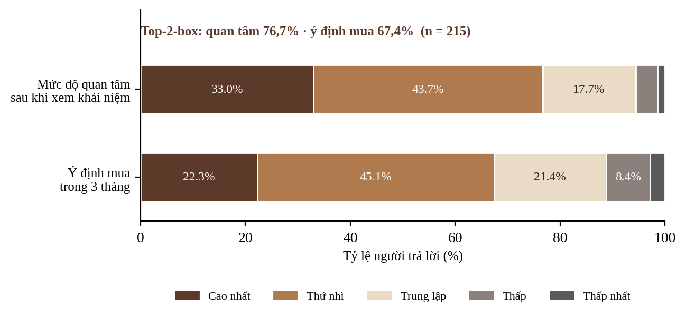

*Hình 2.1. Mức độ quan tâm và ý định mua sau khi xem khái niệm Re:Bean (n = 215)*

*Nguồn: Khảo sát của nhóm, tháng 10/2026.*

### 2.2.3. Mức giá và sự sẵn lòng chi trả

63,7% người trả lời chọn mức giá tối đa chấp nhận trong khoảng 50.000-69.000 đồng cho một hũ nến ***[Cần xác nhận: bảng hỏi mô tả hũ mẫu 45 g hay hũ 50 g]***; 85,6% chấp nhận từ 50.000 đồng và 51,2% chấp nhận từ 60.000 đồng trở lên. Như vậy giá 59.000 đồng nằm sát ngưỡng chấp nhận của khoảng một nửa người trả lời; nhóm giữ mức giá này vì thấp hơn bình quân thị trường (khoảng 79.000 đồng [2]), nhưng sẽ kiểm chứng bằng bán thử và dùng combo, hộp quà để tăng giá trị cảm nhận. Ngoài ra, 75,8% sẵn lòng trả thêm ít nhất 5% cho nến tái chế so với nến thường cùng chất lượng, trong đó 42,8% sẵn lòng trả thêm trên 10% (biểu đồ ở Phụ lục 1).

### 2.2.4. Dòng hương, kênh mua và mối lo ngại

Dòng Phin được chọn nhiều nhất (38,1%), kế đến là Sớm (34,4%) và Đêm (27,4%), nên giữ cả ba dòng hương. Kênh mua ưa thích là Shopee (61,4%), TikTok Shop (54,9%), hội chợ/pop-up (33,0%) và fanpage, Instagram, Zalo (29,8%). Mối lo ngại hàng đầu là mốc, ôi và an toàn (42,8%), tiếp theo là cháy không đều, có khói (31,6%) và giá cao hơn nến thường (19,1%); đây là cơ sở để nhóm đặt tiêu chuẩn sấy bã, giữ lớp trên cùng là sáp nguyên chất và truyền thông minh bạch quy trình (biểu đồ chi tiết ở Phụ lục 1).

### 2.2.5. Khảo sát nhanh phía nguồn cung: các quán cà phê

Song song với khảo sát người tiêu dùng, nhóm trao đổi trực tiếp với chủ hoặc quản lý của 15 quán cà phê quy mô nhỏ đến vừa để hiểu hiện trạng phát sinh, xử lý bã và mức sẵn sàng hợp tác.

**Bảng 2.3. Kết quả khảo sát nhanh 15 quán cà phê**

| **Nội dung** | **Kết quả** |
| --- | --- |
| Quy mô lượng bã phát sinh | Quán nhỏ (dưới 3 kg/ngày): 4 quán; quán vừa (3-6 kg/ngày): 7 quán; quán lớn (trên 6 kg/ngày): 4 quán; trung bình 4,6 kg/ngày |
| Cách xử lý hiện tại | Bỏ chung rác sinh hoạt: 11 quán; tặng hoặc bán cho người trồng cây: 3 quán; cách khác: 1 quán |
| Khó khăn khi lưu trữ bã | Bã ẩm, nhanh có mùi; không có chỗ chứa riêng; ngại tốn công phân loại |
| Mức độ sẵn sàng hợp tác | Đồng ý về nguyên tắc: 11 quán (73,3%); muốn xem sản phẩm mẫu trước: 3 quán (20,0%); từ chối: 1 quán (6,7%) |
| Mong muốn của quán | Thu gom đúng hẹn, thùng chứa gọn có nắp, không tốn thêm công việc; được ghi nhận trên sản phẩm; có sản phẩm để tặng hoặc bán tại quầy |

*Nguồn: Khảo sát nhanh của nhóm, tháng 10/2026; khối lượng bã do quán cung cấp.*

Cần phân biệt rõ mức cam kết hiện tại: 11 quán đồng ý về nguyên tắc cho đặt thùng và thu gom định kỳ, 3 quán muốn xem sản phẩm mẫu trước, 1 quán từ chối; đến thời điểm nộp hồ sơ chưa có quán nào ký thỏa thuận hay hợp đồng. Thỏa thuận mẫu (Phụ lục 4) dự kiến ký với tối thiểu 3 quán trong tháng 1 năm 1. Lượng bã tiềm năng của 11 quán ước khoảng 11 × 4,6 kg/ngày × 30 ngày ≈ 1,5 tấn bã ướt/tháng; đây là ước tính từ mức trung bình các quán cung cấp, chưa phải lượng đã thu gom và cân đo. So với nhu cầu năm 1 chỉ khoảng 53 kg bã ướt (mục 7.1), nguyên liệu không phải điểm nghẽn; điểm nghẽn nằm ở bán hàng và thương hiệu. Quán xem bã là khoản “phải xử lý”, nên điều họ cần là sự thuận tiện và sự ghi nhận - hai quyền lợi được đưa vào thỏa thuận hợp tác.

## 2.3. Chân dung khách hàng mục tiêu

Dựa trên khảo sát, dự án chia khách hàng thành ba nhóm với lộ trình tiếp cận rõ ràng; toàn bộ nguồn lực năm 1 tập trung vào hai nhóm khách hàng cá nhân (B2C).

- Nhóm 1 - Khách hàng cá nhân (16-30 tuổi): Đây là phân khúc trọng tâm trong năm đầu triển khai, bao gồm những người trẻ yêu thích lối sống bền vững, có nhu cầu thư giãn và trang trí không gian học tập, làm việc bằng nến thơm. Nhóm khách hàng này thường mua sắm trực tuyến qua Shopee, TikTok Shop, với mức chi trả dự kiến từ 50.000-70.000 đồng/hũ và tần suất mua khoảng 3-5 lần/năm.

- Nhóm 2 - Khách hàng mua quà tặng (20-35 tuổi): Nhóm này đề cao tính thẩm mỹ, giá trị tinh thần và ý nghĩa của món quà. Re:Bean hướng đến những khách hàng tìm kiếm sản phẩm có bao bì chỉn chu, thiết kế phù hợp để làm quà tặng, đồng thời truyền tải thông điệp sống xanh thông qua câu chuyện tái chế bã cà phê. Mức chi trả dự kiến cho mỗi hộp quà hoặc combo là 100.000-200.000 đồng.

- Nhóm 3 - Khách hàng tổ chức (B2B, chỉ triển khai từ năm 2): quán cà phê, homestay, cửa hàng handmade và doanh nghiệp nhỏ có nhu cầu bán lại hoặc dùng nến làm quà tặng mang thông điệp bền vững; đơn từ 50 hũ, giá sỉ dự kiến 49.000 đồng/hũ. Nhóm này chỉ được khai thác khi dự án đã có pháp nhân, hóa đơn và lô sản xuất đồng nhất.

Nhu cầu giảm mùi phòng kín (37,4% người từng mua nến dùng để khử mùi) là cơ sở nghiên cứu thêm công năng cho dòng Đêm, Sớm; chân dung khách hàng năm 1 vẫn dựa trên nhu cầu thư giãn, trang trí, quà tặng đã được khảo sát.

## 2.4. Kết luận về tính cấp thiết

Tính cấp thiết của Re:Bean dựa trên ba căn cứ: (1) phía nguồn cung, bã cà phê đô thị bị bỏ phí trong khi quán sẵn sàng chia sẻ nếu được thu gom thuận tiện (11/15 quán đồng ý về nguyên tắc); (2) phía nhu cầu, người trẻ có thói quen mua nến (75,8% đã mua trong 12 tháng) và phản hồi tích cực với khái niệm nến tái sinh (76,7% quan tâm, 67,4% có ý định mua), dù nhận biết ban đầu rất thấp; (3) phía giải pháp, sản phẩm mẫu cho thấy có thể làm nến từ bã cà phê với cấu trúc cháy ổn định ở quy mô thử nghiệm. Các căn cứ này đủ để triển khai bán thử năm 1 ở quy mô nhỏ, nhưng chưa đủ để khẳng định quy mô thị trường; nhu cầu thực sẽ được đo bằng dữ liệu bán hàng.

# CHƯƠNG 3. PHÂN TÍCH THỊ TRƯỜNG

## 3.1. Phân tích môi trường vĩ mô

Các yếu tố vĩ mô được tóm tắt theo khung PESTEL, tập trung vào tác động trực tiếp đến dự án.

**Bảng 3.1. Phân tích môi trường vĩ mô (PESTEL) đối với Re:Bean**

| **Yếu tố** | **Diễn biến chính** | **Tác động đến Re:Bean** |
| --- | --- | --- |
| **Chính trị** | Luật Bảo vệ môi trường 2020 đưa kinh tế tuần hoàn vào khung pháp lý; Đề án phát triển kinh tế tuần hoàn (Quyết định 687/QĐ-TTg) và Chiến lược quốc gia về tăng trưởng xanh 2021-2030 (Quyết định 1658/QĐ-TTg) [10], [11], [12] | (+) Mô hình tái sử dụng phụ phẩm phù hợp định hướng; thuận lợi khi tham gia chương trình ươm tạo, quỹ, cuộc thi khởi nghiệp xanh |
| **Kinh tế** | Năm 2025 GDP tăng 8,02%, GDP bình quân đầu người khoảng 5.026 USD, CPI tăng bình quân 3,31% [9]; nhóm nến thơm phòng trên bốn sàn đạt khoảng 36,7 tỷ đồng doanh thu [2] | (+) Sức mua cho sản phẩm self-care, quà tặng; (−) chi phí đầu vào có thể tăng, nhóm dự phòng biến động giá vốn 5-10% |
| **Văn hóa - xã hội** | Người trẻ đô thị chú trọng sức khỏe tinh thần, không gian sống và tiêu dùng có trách nhiệm; 70,2% người được khảo sát quan tâm cao đến sản phẩm tái chế | (+) Phù hợp định vị “self-care xanh có câu chuyện”; nhu cầu làm thơm phòng kín ở căn hộ |
| **Công nghệ** | Thương mại điện tử, mạng xã hội và video ngắn giảm chi phí tiếp cận; thiết bị sấy, nồi nấu cách thủy, máy đo độ ẩm phổ biến, chi phí thấp | (+) Tiếp cận khách hàng bằng nội dung; chuẩn hóa xử lý bã ở quy mô nhỏ |
| **Môi trường** | Rác hữu cơ đô thị gia tăng; khí hậu nóng ẩm khiến bã cà phê dễ mốc, lên men nếu không xử lý kịp thời | (+) Câu chuyện giảm rác hữu cơ; (−) bắt buộc kiểm soát độ ẩm và xử lý bã trong ngày |
| **Pháp lý** | Quy định về nhãn hàng hóa [15], bảo vệ quyền lợi người tiêu dùng [16], bảo vệ dữ liệu cá nhân [18], thương mại điện tử [25]; sản phẩm có tác dụng xua, diệt côn trùng dùng trong gia dụng phải có số đăng ký lưu hành [22] | (Tuân thủ) Ghi nhãn đầy đủ, xác thực người bán, không phóng đại công dụng; công dụng xua côn trùng chỉ công bố sau khi kiểm nghiệm và đăng ký lưu hành |

*Nguồn: Nhóm tác giả tổng hợp từ các tài liệu trích dẫn.*

Các chính sách thuế như miễn thuế thu nhập doanh nghiệp cho doanh nghiệp nhỏ và vừa thành lập mới [23] hay ngưỡng doanh thu không phải nộp thuế giá trị gia tăng, thu nhập cá nhân của hộ kinh doanh [24] có thể giúp dự án giữ lại lợi nhuận để tái đầu tư, nhưng điều kiện áp dụng cho Re:Bean cần được xác minh với cơ quan thuế. Vì vậy mô hình tài chính (mục 5.5) dùng kịch bản cơ sở có tính thuế 15% và trình bày riêng kịch bản được ưu đãi. Danh mục văn bản và tác động chi tiết ở Phụ lục 10.

## 3.2. Phân tích môi trường ngành

Với tình hình thị trường hiện tại, ngành nến thơm đang được thương mại hóa mạnh trên các sàn thương mại điện tử với hàng trăm gian hàng cùng cạnh tranh. Theo số liệu thứ cấp của Metric [2], nhóm nến thơm phòng trên bốn sàn (Shopee, TikTok Shop, Lazada, Tiki) năm 2025 đạt doanh thu khoảng 36,7 tỷ đồng với khoảng 465 nghìn sản phẩm, tương ứng giá bình quân khoảng 79.000 đồng/sản phẩm. Con số này chưa bao gồm kênh cửa hàng và quà tặng doanh nghiệp nên quy mô thực tế còn lớn hơn.

Theo xu hướng tiêu dùng hiện nay, có ba xu hướng hỗ trợ tiềm năng tăng trưởng của ngành. Thứ nhất, người tiêu dùng trẻ ngày càng đầu tư cho không gian cá nhân, dẫn đến nhu cầu nến thơm, tinh dầu, sáp thơm. Thứ hai, quà tặng có câu chuyện và mang thông điệp xanh đang được doanh nghiệp, quán cà phê và homestay ưa chuộng, mở ra kênh B2B có giá trị đơn hàng cao hơn (dự án chỉ khai thác từ năm 2). Thứ ba, mạng xã hội và sàn thương mại điện tử cho phép một thương hiệu nhỏ kể câu chuyện tái chế với chi phí thấp. Đây là nhận định của nhóm, được kiểm chứng một phần bằng khảo sát và sẽ tiếp tục được đo lường bằng dữ liệu bán hàng.

Cấu trúc ngành nến thơm được đánh giá theo mô hình năm lực lượng cạnh tranh [8] (sơ đồ ở Phụ lục 10).

**Bảng 3.2. Đánh giá năm lực lượng cạnh tranh của ngành nến thơm**

| **Lực lượng** | **Mức độ** | **Phân tích và đối sách** |
| --- | --- | --- |
| Cạnh tranh trong ngành | Trung bình - cao | Hàng trăm gian hàng nến thơm trên sàn thương mại điện tử; giá bình quân ≈ 79.000 đồng. Re:Bean tránh cuộc đua giá, cạnh tranh bằng câu chuyện tái chế, mã lô và trải nghiệm ba dòng hương. |
| Đối thủ tiềm ẩn | Cao | Rào cản gia nhập thấp về vốn và công nghệ; tuy nhiên, mạng lưới quán đối tác, công thức xử lý bã và thương hiệu gắn với câu chuyện là những rào cản mềm cần xây dựng sớm. |
| Sản phẩm thay thế | Trung bình | Tinh dầu, máy khuếch tán, sáp thơm không lửa, nước hoa phòng. Re:Bean dự kiến bổ sung wax melt, sachet từ năm 3 để phục vụ khách không dùng lửa. |
| Quyền lực nhà cung ứng | Thấp - trung bình | Sáp, hương liệu, hũ có nhiều nhà cung cấp; nguồn bã dồi dào. Rủi ro chính là biến động giá sáp và hũ thủy tinh; đối sách là đàm phán giá theo lô và có ít nhất hai nhà cung cấp cho mỗi vật tư. |
| Quyền lực khách hàng | Trung bình - cao | Khách hàng trẻ dễ so sánh giá, dễ chuyển đổi. Đối sách: giá tầm trung, ưu đãi tích điểm, cộng đồng “Hũ tái sinh” và quà tặng B2B đặt riêng (từ năm 2) để tăng chi phí chuyển đổi. |

*Nguồn: Nhóm tác giả phân tích.*

## 3.3. Phân tích môi trường bên trong

Chuỗi giá trị của Re:Bean gồm các hoạt động chính: thu gom bã tại quán → xử lý (sàng, sấy) → sản xuất nến → đóng gói và dán mã lô → phân phối đa kênh → chăm sóc khách hàng, được hỗ trợ bởi các hoạt động nền tảng như quản trị tài chính, nhân sự, dữ liệu và pháp lý. Giá trị gia tăng lớn nhất nằm ở hai khâu đầu (biến phụ phẩm thành nguyên liệu) và khâu cuối (kể câu chuyện và xây dựng cộng đồng).

Đánh giá theo khung VRIO (Phụ lục 10) cho thấy chỉ thương hiệu gắn với câu chuyện “tái sinh” có tiềm năng tạo lợi thế bền vững nếu được xây dựng nhất quán; mạng lưới quán và công thức xử lý bã là lợi thế tạm thời, cần thỏa thuận ưu tiên và bảo mật SOP; năng lực kênh số và vốn thấp chỉ tạo hiệu quả vận hành, dễ bị sao chép.

**Bảng 3.3. Ma trận SWOT của dự án Re:Bean**

| **Điểm mạnh (S)** | **Điểm yếu (W)** |
| --- | --- |
| S1. Nguồn bã gần như miễn phí: 11/15 quán đồng ý về nguyên tắc; tiềm năng ước tính trên 1,5 tấn bã ướt/tháng  S2. Câu chuyện tuần hoàn rõ ràng, dễ truyền thông; mã lô gắn với sổ sản xuất  S3. Vốn đầu tư thấp (33 triệu đồng), sản xuất lô nhỏ linh hoạt  S4. Đội ngũ kết hợp quản trị kinh doanh và công nghệ thông tin  S5. Giá 59.000 đồng thấp hơn bình quân thị trường (≈ 79.000 đồng) | W1. Thương hiệu mới, chưa có lịch sử bán hàng  W2. Sản xuất thủ công, năng suất và tính đồng nhất phụ thuộc kỹ thuật  W3. Thành viên là sinh viên, thời gian và kinh nghiệm vận hành hạn chế  W4. Ngân sách marketing nhỏ; phụ thuộc kênh mạng xã hội |
| **Cơ hội (O)** | **Thách thức (T)** |
| O1. Thị trường nến thơm trên sàn khoảng 36,7 tỷ đồng (2025)  O2. Xu hướng tiêu dùng xanh, self-care, quà tặng cá nhân hóa  O3. Chính sách khuyến khích kinh tế tuần hoàn, tăng trưởng xanh  O4. Nhu cầu quà tặng xanh của quán, homestay, doanh nghiệp (khai thác từ năm 2) | T1. Cạnh tranh giá từ nến không thương hiệu  T2. Biến động giá sáp, hũ và phí sàn thương mại điện tử [3]  T3. Mối lo ngại về mốc, an toàn khi dùng sản phẩm từ bã (42,8%)  T4. Đối thủ lớn có thể sao chép ý tưởng |

*Nguồn: Nhóm tác giả phân tích.*

Từ SWOT, nhóm xây dựng các chiến lược kết hợp (ma trận TOWS, Phụ lục 10), trọng tâm là: cạnh tranh bằng minh bạch quy trình thay cho giá (ST); chuẩn hóa SOP, kiểm soát lô để giảm lo ngại an toàn (WT); tận dụng chương trình hỗ trợ khởi nghiệp xanh để bù đắp thiếu vốn và kinh nghiệm (WO); hợp tác quà tặng với quán, homestay chỉ triển khai từ năm 2 (SO).

## 3.4. Đánh giá quy mô và tiềm năng thị trường

### 3.4.1. Quy mô thị trường theo TAM - SAM - SOM

TAM và SAM được ước tính từ trên xuống dựa trên số liệu thứ cấp của Metric về nhóm nến thơm phòng trên bốn sàn thương mại điện tử năm 2025 [2]; SOM được ước tính từ dưới lên theo năng lực sản xuất, ngân sách marketing và số đơn hàng có thể đạt, không suy ra từ tỷ lệ quan tâm trong khảo sát.

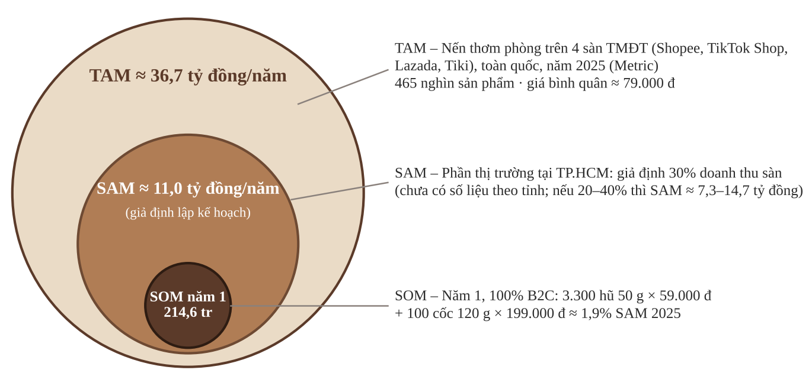

*Hình 3.1. Quy mô thị trường nến thơm của Re:Bean theo TAM - SAM - SOM*

*Nguồn: Metric [2]; nhóm tác giả tính toán.*

**Bảng 3.4. Cơ sở tính toán TAM - SAM - SOM**

| **Cấp thị trường** | **Quy mô** | **Cơ sở tính toán và mức độ chắc chắn** |
| --- | --- | --- |
| **TAM (kênh sàn TMĐT, toàn quốc)** | ≈ 36,7 tỷ đồng/năm (≈ 465 nghìn sản phẩm) | Doanh thu nhóm “nến thơm phòng” trên Shopee, TikTok Shop, Lazada, Tiki năm 2025 [2]; giá bình quân ≈ 36,7 tỷ ÷ 465 nghìn ≈ 79.000 đồng. Bốn sàn là các kênh độc lập nên không trùng đơn hàng, nhưng số liệu phụ thuộc cách Metric phân loại ngành hàng và chưa gồm bán qua tin nhắn, cửa hàng, quà tặng doanh nghiệp |
| **SAM (TP.HCM)** | ≈ 11,0 tỷ đồng/năm | Giả định lập kế hoạch: khách hàng tại TP.HCM chiếm 30% doanh thu trên các sàn. Chưa có số liệu phân bổ theo tỉnh/thành; nếu tỷ lệ là 20-40% thì SAM ≈ 7,3-14,7 tỷ đồng. Cần kiểm chứng bằng dữ liệu phân bổ địa lý của sàn hoặc dữ liệu bán thử |
| **SOM năm 1 (100% B2C)** | ≈ 214,6 triệu đồng (3.300 hũ 50 g + 100 cốc 120 g) | 3.300 hũ × 59.000 đồng + 100 cốc × 199.000 đồng; tương đương ≈ 1,9% SAM năm 2025. Sản lượng theo quý 300 - 600 - 900 - 1.500 hũ, dưới công suất tại nhà 600 hũ/tháng |

*Nguồn: Metric [2]; giả định và tính toán của nhóm.*

### 3.4.2. Dự báo quy mô thị trường và thị phần mục tiêu

Nhóm giả định SAM tăng 12%/năm giai đoạn 2025-2029 (giả định thận trọng, thấp hơn nhịp tăng của thương mại điện tử, cần cập nhật khi có số liệu mới). Doanh thu kế hoạch được so với SAM để kiểm tra mức độ hợp lý.

**Bảng 3.5. Dự báo SAM và tỷ lệ doanh thu kế hoạch so với SAM**

| **Chỉ tiêu** | **2026** | **2027 (Năm 1)** | **2028 (Năm 2)** | **2029 (Năm 3)** |
| --- | --- | --- | --- | --- |
| SAM dự báo (tỷ đồng) | 12,3 | 13,8 | 15,5 | 17,3 |
| Doanh thu kế hoạch (tỷ đồng) | - | 0,215 | 0,807 | 1,726 |
| Tỷ lệ so với SAM (%) | - | 1,6 | 5,2 | 10,0 |
| Tỷ trọng sản lượng hũ bán B2B (%) | - | 0 | 15 | 35 |
| Tỷ trọng doanh thu B2B (%) | - | 0 | 12,8 | 31,0 |

*Nguồn: Nhóm tác giả tính toán.*

SAM chỉ tính kênh sàn thương mại điện tử tại TP.HCM, trong khi doanh thu kế hoạch gồm cả kênh trực tiếp và (từ năm 2) kênh B2B, nên tỷ lệ năm 2-3 chỉ mang tính tham chiếu và bị phóng đại. Nếu chỉ tính doanh thu B2C trực tuyến (giả định tỷ lệ trực tuyến/trực tiếp như năm 2), tỷ lệ so với SAM năm 3 khoảng 5%.

### 3.4.3. Kiểm tra SOM năm 1 theo hướng từ dưới lên

SOM năm 1 được quy đổi sang số đơn hàng cần đạt theo từng kênh B2C. Cơ cấu kênh 75% trực tuyến - 25% trực tiếp là giả định lập kế hoạch, điều chỉnh từ phương án trước (70% trực tuyến, 20% trực tiếp, 10% B2B) vì năm 1 không bán B2B.

**Bảng 3.6. Quy đổi SOM năm 1 sang số đơn hàng theo kênh**

| **Kênh (năm 1)** | **Tỷ trọng** | **Sản lượng** | **Quy đổi** |
| --- | --- | --- | --- |
| Trực tuyến (TikTok Shop, fanpage, Instagram, Zalo) | 75% | 2.475 hũ | ≈ 1.900 đơn/năm (1,3 hũ/đơn), khoảng 5-6 đơn/ngày |
| Trực tiếp (pop-up, hội chợ, trường học) | 25% | 825 hũ | ≈ 8 sự kiện, mỗi sự kiện khoảng 100 hũ |
| B2B | 0% | 0 | Không bán trong năm 1; chỉ chuẩn bị đối tác |
| Cốc quà tặng 120 g (bán thử) | - | 100 cốc | Bán qua hai kênh trên, tập trung mùa quà tặng |
| **Tổng** | **100%** | **3.300 hũ + 100 cốc** | **Doanh thu 214,6 triệu đồng** |

*Nguồn: Nhóm tác giả tính toán; cơ cấu kênh là giả định lập kế hoạch.*

Mục tiêu khoảng 5-6 đơn trực tuyến mỗi ngày phù hợp với ngân sách marketing 41 triệu đồng (chi phí thu hút ước khoảng 16.000 đồng/khách, mục 5.3) và công suất sản xuất tại nhà, nhưng là mục tiêu cho một gian hàng mới nên sẽ được hiệu chỉnh sau quý I theo dữ liệu chuyển đổi thực tế.

### 3.4.4. Ý định mua theo phân khúc và định hướng B2C → B2B

Phân tích chéo dữ liệu khảo sát cho thấy ý định mua không đồng đều giữa các nhóm khách hàng.

**Bảng 3.7. Ý định mua theo độ tuổi và nghề nghiệp (n = 215)**

| **Nhóm** | **Số người** | **Có ý định mua** | **Tỷ lệ** |
| --- | --- | --- | --- |
| Dưới 18 tuổi | 20 | 9 | 45,0% |
| 18-22 tuổi | 112 | 80 | 71,4% |
| 23-30 tuổi | 67 | 47 | 70,1% |
| Trên 30 tuổi | 16 | 9 | 56,3% |
| Học sinh | 20 | 9 | 45,0% |
| Sinh viên | 108 | 77 | 71,3% |
| Người đi làm | 79 | 54 | 68,4% |
| Khác | 8 | 5 | 62,5% |
| **Tổng** | **215** | **145** | **67,4%** |

*Nguồn: Khảo sát của nhóm, tháng 10/2026.*

Nhóm 18-30 tuổi (sinh viên và người đi làm trẻ) có ý định mua cao nhất (khoảng 70%), xác nhận thứ tự ưu tiên khách hàng; nhóm dưới 18 tuổi thấp hơn (45,0%), chủ yếu do hạn chế ngân sách, nên được phục vụ bằng combo giá thấp thay vì giảm giá hũ lẻ. Dự án bắt đầu từ B2C vì nhóm này mua chủ yếu qua mạng xã hội, phù hợp quy mô sản xuất tại nhà và cho phép thu phản hồi nhanh; thị trường B2B có giá trị đơn hàng lớn nhưng đòi hỏi sản phẩm ổn định, hóa đơn chứng từ và năng lực giao số lượng, nên chỉ khai thác từ năm 2 khi đã có pháp nhân và mặt bằng (đặc điểm khách hàng từng giai đoạn ở Phụ lục 10).

Tổng hợp các bậc của phễu chấp nhận: chỉ 13,0% đã biết đến nến từ bã cà phê, nhưng sau khi xem khái niệm có 76,7% quan tâm và 67,4% có ý định mua; ở nhóm dùng thử, điểm trung bình đạt 4,2/5 và 83,3% sẵn sàng giới thiệu; phía nguồn cung có 73,3% quán đồng ý về nguyên tắc. Hàm ý là rào cản lớn nhất nằm ở mức nhận biết chứ không phải ở nhu cầu; tuy nhiên do ý định mua thường cao hơn hành vi thực tế, nhóm coi các số liệu này là giới hạn trên và sẽ đo lại bằng tỷ lệ chuyển đổi, tỷ lệ mua lại, điểm đánh giá gian hàng (mục tiêu ≥ 4,5/5) sau mỗi quý.

## 3.5. Phân tích đối thủ cạnh tranh

Đối thủ được phân loại theo mức độ đáp ứng cùng nhu cầu của khách hàng mục tiêu: ba nhóm đối thủ trực tiếp (cùng bán nến thơm) và hai nhóm gián tiếp. Việc so sánh dựa trên thông tin công khai trên website, gian hàng chính thức và trang đánh giá; nhóm không có số liệu thị phần của từng đối thủ.

**Bảng 3.8. So sánh các nhóm đối thủ cạnh tranh**

| **Nhóm đối thủ** | **Đại diện, mức giá** | **Điểm mạnh** | **Điểm yếu (so với nhu cầu khách hàng mục tiêu)** |
| --- | --- | --- | --- |
| **Nến giá rẻ không thương hiệu (trực tiếp)** | Gian hàng trên Shopee, TikTok Shop; 24.000-33.000 đồng | Giá thấp, mẫu mã đa dạng, giao nhanh, hiện diện dày đặc trên sàn | Thông tin thành phần, nguồn gốc thường không đầy đủ (theo quan sát gian hàng của nhóm); thiếu câu chuyện thương hiệu |
| **Nến handmade, phổ thông trong nước (trực tiếp)** | AGAYA (mini 45 g 65.000 đồng; 75.000-150.000 đồng), Le Rustique, Cát Candle, THƠM DZI, RosieCandle; Heny Garden (200 g: 289.000-379.000 đồng); First Sight Present (239.000-359.000 đồng) | Thiết kế riêng, cộng đồng trung thành; phối hương đa tầng, hương cà phê sữa đá quen thuộc; Heny Garden có công thức sả chanh - sả Java định hướng đuổi muỗi; bao bì quà tặng nổi bật | Phần lớn chưa dùng bã cà phê tái chế; quy mô nhỏ; nhiều dòng có giá cao hơn mặt bằng chung |
| **Nến nhập khẩu, thương hiệu quốc tế có yếu tố cà phê (trực tiếp)** | Yankee Candle; UpCircle (Anh, 180 ml ≈ 650.000-750.000 đồng); Incapto (Tây Ban Nha, 275.000-410.000 đồng); Herbzen (New Zealand) | Thương hiệu mạnh, hương ổn định; chứng nhận bền vững (UpCircle); chuỗi cung ứng bã khép kín (Incapto); nền sáp đậu nành - sáp ong giữ bã lơ lửng (Herbzen) | Giá cao, không gắn câu chuyện địa phương; một số đánh giá người dùng phản ánh bã lắng đáy, mùi cà phê lấn hương (UpCircle); ít dòng hương (Incapto) |
| **Đơn vị tái chế bã cà phê (gián tiếp)** | Lộc Nhân Coffee Recycle, AirX Coffee | Kinh nghiệm xử lý bã; sản phẩm vật liệu cứng (cốc, ống hút, nội thất, quà lưu niệm) có giá trị tuần hoàn cao | Không đi vào nến thơm; cạnh tranh gián tiếp về câu chuyện tái chế và nguồn bã |
| **Sản phẩm thư giãn thay thế (gián tiếp)** | Tinh dầu, máy khuếch tán, sáp thơm không lửa, nước hoa phòng | Tiện dụng, không dùng lửa | Thiếu giá trị trang trí, quà tặng và câu chuyện tuần hoàn; Re:Bean dự kiến bổ sung wax melt, sachet từ năm 3 |

*Nguồn: Nhóm tổng hợp từ website, gian hàng chính thức và trang đánh giá của các thương hiệu, tháng 10/2026; giá quy đổi mang tính tham khảo (chi tiết ở Phụ lục 6).*

Từ việc đối sánh, nhóm rút ra sáu cải tiến được đưa vào phiên bản thương mại: (1) dùng hệ sáp đậu nành - sáp ong để giữ bã lơ lửng như Herbzen; (2) chỉ đặt bã ở lớp bã - sáp, không để bã ở vùng cháy và đáy hũ nhằm tránh lỗi của UpCircle; (3) xây dựng tháp hương ba tầng như Heny Garden để mùi cà phê không lấn hương chính; (4) bổ sung hương chức năng mà Incapto còn thiếu; (5) chọn quy cách thương mại 50 g và thêm cốc 120 g cho phòng lớn, quà tặng; (6) đầu tư bao bì quà tặng theo vùng miền để cạnh tranh với First Sight Present ở dịp lễ. Ở chiều ngược lại, mẫu thử Re:Bean 45 g có chi phí bã rất thấp (≈ 300 đồng/hũ) và ba hương rõ ràng, nhưng dung tích nhỏ cho phòng lớn và chưa có hương chức năng.

## 3.6. Vị thế cạnh tranh và lợi thế của Re:Bean

Từ kết quả phân tích, Re:Bean được định vị trong phân khúc giá vừa phải - giá trị tuần hoàn cao, thể hiện định hướng kết hợp khả năng chi trả với việc tái sử dụng bã cà phê. Các nhóm đối thủ hiện có chủ yếu tập trung vào những giá trị khác nhau: đơn vị tái chế bã cà phê chú trọng yếu tố tuần hoàn nhưng không chuyên về nến thơm, trong khi nến giá rẻ và nến nhập khẩu chưa tạo được sự kết hợp tương đồng về giá và giá trị tái chế. Bản đồ định vị ở Phụ lục 10 cho thấy Re:Bean có cơ hội tạo sự khác biệt trên thị trường thông qua mô hình nến thơm tái sử dụng bã cà phê.

Để lượng hóa vị thế, nhóm lập ma trận hình ảnh cạnh tranh (CPM) với bảy yếu tố thành công then chốt; trọng số do nhóm ấn định, tham khảo các mối quan tâm của khách hàng trong khảo sát, điểm 1-4 là đánh giá chủ quan của nhóm (4: mạnh nhất, 1: yếu nhất); bảng chi tiết ở Phụ lục 10.

Re:Bean đạt 3,00 điểm, xấp xỉ Heny Garden (3,05) dù là thương hiệu mới: lợi thế nằm ở giá, câu chuyện tái chế và gợi ý sử dụng theo không gian; điểm yếu rõ nhất là nhận biết thương hiệu (1/4) và độ phủ kênh (2/4). Đây là hai khoảng trống kế hoạch marketing tập trung xử lý.

Lợi thế cạnh tranh của Re:Bean gồm: (1) chi phí nguyên liệu đặc trưng thấp nhờ bã từ quán đối tác; (2) câu chuyện thương hiệu gắn với mạng lưới quán cụ thể và mã lô; (3) bộ ba dòng hương gắn với thời điểm, không gian sử dụng; (4) giá thấp hơn bình quân thị trường nhưng có giá trị khác biệt; (5) sản xuất lô nhỏ linh hoạt. Các lợi thế này chưa được bảo vệ vững chắc vì rào cản gia nhập ngành thấp; nhóm dự kiến bốn lớp bảo vệ: thỏa thuận ưu tiên với quán (ký từ tháng 1 năm 1); nộp đơn đăng ký nhãn hiệu “Re:Bean” trong quý I năm 1 [17]; bảo mật công thức và SOP dưới dạng bí quyết kỹ thuật; xây dựng cộng đồng khách hàng quanh chương trình “Hũ tái sinh” từ năm 2.

# CHƯƠNG 4. MÔ TẢ Ý TƯỞNG KINH DOANH

## 4.1. Sản phẩm và dịch vụ

Sản phẩm thương mại của Re:Bean là nến thơm phân tầng làm từ bã cà phê thu gom tại quán đối tác, kết hợp hệ sáp đậu nành - sáp ong, bấc cotton và hương liệu, gồm hai quy cách: hũ thủy tinh 50 g và cốc thạch cao quà tặng 120 g. Bã được sấy về độ ẩm mục tiêu ≤ 5% trước khi đúc; lớp bã - sáp nằm ở thân và đáy, còn lớp trên cùng (vùng cháy) là sáp thơm nguyên chất. Hình 4.1 là ảnh mô phỏng ý tưởng ba dòng nến do công cụ AI tạo (Phụ lục 5), không phải ảnh chụp sản phẩm thực tế.

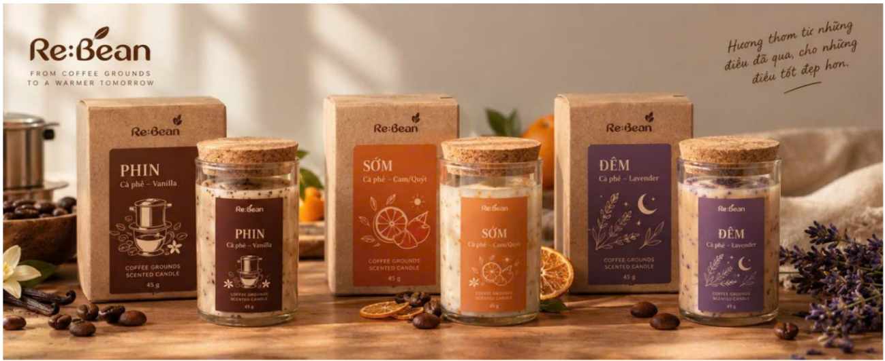

*Hình 4.1. Ảnh mô phỏng ba dòng nến thơm bã cà phê Re:Bean (Phin - Sớm - Đêm; nhãn ghi quy cách mẫu thử 45 g)*

*Nguồn: Nhóm tạo bằng công cụ AI (ChatGPT).*

***[Cần bổ sung: ảnh chụp sản phẩm mẫu thật (hũ 45 g đã sản xuất) và ảnh quy trình làm nến để minh chứng mức độ hoàn thiện]***

### 4.1.1. Phân tích sản phẩm theo năm cấp độ

**Bảng 4.1. Phân tích sản phẩm Re:Bean theo năm cấp độ**

| **Cấp độ** | **Nội dung** |
| --- | --- |
| **Sản phẩm cốt lõi** | Khoảnh khắc thư giãn, cảm giác “sống xanh” và một món quà có câu chuyện; làm thơm không gian sống. |
| **Sản phẩm hiện thực** | Hũ thủy tinh 50 g (59.000 đồng) và cốc thạch cao 120 g (199.000 đồng); cấu trúc phân tầng lớp bã - sáp nhìn thấy được; ba dòng hương Phin - Đêm - Sớm; hộp giấy kraft in họa tiết vùng miền; nhãn decal chống thấm ghi thành phần, khối lượng, mã lô, cảnh báo an toàn. |
| **Sản phẩm kỳ vọng** | Cháy ổn định, ít khói, không mốc, không tách lớp; hương ổn định; nguồn gốc nguyên liệu minh bạch. |
| **Sản phẩm bổ sung** | Thẻ Scent Map kèm QR dẫn đến trang trải nghiệm; đổi 1-1 trong 7 ngày nếu lỗi sản xuất; tích điểm; chương trình “Hũ tái sinh” thu hồi vỏ (từ năm 2). |
| **Sản phẩm tiềm năng** | Wax melt, túi thơm từ bã (năm 3, sau thử nghiệm); hộp quà theo mùa; quà tặng in logo cho doanh nghiệp (B2B từ năm 2); công năng giảm mùi, xua côn trùng nếu được kiểm chứng và đủ điều kiện pháp lý. |

*Nguồn: Nhóm tác giả phân tích theo Kotler và Keller [6].*

### 4.1.2. Các phiên bản sản phẩm: mẫu thử nghiệm và phiên bản thương mại

Quy cách 45 g và 50 g là hai phiên bản khác nhau: 45 g là mẫu dùng trong 18 mẻ thử nghiệm, còn 50 g là phiên bản thương mại đã chốt thiết kế nhưng chưa sản xuất thử. Bảng dưới đây đối chiếu các phiên bản để tránh nhầm lẫn khi đọc số liệu.

**Bảng 4.2. Đối chiếu các phiên bản sản phẩm Re:Bean**

| **Tiêu chí** | **Mẫu thử nghiệm 45 g** | **Hũ thủy tinh 50 g (thương mại)** | **Cốc thạch cao 120 g (thương mại)** |
| --- | --- | --- | --- |
| **Vai trò** | Mẫu nghiên cứu, dùng thử | Sản phẩm chủ lực | Quà tặng, không gian lớn |
| **Vỏ, cấu tạo** | Hũ thủy tinh nắp nút bần; 4 lớp: bã - sáp (đáy), sáp thơm, bã - sáp mỏng, sáp thơm nguyên chất trên cùng ≥ 8 mm; bã 12-15% khối lượng lớp bã - sáp | Hũ thủy tinh có nắp; phân tầng như mẫu thử; tim cotton đan xoắn trên đế kim loại | Cốc thạch cao có nắp, phủ chống thấm; hai tim |
| **Hệ sáp** | Sáp đậu nành (hoặc đậu nành - dừa); hương 7% | 80% đậu nành - 20% sáp ong; hương 7-10% | 80% đậu nành - 20% sáp ong; hương 7-10% |
| **Khách hàng** | 30 người dùng thử | Năm 1: B2C 16-35 tuổi; từ năm 2: thêm B2B | Năm 1: người mua quà 20-35 tuổi; từ năm 2: thêm doanh nghiệp |
| **Giá bán** | Không bán | 59.000 đồng; B2B từ năm 2: 49.000 đồng/hũ (từ 50 hũ) | 199.000 đồng; B2B từ năm 2: 169.000 đồng/cốc (từ 30 cốc) |
| **Giá thành dự kiến** | Chưa tổng hợp (riêng bã ≈ 300 đồng/hũ) | 33.000 đồng (năm 1) | 68.000 đồng (năm 1-2) |
| **Trạng thái thử nghiệm** | 5 đợt, 18 mẻ, ≈ 90 hũ; cháy trung bình 9,5 giờ (5 hũ) | Chưa sản xuất thử; đợt 6 (quý I năm 1) | Chưa sản xuất thử; đợt 7 (quý I năm 1, trước khi bán) |
| **Thương mại hóa** | Không; là cơ sở công thức | Bán từ năm 1 (3.300 hũ) | Bán thử 100 cốc năm 1; mở rộng từ năm 2 |

*Nguồn: Nhóm tác giả tổng hợp; giá thành chi tiết ở Phụ lục 2.*

*Ghi chú: mẫu mini dùng cho người dùng thử và 100-150 khách đầu tiên chưa chốt quy cách; combo Tam hương (165.000 đồng/3 hũ) và hộp quà (119.000 đồng/2 hũ) là cách đóng gói của hũ 50 g, không phải sản phẩm riêng.*

### 4.1.3. Bộ sưu tập Re:Bean Scent Map và trạng thái các tuyên bố công năng

Ba dòng hương có chung cấu tạo lõi nến (chi tiết ở Phụ lục 7) và khác nhau ở nhóm hương, không gian và thời điểm sử dụng.

**Bảng 4.3. Thông tin chi tiết ba dòng sản phẩm Re:Bean Scent Map**

| **Tiêu chí** | **PHIN - Vani, Bạc xỉu Sài Gòn** | **ĐÊM - Lavender, Vườn hoa Đà Lạt** | **SỚM - Cam chanh, Vườn trái cây Nam Bộ** |
| --- | --- | --- | --- |
| Cảm hứng thiết kế | Ly bạc xỉu và quán cóc Sài Gòn buổi sáng, văn hóa cà phê vợt mộc mạc, thân tình | Không khí se lạnh, sương đêm và những đồi hoa oải hương Đà Lạt | Sự rạng rỡ của vườn cam sành trĩu quả miền Tây sông nước |
| Nhóm hương chính | Cà phê Robusta rang mộc, caramel nướng | Oải hương tươi, xô thơm | Cam, chanh, quýt |
| Công dụng và định hướng nghiên cứu | Tạo không khí ấm cúng cho góc làm việc, tiếp khách | Thư giãn trước khi ngủ  Định hướng nghiên cứu: hỗ trợ giảm mùi phòng kín nhờ bã đã xử lý (giả thuyết, đang kiểm nghiệm) | Tạo cảm giác tươi tỉnh  Định hướng nghiên cứu: phối geraniol, linalool, sả chanh theo hướng hỗ trợ xua côn trùng, kể cả kiến ba khoang (giả thuyết; chỉ công bố sau kiểm nghiệm và đăng ký lưu hành) |
| Không gian tối ưu | Bàn làm việc, phòng khách, góc tiếp khách, studio | Phòng ngủ, phòng tắm, phòng đọc sách, góc thiền | Ban công, cửa sổ, phòng khách căn hộ cao tầng, gian bếp |
| Thời điểm sử dụng | Buổi sáng bắt đầu ngày mới, buổi chiều làm việc, khi tiếp bạn bè | 30-45 phút trước khi ngủ, sau giờ làm việc căng thẳng | Sáng sớm cần tỉnh táo; chiều tối |
| Quy cách & Giá bán | Hũ thủy tinh 50 g: 59.000 VNĐ  Cốc thạch cao 120 g: 199.000 VNĐ | Hũ thủy tinh 50 g: 59.000 VNĐ  Cốc thạch cao 120 g: 199.000 VNĐ | Hũ thủy tinh 50 g: 59.000 VNĐ  Cốc thạch cao 120 g: 199.000 VNĐ |
| Trải nghiệm đi kèm | Thẻ Scent Map, mã QR, playlist acoustic | Thẻ Scent Map, mã QR, playlist lofi/thư giãn | Thẻ Scent Map, mã QR, playlist sảng khoái |

*Nguồn: Nhóm tác giả thiết kế.*

Một số tuyên bố về sản phẩm đã có bằng chứng nội bộ, một số mới là giả thuyết. Bảng dưới đây phân định rõ để thông tin trong hồ sơ và trong truyền thông không vượt quá bằng chứng hiện có.

**Bảng 4.4. Trạng thái bằng chứng của các tuyên bố về sản phẩm**

| **Tuyên bố** | **Bằng chứng hiện có** | **Trạng thái** | **Bằng chứng còn thiếu / cách kiểm nghiệm** |
| --- | --- | --- | --- |
| **Bã sau sấy không mốc** | Đợt 2: mẫu không xử lý có dấu hiệu mốc sau 9-12 ngày; mẫu sấy 80°C không mốc sau 21 ngày (mẫu 45 g, quan sát bằng mắt) | Có bằng chứng nội bộ, ngắn hạn | Theo dõi mẫu lưu 3-6 tháng; ghi rõ thiết bị đo độ ẩm; kiểm nghiệm vi sinh nếu muốn tuyên bố “khử khuẩn” |
| **Cháy ổn định, ít khói** | Đợt 1 và 4: tỷ lệ bã 15-20% cháy ổn định, tim cỡ trung bình cho hồ sáp đều, ít khói (quan sát) | Có bằng chứng nội bộ, định tính, trên mẫu 45 g | Đốt thử theo chu kỳ có biên bản trên hũ 50 g, cốc 120 g (đợt 6-7); ghi muội đen, chiều cao ngọn lửa, đường kính hồ sáp |
| **Thời gian cháy 9-10 giờ** | 5 hũ thử 45 g, trung bình 9,5 giờ | Chỉ áp dụng cho mẫu 45 g | Đo lại cho 50 g và 120 g |
| **Bền khi vận chuyển** | Đợt 5: 14/15 hũ không tách lớp sau thử rơi, lắc, để 7 ngày | Đã điều chỉnh (đóng rắn 48 giờ, lót giấy) nhưng chưa thử lại | Thử lại ở đợt 6 |
| **Hỗ trợ giảm mùi (dòng Đêm)** | Cảm nhận khử mùi của 30 người dùng thử: 3,8/5 (chủ quan, không đối chứng) | Giả thuyết | Thử trong phòng kín có đối chứng; không quảng bá cho đến khi có kết quả |
| **Hỗ trợ xua côn trùng, kiến ba khoang (dòng Sớm)** | Tài liệu cho thấy nến chứa geraniol, linalool xua muỗi, ruồi cát trong nhà [21]; chưa thử trên sản phẩm, chưa thử với kiến ba khoang | Giả thuyết, mục tiêu phát triển | Thử đếm có đối chứng; kiểm nghiệm và đăng ký lưu hành chế phẩm trước khi công bố [22] |
| **Công thức tinh dầu “độc quyền”** | Công thức do nhóm tự phối, chưa đăng ký bảo hộ | Bí quyết nội bộ, chưa đủ căn cứ gọi là “công nghệ độc quyền” | Ghi SOP, bảo mật; cân nhắc đăng ký sáng chế hoặc giải pháp hữu ích nếu công thức có tính mới |
| **An toàn hương liệu** | Chưa có tài liệu của nhà cung cấp | Cần bổ sung | Yêu cầu bảng dữ liệu an toàn (SDS) và xác nhận phù hợp tiêu chuẩn IFRA trước khi mua |

*Nguồn: Nhóm tác giả tổng hợp từ nhật ký thử nghiệm (Bảng 4.5) và tài liệu tham khảo.*

Về cơ sở khoa học của công năng xua côn trùng, nghiên cứu của Müller và cộng sự [21] cho thấy trong nhà, nến chứa 5% citronella, linalool và geraniol có tỷ lệ xua muỗi lần lượt 29,0%, 71,1% và 85,4%; đây là căn cứ để nhóm ưu tiên geraniol và linalool trong công thức Sớm. Tuy nhiên nghiên cứu đo trên muỗi và ruồi cát, không phải kiến ba khoang, với nồng độ và điều kiện đốt khác sản phẩm của nhóm. Vì vậy nhóm (1) không ghi công dụng xua côn trùng, giảm mùi trên nhãn và quảng cáo khi chưa có kết quả kiểm nghiệm; (2) chỉ công bố công dụng xua côn trùng sau khi đăng ký lưu hành theo Nghị định 91/2016/NĐ-CP [22] (định hướng năm 3, có thể hợp tác với đơn vị đã có số đăng ký); (3) tiếp tục đo cảm nhận giảm mùi trong phòng kín có đối chứng, mục tiêu nâng điểm từ 3,8 lên ≥ 4,0/5. Trong thời gian đó, thông điệp thương mại chỉ mô tả mùi hương và không gian phù hợp.

### 4.1.4. Dịch vụ đi kèm và nhận diện thương hiệu

Mỗi hộp có thẻ Scent Map in hai mặt: mặt trước giới thiệu bộ sưu tập và thông điệp “Three scents. Three moments. One Re:Bean.”; mặt sau gợi ý chọn hương theo thời điểm (Sớm - buổi sáng, Phin - buổi chiều, Đêm - buổi tối). Mã QR trên thẻ dẫn đến trang trải nghiệm với ba chế độ Work, Guest, Relax, gồm gợi ý bố trí không gian, playlist và video 30 giây hướng dẫn cắt bấc, dập lửa, vệ sinh ly để tái sử dụng; trang do hai thành viên CNTT xây dựng nên chi phí thấp. QR phục vụ trải nghiệm, không thay thế mã lô: việc truy xuất nguồn bã được thực hiện qua mã lô trên nhãn và sổ sản xuất; tên quán đối tác được giới thiệu trên kênh truyền thông khi quán đồng ý ***[Cần xác nhận: có in tên quán trên nhãn hay không]***.

Tên Re:Bean ghép “Re” (làm lại, tái sinh) và “Bean” (hạt cà phê); logo dùng tên thương hiệu với họa tiết hạt cà phê hoặc chiếc lá, thông điệp “From coffee grounds to new beginnings”. Màu chủ đạo là nâu cà phê kết hợp kem, cam đất, xanh olive; mỗi dòng có màu nhấn riêng: cam sành (Sớm), be sữa (Phin), tím lavender (Đêm). Bao bì gồm vỏ thủy tinh hoặc thạch cao có thể tái sử dụng, hộp giấy kraft in họa tiết vùng miền và nhãn decal chống thấm ghi tên thương hiệu, dòng hương, khối lượng, thành phần chính, hướng dẫn sử dụng, cảnh báo an toàn khi đốt, mã lô và thông tin liên hệ.

### 4.1.5. Đánh giá sản phẩm theo ba tiêu chí: cần thiết - độc đáo - khả thi

Về tính cần thiết, sản phẩm đáp ứng nhu cầu thư giãn, trang trí, quà tặng đã được khảo sát xác nhận và giải quyết một phần bài toán bã cà phê đô thị. Về tính độc đáo, khác biệt nằm ở nguyên liệu tái sinh có nguồn gốc rõ ràng, thiết kế lớp bã nhìn thấy được và bộ hương theo vùng miền; công năng giảm mùi, xua côn trùng nếu được kiểm chứng sẽ là lớp khác biệt thứ hai. Về tính khả thi, công suất tại nhà khoảng 600 hũ/tháng đáp ứng nhu cầu cao điểm khoảng 500 hũ và 8 cốc mỗi tháng ở quý IV năm 1 (mục 5.4), giá thành khoảng 33.000 đồng/hũ và vốn khởi sự 33 triệu đồng phù hợp quy mô ban đầu; điều còn thiếu là kết quả thử nghiệm phiên bản thương mại và dữ liệu bán hàng thực tế.

## 4.2. Phương thức tiến hành

### 4.2.1. Mô hình kinh doanh

Mô hình kinh doanh được tóm tắt theo Business Model Canvas [7] ở hình dưới. Dòng doanh thu thay đổi theo giai đoạn: năm 1 chỉ có bán lẻ B2C (hũ 50 g, combo, hộp quà và 100 cốc 120 g bán thử); từ năm 2 bổ sung bán sỉ B2B và đơn quà tặng đặt riêng; từ năm 3 bổ sung sản phẩm mở rộng từ bã. Trong năm 1, quán cà phê chỉ là đối tác cung cấp nguyên liệu, nhận lại sự thuận tiện (thu gom miễn phí) và sự ghi nhận; từ năm 2 quán mới có thể trở thành điểm bán hoặc khách hàng B2B.

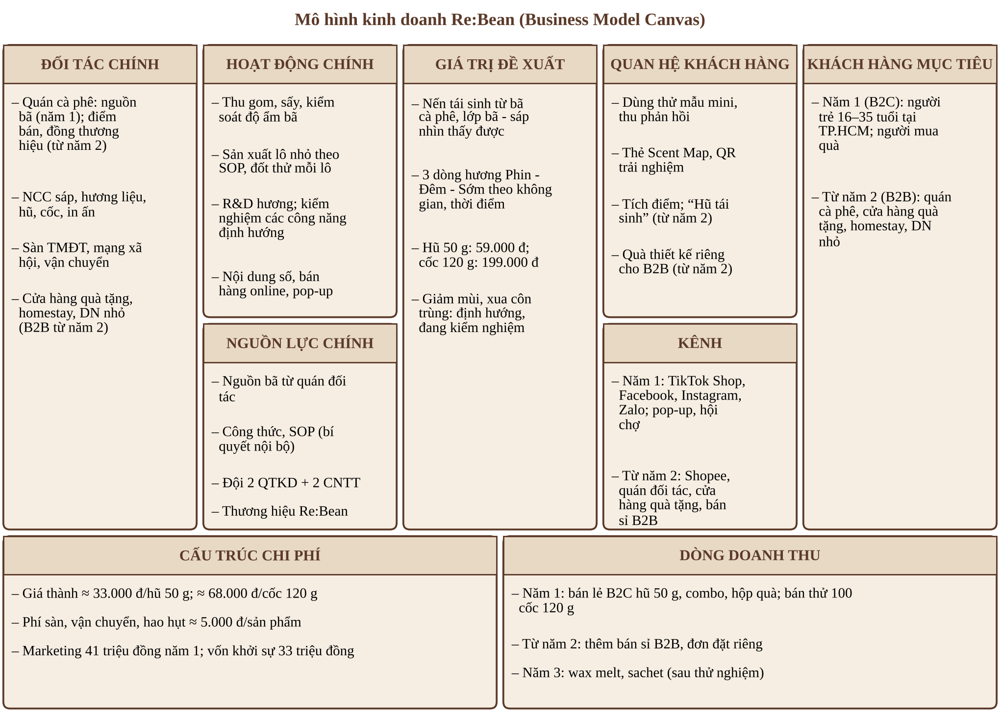

*Hình 4.2. Mô hình kinh doanh của Re:Bean (Business Model Canvas)*

*Nguồn: Nhóm tác giả xây dựng theo Osterwalder và Pigneur [7].*

### 4.2.2. Quy trình sản xuất

Quy trình gồm bảy bước: (1) thu gom bã tại quán bằng thùng kín, 2-3 lần/tuần; (2) sàng loại tạp chất, sấy khoảng 80°C đến độ ẩm ≤ 5%, đóng túi kín; (3) nghiền mịn, chia bã theo mẻ (12-15% khối lượng lớp bã - sáp, tránh vùng nhiệt cao quanh tim); (4) nấu sáp 75-80°C, hạ còn khoảng 62°C để cho hương, đổ từng lớp xen kẽ; (5) để nguội, đóng rắn 24-48 giờ; (6) đốt thử mẫu mỗi lô; (7) dán nhãn, mã lô, cảnh báo an toàn và đóng hộp. Mỗi bước có tiêu chuẩn kiểm soát, hồ sơ ghi nhận riêng (SOP ở Phụ lục 3) và được cụ thể hóa thành chỉ tiêu kiểm soát chất lượng ở mục 5.4.3.

### 4.2.3. Nhật ký thử nghiệm sản phẩm mẫu

Nhóm thực hiện năm đợt thử nghiệm trên mẫu 45 g với tổng cộng 18 mẻ, khoảng 90 hũ mẫu; mỗi đợt đi theo trình tự vấn đề → cách thử → kết quả quan sát → điều chỉnh.

**Bảng 4.5. Nhật ký thử nghiệm sản phẩm mẫu 45 g (5 đợt, 18 mẻ)**

| **Đợt** | **Giả thuyết cần kiểm chứng** | **Cách thử và kết quả** | **Điều chỉnh đã thực hiện** |
| --- | --- | --- | --- |
| 1 (4 mẻ) | Tỷ lệ bã trong lớp bã - sáp bao nhiêu thì cháy ổn định? | Thử 10%, 15%, 20%, 30% theo khối lượng lớp. Ở 30%, tim nghẹn, cháy lệch; 15-20% ổn định | Chốt 12-15% (giữ biên an toàn); không trộn bã vào lớp trên cùng |
| 2 (4 mẻ) | Cách xử lý bã nào bền nhất? | So sánh phơi nắng, sấy 80°C, sấy và rang nhẹ, không xử lý. Mẫu không xử lý có dấu hiệu mốc sau 9-12 ngày; mẫu sấy hoặc sấy - rang nhẹ không mốc sau 21 ngày | Chọn sấy 80°C (đạt độ ẩm ≤ 5%), bảo quản túi kín, dùng trong 14 ngày |
| 3 (4 mẻ) | Lượng hương và nhiệt độ cho hương thế nào là tối ưu? | Thử hương 5%, 7%, 9% và nhiệt độ cho hương 60°C, 62°C, 65°C. Hương 7% ở 62°C lan hương tốt, không gắt | Chốt 7% hương liệu, cho hương ở 62°C |
| 4 (3 mẻ) | Tim nến nào phù hợp hũ 45 g? | Thử 3 cỡ tim cotton, đốt 3 giờ liên tục. Cỡ trung bình cho hồ sáp đều, ít khói | Chọn cỡ tim trung bình; thời gian cháy trung bình 9,5 giờ |
| 5 (3 mẻ) | Sản phẩm có bền khi vận chuyển và bảo quản không? | Thử rơi từ 30 cm, lắc 24 giờ, để 7 ngày ở nhiệt độ phòng. Không tách lớp ở 14/15 hũ; 1 hũ nứt bề mặt nhẹ | Tăng thời gian đóng rắn lên 48 giờ; thêm lớp lót giấy chống va đập |

*Nguồn: Nhật ký thử nghiệm của nhóm.*

Các kết quả trên là quan sát nội bộ (bằng mắt và cảm quan, chưa dùng thiết bị đo khói hay phòng thí nghiệm), nên đủ để chốt công thức nội bộ nhưng chưa đủ để chứng minh độ an toàn. Các điều chỉnh sau từng đợt chưa được kiểm chứng lại bằng một đợt độc lập; đợt 6 và 7 sẽ kiểm tra lại toàn bộ trên phiên bản thương mại.

### 4.2.4. Phản hồi từ người dùng thử

Nhóm cho 30 người (sinh viên và nhân viên văn phòng) dùng thử đủ ba dòng hương ở dạng mẫu mini trong 7-10 ngày, sau đó chấm năm tiêu chí theo thang 1-5 ***[Cần bổ sung: quy cách mẫu mini, cách chọn người dùng thử, mẫu phiếu đánh giá]***.

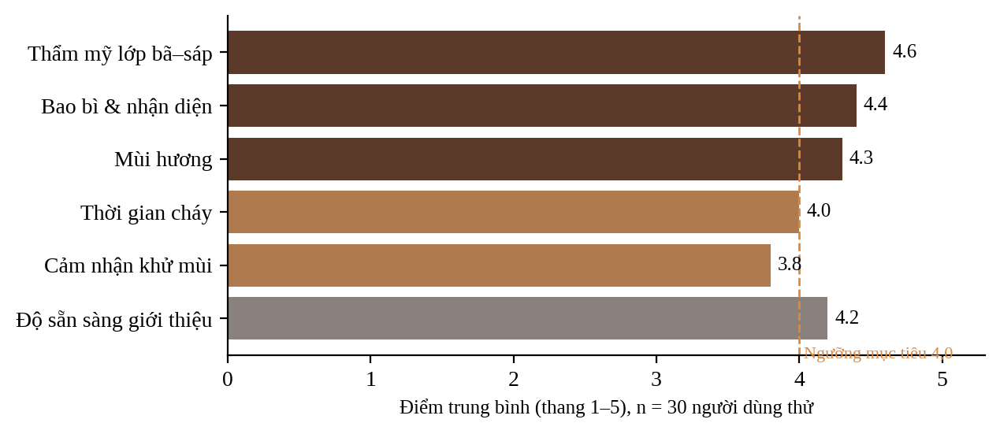

*Hình 4.3. Điểm đánh giá trung bình của 30 người dùng thử sản phẩm mẫu*

*Nguồn: Phiếu đánh giá dùng thử của nhóm.*

Điểm trung bình theo tiêu chí: thẩm mỹ lớp bã - sáp 4,6; bao bì 4,4; mùi hương 4,3; thời gian cháy 4,0; cảm nhận khử mùi 3,8; điểm hài lòng chung 4,2/5 là trung bình cộng của năm tiêu chí này, và 25/30 người (83,3%) sẵn sàng giới thiệu cho bạn bè. Đây là đánh giá cảm quan, không thay thế bằng chứng kỹ thuật về an toàn hay công năng; riêng cảm nhận khử mùi thấp hơn mục tiêu 4,0 nên chưa được dùng làm thông điệp. Hai góp ý chính (hương Phin hơi ngọt; nhãn cần rõ cảnh báo) đã được điều chỉnh trong công thức và mẫu nhãn, nhưng chưa có đánh giá lại sau điều chỉnh; nhóm sẽ đo lại với 100-150 khách dùng thử đầu tiên.

### 4.2.5. Các việc cần hoàn thành trước khi thương mại hóa

Trước khi mở bán chính thức (tháng 4 năm 1), nhóm phải hoàn thành các việc sau; đây cũng là điều kiện để chuyển từ bán thử sang bán chính thức:

- Đợt 6 (quý I năm 1, hũ 50 g): hệ sáp 80/20 với ba mức hương 7%, 8,5% và 10%; đánh giá hồ sáp, khói, độ bám bã; đo thời gian cháy; sản xuất 3 mẻ liên tiếp cho mỗi dòng hương để kiểm tra tính đồng nhất.

- Đợt 7 (quý I năm 1, trước khi bán lô cốc đầu tiên): cốc 120 g với tim đôi; kiểm tra độ thấm dầu và nứt do sốc nhiệt của cốc thạch cao sau khi phủ chống thấm.

- Chuẩn hóa SOP bằng văn bản, đào tạo chéo để mọi thành viên sản xuất cùng chất lượng; áp dụng phiếu kiểm tra lô (Phụ lục 3).

- Có SDS và xác nhận IFRA của hương liệu; nhãn đúng Nghị định 43/2017/NĐ-CP [15].

- Đo cảm nhận giảm mùi (Đêm) và đếm côn trùng có đối chứng (Sớm) trong phòng kín; kết quả chỉ dùng cải tiến nội bộ cho đến khi đủ điều kiện pháp lý.

### 4.2.6. An toàn lao động và thân thiện môi trường trong sản xuất

Do công đoạn nấu sáp sử dụng nhiệt, nhóm áp dụng các nguyên tắc an toàn: nấu sáp bằng nồi cách thủy và có nhiệt kế, không đun trực tiếp; không để người làm việc một mình khi đang nấu; có bình chữa cháy và chăn dập lửa trong khu sản xuất; mặc trang phục bảo hộ (găng tay chịu nhiệt, tạp dề); lưu trữ hương liệu theo hướng dẫn của SDS. Về môi trường, phần sáp thừa được tái sử dụng cho mẻ sau; bã không đạt chất lượng được chuyển cho đối tác làm phân bón thay vì thải bỏ; vật tư đóng gói được ưu tiên loại có thể tái chế hoặc tái sử dụng; nước vệ sinh dụng cụ được lọc cặn sáp trước khi thải. Nhờ đó, quy trình sản xuất không đánh đổi môi trường để lấy chi phí thấp, đúng với định vị của dự án.

## 4.3. Chiến lược phát triển

### 4.3.1. Lộ trình ba giai đoạn

Chiến lược phát triển đi theo lộ trình “chứng minh - mở rộng - nhân rộng” trong ba năm (sơ đồ ở Phụ lục 11): năm 1 sản xuất tại nhà, bán 100% B2C 3.300 hũ và 100 cốc bán thử, chuẩn bị B2B nhưng chưa bán sỉ; năm 2 lập công ty cổ phần, thuê mặt bằng 30 m², gọi vốn seed, bắt đầu bán sỉ B2B (15% sản lượng); năm 3 mở xưởng 60 m², mở rộng Hà Nội, thử nghiệm wax melt, sachet và nâng B2B lên 35% sản lượng. Việc chuyển sang giai đoạn sau phụ thuộc vào các điều kiện ở mục 6.2.

### 4.3.2. Mục tiêu phát triển và khoảng trống tăng trưởng

Mục tiêu ba năm được xây dựng theo nguyên tắc SMART: (S) chia theo bốn mảng kinh doanh, tiếp thị, sản xuất, kênh phân phối, mỗi mảng có người phụ trách (mục 5.2); (M) doanh thu 214,6 triệu đồng năm 1, 806,7 triệu đồng năm 2 và khoảng 1,73 tỷ đồng năm 3, biên lợi nhuận gộp khoảng 46-48%; cuối năm 1 đạt 7.000 người theo dõi, tỷ lệ chuyển đổi 3%, tỷ lệ mua lại 20%, điểm hài lòng ≥ 4,3/5; tỷ lệ thành phẩm đạt ≥ 95%, khiếu nại chất lượng < 2%; (A) dựa trên công suất tại nhà khoảng 600 hũ/tháng ở năm 1; (R) gắn với phân tích khoảng trống dưới đây; (T) đánh giá theo năm, cốc 120 g bán thử năm 1 và mở rộng từ quý I năm 2, kênh B2B bắt đầu từ năm 2 và đạt 35% sản lượng năm 3.

Nếu chỉ bán lẻ hũ 50 g qua mạng xã hội với công suất tại nhà (600 hũ/tháng × 12 tháng × 59.000 đồng), doanh thu tối đa khoảng 424,8 triệu đồng/năm, tương đương 24,6% mục tiêu năm 3. Khoảng trống còn lại được lấp bởi các hướng trong ma trận Ansoff [19], triển khai theo thứ tự rủi ro tăng dần: thâm nhập thị trường (năm 1-2, rủi ro thấp vì sản phẩm và khách hàng đã được khảo sát); phát triển thị trường và B2B (năm 2-3, rủi ro trung bình do biên lợi nhuận sỉ thấp hơn và cần pháp nhân, logistics; giảm thiểu bằng đơn tối thiểu, thanh toán trước 50%); phát triển sản phẩm (năm 2-3, rủi ro trung bình đến cao; thử lô nhỏ 50-100 sản phẩm trước khi sản xuất đại trà). Đa dạng hóa (dịch vụ “Bean Back” chia sẻ mô hình thu gom cho quán) chỉ xem xét sau năm 3.

**Bảng 4.6. Phân tích khoảng trống doanh thu năm 3 theo nguồn tăng trưởng**

| **Nguồn doanh thu năm 3** | **Hướng chiến lược** | **Triệu đồng** | **Tỷ trọng** |
| --- | --- | --- | --- |
| Quỹ đạo hiện tại: B2C hũ 50 g với năng lực tại nhà | Duy trì | 424,8 | 24,6% |
| Tăng năng lực sản xuất, mở rộng B2C tại TP.HCM và Hà Nội | Thâm nhập, phát triển thị trường | 572,3 | 33,2% |
| Bán sỉ B2B hũ 50 g (35% sản lượng, 49.000 đồng/hũ) | Phát triển thị trường | 445,9 | 25,8% |
| Cốc quà tặng 120 g (1.500 cốc) | Phát triển sản phẩm | 282,8 | 16,4% |
| **Tổng doanh thu mục tiêu năm 3** |  | **1.725,8** | **100%** |

*Nguồn: Nhóm tác giả tính toán.*

### 4.3.3. Giá trị cốt lõi và nỗi đau của khách hàng

Khách hàng của Re:Bean không chỉ mua một cây nến mà mua một khoảnh khắc thư giãn có ý nghĩa, cảm giác mình đang sống xanh và một món quà có câu chuyện. Theo Lean Canvas [29], giá trị cốt lõi (USP) là “nến thơm tái sinh từ bã cà phê Việt, mỗi dòng hương cho một khoảnh khắc trong ngày, đẹp - thơm - có câu chuyện - giá dễ chạm”. Giải pháp gắn với nỗi đau của từng nhóm: người trẻ sợ nến rẻ có mùi hắc, khói, không rõ nguồn gốc (lo ngại an toàn 42,8%) → sáp đậu nành - sáp ong, tim cotton không chì, đốt thử từng lô, mã lô, giá 59.000 đồng; người mua quà khó tìm quà nhỏ có ý nghĩa (48,5% mua nến để tặng) → hộp vùng miền, cốc 120 g, thẻ Scent Map; cư dân căn hộ có phòng kín dễ ám mùi → dòng Đêm, Sớm với hương phù hợp, công năng giảm mùi, xua côn trùng đang kiểm nghiệm; quán cà phê ngại xử lý bã → thu gom miễn phí, được ghi nhận, từ năm 2 có thể bán tại quầy; doanh nghiệp cần quà xanh có hóa đơn → bộ quà in tên từ năm 2 (bảng chi tiết ở Phụ lục 11).

### 4.3.4. Chiến lược theo vòng đời sản phẩm

Theo vòng đời sản phẩm và ma trận BCG (Phụ lục 11), hũ 50 g ở năm 1 là “dấu hỏi” cần đầu tư truyền thông để trở thành “ngôi sao” (dự kiến là dòng Phin, được 38,1% người khảo sát ưa thích); cốc 120 g và kênh B2B là “ngôi sao” của năm 2-3; combo Tam hương và đơn quà doanh nghiệp định kỳ được kỳ vọng trở thành “bò sữa” từ năm 3, tạo dòng tiền tài trợ cho dòng mới (wax melt, sachet) thay vì gọi thêm vốn; các hương hoặc phiên bản theo mùa có doanh số dưới 5% danh mục trong hai quý liên tiếp được loại bỏ hoặc cải tổ.

### 4.3.5. Điểm mới và khả năng bảo vệ lợi thế

**Điểm mới đã được kiểm chứng ở mức sản phẩm mẫu:** (1) công thức nến có lớp bã cà phê tái chế cháy ổn định nhờ giới hạn tỷ lệ bã 12-15% và giữ vùng cháy là sáp nguyên chất; (2) quy trình xử lý bã đơn giản (sấy 80°C, dùng trong 14 ngày) đủ cho sản xuất lô nhỏ; (3) thiết kế lớp bã nhìn thấy được, được người dùng thử đánh giá cao nhất (4,6/5). **Điểm mới đang phát triển:** (4) bộ hương theo vùng miền gắn với không gian, thời điểm sử dụng và trải nghiệm Scent Map; (5) công năng hỗ trợ giảm mùi, xua côn trùng - nếu được kiểm chứng sẽ là khác biệt rõ rệt, nhưng hiện nhóm không tuyên bố là “công nghệ độc quyền” hay “đầu tiên trên thị trường” vì chưa có kết quả kiểm nghiệm và trên thị trường đã có nến hương sả chanh định hướng đuổi muỗi (Heny Garden).

**Khả năng bảo vệ lợi thế** ở giai đoạn đầu còn hạn chế vì rào cản gia nhập thấp. Nhóm xây dựng bốn lớp: thỏa thuận ưu tiên với quán đối tác; đăng ký nhãn hiệu; bảo mật công thức, SOP như bí quyết kỹ thuật (cân nhắc đăng ký sáng chế hoặc giải pháp hữu ích nếu công thức chức năng được kiểm chứng có tính mới); cộng đồng khách hàng và chương trình “Hũ tái sinh”.

# CHƯƠNG 5. KẾ HOẠCH KINH DOANH

## 5.1. Đầu tư ban đầu

### 5.1.1. Hạng mục và quy mô vốn

Tổng vốn cần thiết cho giai đoạn đầu là 33 triệu đồng, ưu tiên cho hoàn thiện sản phẩm, xây dựng thương hiệu và đưa sản phẩm ra thị trường.

**Bảng 5.1. Cơ cấu vốn đầu tư ban đầu**

| Hạng mục | Số tiền (đồng) | Tỷ trọng | Nội dung chính |
| --- | --- | --- | --- |
| Dụng cụ và thiết bị sản xuất | 6.000.000 | 18,2% | Nồi nấu sáp cách thủy, nhiệt kế, cân điện tử, máy sấy bã, dụng cụ đổ nến, kệ và khay |
| Nguyên vật liệu lô đầu | 9.000.000 | 27,3% | Sáp, hương liệu, tim nến, hũ thủy tinh, bao bì cho lô sản xuất ban đầu |
| Nhận diện thương hiệu | 4.000.000 | 12,1% | Thiết kế logo, tem nhãn, bao bì; hoàn thiện mẫu sản phẩm |
| Marketing ra mắt | 5.000.000 | 15,2% | Nội dung, mẫu dùng thử, quảng cáo thử nghiệm |
| Vốn lưu động và dự phòng | 9.000.000 | 27,3% | Chi phí phát sinh, pháp lý, bù đắp dòng tiền quý I |
| Tổng | 33.000.000 | 100% |  |

*Nguồn: Nhóm tác giả dự toán.*

Trong 6 triệu đồng thiết bị, chi tiết gồm: Nồi nấu sáp 1,2 triệu; nhiệt kế hồng ngoại 0,4 triệu; cân điện tử độ chính xác 0,1 g là 0,5 triệu; máy sấy bã 2,0 triệu; dụng cụ đổ nến (ca rót, que khuấy, kẹp tim) 0,9 triệu; khay, kệ và dụng cụ vệ sinh 1,0 triệu.

Theo cách tiếp cận “tổng vốn đầu tư = vốn cố định + chi phí triển khai ban đầu + vốn dự phòng”, cơ cấu là 6 + 18 + 9 = 33 triệu đồng. Trong đó 24 triệu đồng được chi ngay khi khởi sự (thiết bị 6, nguyên vật liệu lô đầu 9, nhận diện thương hiệu 4, marketing ra mắt 5 triệu đồng), còn 9 triệu đồng vốn lưu động và dự phòng được giữ dưới dạng tiền mặt để bù đắp dòng tiền quý I và chi phí pháp lý phát sinh. Vì vậy bảng dòng tiền (mục 5.5.5) ghi khoản đầu tư ban đầu 24 triệu đồng, còn 9 triệu đồng nằm trong số dư tiền mặt. Năm 1 sản xuất tại nhà nên không có tiền đặt cọc mặt bằng.

### 5.1.2. Nguồn vốn

**Bảng 5.2. Nguồn vốn khởi sự và tình trạng huy động**

| **Nguồn vốn** | **Số tiền (đồng)** | **Tỷ trọng** | **Điều kiện** | **Tình trạng** |
| --- | --- | --- | --- | --- |
| Vốn góp của 4 thành viên | 20.000.000 | 60,6% | Góp bằng nhau, 5 triệu đồng/người | ***[Cần xác nhận: đã góp hay cam kết góp]*** |
| Hỗ trợ không hoàn lại từ gia đình | 8.000.000 | 24,2% | Không hoàn trả | Đã có |
| Hỗ trợ từ mentor | 5.000.000 | 15,2% | Hỗ trợ khởi sự, không tính lãi, không hoàn trả | Đã có |
| **Tổng** | **33.000.000** | **100%** |  |  |
| Vốn seed (kế hoạch, đầu năm 2) | ≈ 60.000.000 | - | Nhà đầu tư thiên thần, nhường khoảng 10-12% cổ phần công ty cổ phần | Chưa huy động |

*Nguồn: Nhóm tác giả tổng hợp.*

Dự án không vay nợ và không bán đặt trước để tránh áp lực giao hàng khi phiên bản thương mại còn đang hoàn thiện. Năm 1 dùng vốn góp, hỗ trợ của gia đình và mentor; đầu năm 2 kêu gọi khoảng 60 triệu đồng từ nhà đầu tư thiên thần; vay ngân hàng chỉ cân nhắc từ năm 3. Đánh giá ưu, nhược điểm các phương án huy động vốn ở Phụ lục 8.

### 5.1.3. Mặt bằng và cơ sở vật chất

Năm 1, dự án sản xuất thủ công tại nhà của một thành viên, dùng khu bếp - kho khoảng 12-15 m² bố trí riêng, tách khỏi khu sinh hoạt, có bình chữa cháy và không nấu sáp khi không có người trông; công suất tối đa khoảng 600 hũ/tháng. Năm 2 thuê mặt bằng khoảng 30 m² (4 triệu đồng/tháng, công suất khoảng 1.500 hũ/tháng); năm 3 mở rộng lên khoảng 60 m² (6 triệu đồng/tháng, khoảng 3.500 hũ/tháng). Mặt bằng thuê được chọn theo ba tiêu chí: gần cụm quán đối tác, thuận tiện đi lại cho thành viên và lao động, gần điểm giao nhận của đơn vị vận chuyển nội thành.

## 5.2. Kế hoạch nhân sự

### 5.2.1. Cơ cấu nhân sự và phân công

Năm 1, bốn thành viên sáng lập kiêm nhiệm theo cơ cấu phẳng, các bộ phận báo cáo trực tiếp Giám đốc để ra quyết định nhanh; nhân viên được tuyển từ năm 2; kế toán, in ấn, vận chuyển thuê ngoài; giảng viên và mentor giữ vai trò cố vấn, không tham gia vận hành (sơ đồ cơ cấu ở Phụ lục 12).

**Bảng 5.3. Phân công nhiệm vụ của các thành viên**

| Thành viên | Vai trò | Nhiệm vụ chính và chỉ tiêu |
| --- | --- | --- |
| Phạm Duy Đăng (Khoa CNTT) | Giám đốc, trưởng nhóm; dữ liệu - vận hành số | Điều hành chung, quan hệ đối tác, quản lý CRM và hệ thống mã lô QR; chỉ tiêu: Hoàn thành kế hoạch năm, tỷ lệ đơn đúng hạn ≥ 95% |
| Nguyễn Tấn Phát (Khoa CNTT) | Marketing số và thương mại điện tử | Vận hành gian hàng TikTok Shop (Shopee từ năm 2), quảng cáo, nội dung; chỉ tiêu: tỷ lệ chuyển đổi đơn hàng, chi phí thu hút khách |
| Tiêu Thị Tuyết Mai (Khoa QTKD) | Sản xuất và chất lượng | Chuẩn hóa SOP, kiểm soát lô, R&D hương; chỉ tiêu: Tỷ lệ thành phẩm đạt ≥ 95%, khiếu nại chất lượng ≤ 2% |
| Trương Ngọc Thảo (Khoa QTKD) | Tài chính, bán hàng và đối tác thu gom | Ngân sách, sổ sách, phát triển đối tác quán và kênh B2B (từ năm 2); chỉ tiêu: Số quán đối tác, doanh thu B2B, dòng tiền |

*Nguồn: Nhóm tác giả phân công.*

### 5.2.2. Tuyển dụng, đãi ngộ và ngân sách nhân sự

**Bảng 5.4. Nhu cầu nhân sự và thu nhập theo giai đoạn**

| Vị trí | Năm 1 | Năm 2 | Năm 3 |
| --- | --- | --- | --- |
| Thành viên sáng lập | 4 người, chưa nhận lương | 4 người, phụ cấp 1 triệu đồng/người/tháng | 2 người toàn thời gian (5 triệu đồng/người/tháng); 2 người bán thời gian (chưa nhận lương cố định, xem xét chia lợi nhuận khi có lãi) |
| Lao động sản xuất | Không | 1 toàn thời gian (6,5 triệu đồng/tháng) | 2 toàn thời gian (13 triệu đồng/tháng) |
| Đóng gói, bán hàng, chăm sóc khách | Thành viên kiêm nhiệm | Cộng tác viên theo mùa vụ | 1 bán thời gian (4 triệu đồng/tháng) |
| Kế toán, pháp lý | Thành viên kiêm nhiệm | Thuê ngoài (≈ 1 triệu đồng/tháng) | Thuê ngoài (≈ 2 triệu đồng/tháng) |

*Nguồn: Nhóm tác giả dự kiến.*

Lao động sản xuất được tuyển qua kênh miễn phí (nhóm sinh viên, trung tâm hỗ trợ việc làm), thử việc bằng bài thực hành đổ một mẻ nến theo SOP và được đào tạo 2 tuần về SOP, an toàn nhiệt, phòng cháy. Lương lao động sản xuất khoảng 5,35 triệu đồng/tháng, không thấp hơn lương tối thiểu vùng I 5,31 triệu đồng/tháng áp dụng từ 01/01/2026 [28]; tổng chi phí 6,5 triệu đồng/tháng gồm bảo hiểm bắt buộc. Chính sách đãi ngộ gồm thưởng theo tỷ lệ thành phẩm đạt và doanh số mùa cao điểm; khi thành lập công ty cổ phần, dành tối đa 5% cổ phần làm quỹ ESOP cho nhân sự chủ chốt gắn với cam kết làm việc từ hai năm.

**Bảng 5.5. Ngân sách nhân sự theo năm (triệu đồng)**

| Khoản mục | Năm 1 | Năm 2 | Năm 3 |
| --- | --- | --- | --- |
| Lao động sản xuất (lương và bảo hiểm bắt buộc) | 0 | 78,0 | 156,0 |
| Phụ cấp, lương thành viên sáng lập | 0 | 48,0 | 120,0 |
| Nhân viên bán hàng, đóng gói bán thời gian | 0 | 0 | 48,0 |
| Kế toán, pháp lý thuê ngoài | 0 | 12,0 | 24,0 |
| Tuyển dụng, đào tạo | Nội bộ | Nội bộ | Nội bộ |
| Tổng chi phí nhân sự | 0 | 138,0 | 348,0 |

*Nguồn: Nhóm tác giả dự toán; thống nhất với chi phí cố định ở Bảng 5.12.*

Năm 1 các thành viên làm việc không lương nên chưa được tính là việc làm được trả lương. Việc làm được trả lương bắt đầu từ năm 2 (1 lao động sản xuất toàn thời gian; 4 thành viên nhận phụ cấp 1 triệu đồng/tháng; cộng tác viên mùa vụ trả khoán theo đơn) và tăng ở năm 3 (2 lao động sản xuất, 2 thành viên toàn thời gian có lương, 1 nhân viên bán thời gian). Mô tả công việc, phân tích khoảng trống năng lực theo mô hình Build - Buy - Borrow và ma trận phân công RACI ở Phụ lục 12.

## 5.3. Kế hoạch tiếp thị

### 5.3.1. Nghiên cứu thị trường, phân khúc và định vị

Bốn phát hiện từ nghiên cứu dẫn tới quyết định marketing (tổng hợp ở Phụ lục 9): (1) 87,0% khách hàng chưa biết đến nến bã cà phê nên ngân sách năm 1 ưu tiên tạo nhận biết; (2) lo ngại an toàn chiếm 42,8% nên nội dung phải minh bạch quy trình và mã lô; (3) thẩm mỹ lớp bã được chấm 4,6/5 trong khi cảm nhận khử mùi chỉ 3,8/5, nên hình ảnh lớp bã là hình ảnh chủ đạo và chưa dùng khử mùi làm thông điệp; (4) TikTok Shop, Shopee là kênh mua ưa thích, còn ma trận CPM cho thấy Re:Bean yếu nhất ở nhận biết và độ phủ kênh, nên năm 1 tập trung thương mại xã hội, KOC và quảng cáo theo mùa.

Thị trường được phân khúc theo hành vi và nhu cầu: (i) người trẻ yêu lối sống xanh dùng nến để thư giãn; (ii) người mua quà tặng; (iii) khách hàng tổ chức. Năm 1 chỉ nhắm (i) và (ii) tại TP.HCM; nhóm (iii) được mở rộng từ năm 2. Các tiêu thức chính: địa lý - TP.HCM, quanh trường đại học và khu văn phòng, Hà Nội từ năm 3; nhân khẩu học - 18-30 tuổi (ý định mua khoảng 70%), sinh viên và nhân viên văn phòng, chi 50.000-200.000 đồng/lần; tâm lý - quan tâm sống xanh, self-care, thích sản phẩm có câu chuyện; hành vi - mua 3-5 lần/năm để thư giãn, trang trí, tặng quà, cao điểm vào Tết, 20/10 và cuối năm. Định vị: “Nến thơm tái sinh từ bã cà phê Việt - đẹp, thơm, có câu chuyện và giá dễ chạm”.

### 5.3.2. Chiến lược marketing hỗn hợp

**Bảng 5.6. Chiến lược marketing hỗn hợp của Re:Bean**

| Yếu tố | Nội dung triển khai |
| --- | --- |
| Sản phẩm (Product) | Ba dòng Phin - Đêm - Sớm theo vùng miền, hũ 50 g và cốc thạch cao 120 g; hộp in họa tiết vùng miền; thẻ Scent Map - QR; phiên bản theo mùa (Tết, Valentine, 8/3, 20/10) từ năm 2 |
| Giá (Price) | Giá lẻ 59.000 đồng/hũ (tầm trung, thấp hơn giá bình quân thị trường 79.000 đồng ); từ năm 2, giá B2B từ 49.000 đồng/hũ khi đặt từ 50 hũ; cốc quà tặng 120g 199.000 đồng (từ năm 2, B2B 169.000 đồng từ 30 cốc). Ưu đãi giới hạn thời gian thay vì giảm giá sâu để bảo vệ biên lợi nhuận |
| Phân phối (Place) | Năm 1: TikTok Shop, fanpage, Instagram, Zalo; pop-up, hội chợ, trường học. Từ năm 2: thêm Shopee, điểm bán liên kết (quán cà phê đối tác, cửa hàng quà tặng, handmade, homestay) và bán B2B |
| Xúc tiến (Promotion) | Nội dung video ngắn về quy trình “bã → nến”; KOC/KOL sinh viên; dùng thử mini; thông điệp “Lô của quán…”; tích điểm, voucher; chương trình “Hũ tái sinh” |

*Nguồn: Nhóm tác giả đề xuất.*

**Giá** được kiểm tra theo ba phương pháp: (1) theo chi phí - giá thành khoảng 33.000 đồng/hũ 50 g, cộng phí bán hàng khoảng 5.000 đồng, giá 59.000 đồng cho số dư đảm phí khoảng 21.000 đồng/hũ; cốc 120 g giá thành khoảng 68.000 đồng, giá 199.000 đồng cho biên gộp khoảng 66%; (2) theo giá trị cảm nhận - 85,6% khách chấp nhận từ 50.000 đồng, 51,2% từ 60.000 đồng, nhóm mua quà chi 100.000-200.000 đồng; (3) theo đối thủ - cao hơn hàng giá rẻ (24.000-33.000 đồng), gần AGAYA mini 45 g (65.000 đồng), thấp hơn nhiều so với Heny Garden, UpCircle. Nguyên tắc: không giảm giá niêm yết, chỉ dùng ưu đãi có thời hạn (combo, voucher); xem xét tăng giá 5-10% khi chi phí đầu vào tăng trên 10%. Thang giá và chính sách ưu đãi chi tiết ở Phụ lục 13.

**Phân phối** đi từ trực tiếp sang đa kênh theo giai đoạn: năm 1 chỉ bán B2C qua thương mại xã hội (TikTok Shop, fanpage, Instagram, Zalo) và gian pop-up do nhóm tự bán; năm 2 thêm Shopee, điểm bán liên kết (quán cà phê đối tác, cửa hàng quà tặng, homestay) và bán sỉ; năm 3 thêm đối tác phân phối tại Hà Nội. Khi có kênh trung gian (từ năm 2), nhóm áp dụng bốn nguyên tắc tránh xung đột kênh: giá bán lẻ thống nhất trên mọi kênh; chiết khấu sỉ theo bậc số lượng; sản phẩm khác biệt theo kênh (combo độc quyền trực tuyến, tem đồng thương hiệu cho quán, bộ quà in tên cho doanh nghiệp); mỗi quán đối tác là điểm bán duy nhất trong bán kính khoảng 1 km. Khách nội thành nhận hàng trong 24-48 giờ, đơn được xử lý trong 24 giờ, đổi trả 7 ngày nếu lỗi.

**Truyền thông** dùng năm công cụ truyền thông marketing tích hợp với cùng thông điệp “Mua một cây nến, góp một vòng tuần hoàn”. Nhu cầu nến và quà tặng có tính mùa vụ rõ rệt (Tết, Valentine, 8/3; 20/10, 20/11, 11.11, 12.12, Giáng sinh), nên tồn kho được chuẩn bị trước ít nhất 4 tuần; lịch chiến dịch theo mùa và năm công cụ truyền thông (quảng cáo, quan hệ công chúng, khuyến mãi, bán hàng cá nhân, marketing trực tiếp - kỹ thuật số) ở Phụ lục 13.

### 5.3.3. Triển khai và kiểm soát chiến lược marketing

Mục tiêu marketing năm 1 (mục tiêu đề xuất của nhóm) được lượng hóa theo phễu: tỷ lệ nhận biết thương hiệu trong sinh viên tại các trường mục tiêu đạt 20% (khảo sát nhanh cuối quý IV); 150 khách dùng thử mẫu mini; tỷ lệ chuyển đổi đơn hàng 3%; tỷ lệ mua lại 20%; điểm hài lòng ≥ 4,3/5. Mỗi hạng mục có người chịu trách nhiệm, thời hạn, ngân sách và chỉ số đo lường.

**Bảng 5.7. Kế hoạch hành động và ngân sách marketing (triệu đồng)**

| Hạng mục công việc | Phụ trách | Thời hạn (năm 1) | Năm 1 | Năm 2 | Năm 3 | Đo lường năm 1 |
| --- | --- | --- | --- | --- | --- | --- |
| Nội dung số: xây dựng kênh TikTok, Facebook, Instagram, Zalo OA; quay dựng khoảng 120 video, 150 bài; thiết kế Scent Map | Phát (R), Đăng (A) | T1-T12 | 14,4 | 21,6 | 27,0 | 7.000 người theo dõi |
| KOC sinh viên, micro-influencer sống xanh (khoảng 5 người/đợt): gửi sản phẩm, thù lao, mã giảm giá riêng | Phát | T4-T6; T10-T12 | 10,2 | 14,4 | 21,6 | Khoảng 300 đơn qua mã KOC |
| Quảng cáo TikTok, Meta theo mùa, nhắm lại người đã tương tác | Phát | T4-T12 (tập trung T10-T12) | 10,2 | 21,6 | 37,8 | CAC ≤ 20.000 đồng; doanh thu ≥ 3 lần chi phí quảng cáo |
| Sự kiện, dùng thử: pop-up, hội chợ, trường học; mẫu mini cho 150 khách đầu tiên; vật phẩm trưng bày | Thảo, Mai | T2-T11 | 6,2 | 14,4 | 21,6 | 8 sự kiện; 825 hũ |
| Chiến dịch quà tặng cuối năm, livestream, combo | Cả nhóm (A: Đăng) | T9-T12 | - | - | - | 1.500 hũ quý IV |
| CRM, tích điểm, tin nhắn chăm sóc sau mua | Đăng | T2-T12 | - | - | - | Tỷ lệ mua lại 20% |
| Tổng ngân sách marketing |  |  | 41,0 | 72,0 | 108,0 |  |

*Nguồn: Nhóm tác giả dự toán; chiến dịch cuối năm và CRM dùng ngân sách các hạng mục trên.*

Kiểm soát marketing theo chu trình thực thi → đo lường KPI → phân tích khoảng trống so với kế hoạch → điều chỉnh: bảng theo dõi trên Google Sheets - Looker Studio cập nhật hằng tuần, họp đánh giá hằng tháng, rà soát chiến lược hằng quý; mỗi chỉ số có ngưỡng cảnh báo và phương án điều chỉnh (Phụ lục 13). Nội dung truyền thông xoay quanh ba trụ cột: “Từ bã đến nến” (video quy trình, câu chuyện quán), “Góc thư giãn” (gợi ý dùng Sớm - Phin - Đêm theo thời điểm) và “Cộng đồng Hũ tái sinh” (từ năm 2). Tần suất dự kiến: TikTok 4-5 video/tuần, Facebook và Instagram 3 bài/tuần, livestream 2 buổi/tháng (4 buổi/tháng trong quý IV), Zalo OA 2 tin/tháng cho khách cũ. Mọi nội dung, kể cả của KOC, tuân thủ Luật Thương mại điện tử 2025: công khai thông tin người bán, mô tả đúng sản phẩm và không phóng đại công dụng [25].

### 5.3.4. Kế hoạch bán hàng và chăm sóc khách hàng

Năm 1, nhóm bán thử và cho dùng thử để tạo niềm tin: tặng mẫu mini cho 100-150 khách đầu tiên, mở bán với ưu đãi giới hạn cho khách đăng ký sớm; sau bán hàng, khách được mời đánh giá, chia sẻ ảnh, nhận điểm tích lũy và voucher cho lần mua thứ hai. Các quán cà phê, trường học và câu lạc bộ khởi nghiệp là đối tác thu gom bã, tổ chức sự kiện và truyền thông, chưa phải kênh bán. Từ năm 2, nhóm chủ động chào bộ mẫu ba hương và chính sách chiết khấu đến quán đối tác, homestay, cửa hàng quà tặng theo lộ trình B2B ở mục 6.2.3.

### 5.3.5. Ngân sách marketing và chỉ số đo lường

Ngân sách marketing là 3 triệu đồng/tháng cộng 5 triệu đồng ra mắt ở năm 1 (41 triệu đồng, 19,1% doanh thu), 6 triệu đồng/tháng ở năm 2 (72 triệu đồng, 8,9%) và 9 triệu đồng/tháng ở năm 3 (108 triệu đồng, 6,3%); năm 1 phân bổ nội dung 35%, KOC 25%, quảng cáo 25%, sự kiện 15%, tỷ trọng quảng cáo tăng dần lên 35% ở năm 3.

Chi phí thu hút khách hàng (CAC) năm 1 ước khoảng 16.000 đồng/khách (41 triệu đồng cho khoảng 2.500 khách), thấp hơn số dư đảm phí của lần mua đầu (khoảng 21.000 đồng × 1,3 hũ ≈ 27.300 đồng). Với giả định thận trọng 35% khách mua lại trung bình hai lần trong 24 tháng, giá trị vòng đời khách hàng (LTV) khoảng 27.300 × (1 + 0,35 × 2) ≈ 46.400 đồng, gấp khoảng 2,9 lần CAC, thấp hơn mức LTV/CAC ≥ 3 thường được dùng làm mốc tham chiếu trong khởi nghiệp; vì vậy nhóm cần giảm CAC hoặc nâng tỷ lệ mua lại và giá trị đơn hàng.

**Bảng 5.8. Chỉ số KPI marketing và bán hàng năm 1 (mục tiêu đề xuất)**

| Chỉ số | Quý I | Quý II | Quý III | Quý IV |
| --- | --- | --- | --- | --- |
| Số hũ bán | 300 | 600 | 900 | 1.500 |
| Người theo dõi các kênh | 1.000 | 2.500 | 4.500 | 7.000 |
| Tỷ lệ chuyển đổi đơn hàng | 1,5% | 2,0% | 2,5% | 3,0% |
| Tỷ lệ khách mua lại | - | 10% | 15% | 20% |
| Điểm hài lòng (thang 5) | ≥ 4,0 | ≥ 4,2 | ≥ 4,3 | ≥ 4,3 |
| Số sự kiện pop-up, hội chợ (lũy kế) | 1 | 3 | 5 | 8 |

*Nguồn: Nhóm tác giả đề xuất.*

Dự phóng lợi nhuận đóng góp sau marketing (Phụ lục 13) cho thấy năm 1 ROMI thận trọng (giả định chỉ 50% số dư đảm phí do marketing tạo ra) ở mức hòa vốn (khoảng -0,1%), năm 2 khoảng 125,6% và năm 3 khoảng 223,7%; các con số này chưa trừ các chi phí cố định khác.

## 5.4. Kế hoạch sản xuất

### 5.4.1. Năng lực và kế hoạch sản lượng

Sản xuất theo lô nhỏ, mỗi mẻ khoảng 20 hũ 50 g mất khoảng 3,5 giờ thao tác (Bảng PL.4), theo nguyên tắc sản xuất theo kế hoạch bán hàng và giữ tồn kho an toàn 3-4 tuần. Bảng dưới so sánh sản lượng kế hoạch với công suất.

**Bảng 5.9. Sản lượng kế hoạch và công suất sản xuất**

| **Chỉ tiêu** | **Quý I** | **Quý II** | **Quý III** | **Quý IV** | **Cả năm** |
| --- | --- | --- | --- | --- | --- |
| Năm 1: hũ 50 g | 300 | 600 | 900 | 1.500 | 3.300 |
| Năm 1: cốc 120 g | 25 | 25 | 25 | 25 | 100 |
| Năm 2: hũ 50 g | 2.400 | 2.700 | 3.000 | 3.900 | 12.000 |
| Năm 2: cốc 120 g | 150 | 150 | 150 | 150 | 600 |
| Năm 3: hũ 50 g | 5.200 | 6.000 | 6.400 | 8.400 | 26.000 |
| Năm 3: cốc 120 g | 375 | 375 | 375 | 375 | 1.500 |
| Công suất (hũ quy đổi/tháng) | Năm 1: 600; năm 2: 1.500; năm 3: 3.500 | | | | |

*Nguồn: Nhóm tác giả lập kế hoạch.*

Công suất được tính theo hũ 50 g quy đổi; mỗi cốc 120 g dùng lượng sáp tương đương khoảng 2,4 hũ nên được quy đổi theo hệ số này (giả định của nhóm, chưa có định mức thời gian riêng cho mẻ 8 cốc). Năm 1, công suất 600 hũ/tháng tương ứng khoảng 30 mẻ × 3,5 giờ ≈ 105 giờ thao tác/tháng (khoảng 6 giờ/tuần cho mỗi thành viên), chưa kể thu gom, sấy và đóng gói. Nhu cầu cao nhất ở quý IV năm 1 khoảng 500 hũ + 8 cốc/tháng (≈ 520 hũ quy đổi, ≈ 26 mẻ), dưới công suất nhưng sát ngưỡng; vì vậy nhóm sản xuất trước từ tháng 9-10 và giới hạn cốc 120 g ở 100 cốc. Năm 2, nhu cầu quy đổi khoảng 13.440 hũ/năm so với công suất 18.000 hũ/năm; tháng cao điểm khoảng 1.420/1.500 hũ quy đổi nên cốc được sản xuất trước từ tháng 9 và bổ sung cộng tác viên. Năm 3 cần khoảng 29.600 hũ quy đổi so với 42.000; công suất năm 2-3 dựa trên mặt bằng thuê, lao động toàn thời gian và thiết bị dung tích lớn hơn, nên định mức thời gian cần được xác định lại khi có thiết bị mới.

### 5.4.2. Nguyên vật liệu và nhà cung cấp

Giá thành hũ 50 g dự kiến 33.000 đồng ở năm 1 (chi tiết ở Phụ lục 2), trong đó vỏ hũ thủy tinh 10.000 đồng là khoản lớn nhất, bã cà phê đã sấy chỉ khoảng 300 đồng; nhờ mua theo lô, giá thành dự kiến giảm còn 31.500 đồng (năm 2) và 30.500 đồng (năm 3). Cốc 120 g có giá thành dự kiến 68.000 đồng (năm 1-2) và 64.000 đồng (năm 3). Đây là ước tính sơ bộ của nhóm, chưa có báo giá chính thức của nhà cung cấp ***[Cần bổ sung: báo giá sáp, hương liệu, hũ, cốc thạch cao]***. Mỗi vật tư chính có ít nhất hai nhà cung cấp; hương liệu chỉ được mua khi nhà cung cấp có SDS và xác nhận IFRA.

### 5.4.3. Cung ứng bã cà phê và kiểm soát chất lượng

Bã cà phê được thu gom 2-3 lần/tuần bằng thùng kín có nắp đặt tại quán, đưa về nơi sản xuất và xử lý trong ngày. Mỗi chỉ tiêu dưới đây là chỉ tiêu nội bộ, xác định từ kết quả thử nghiệm của nhóm; nhóm chưa áp dụng hay được chứng nhận theo tiêu chuẩn kỹ thuật nào.

**Bảng 5.10. Tiêu chuẩn kiểm soát nguyên liệu và thành phẩm**

| **Công đoạn (áp dụng cho)** | **Tiêu chuẩn / ngưỡng đạt** | **Phương pháp, thời điểm kiểm tra** | **Căn cứ chọn ngưỡng** | **Xử lý khi không đạt** |
| --- | --- | --- | --- | --- |
| **Thu gom (bã ướt tại quán)** | Không lẫn giấy lọc, đường, sữa; không mùi chua, không đốm mốc | Cảm quan khi nhận; cân khối lượng ướt; ghi sổ thu gom (quán, ngày, kg) | Kết quả đợt 2; yêu cầu trong thỏa thuận với quán | Không nhận; bã lẫn tạp chuyển làm phân bón |
| **Vận chuyển, chờ xử lý (bã ướt)** | Bắt đầu sấy trong ngày thu gom | Ghi giờ nhận, giờ sấy | Bã ẩm dễ lên men, sinh mùi [1] | Có mùi lạ: loại |
| **Sàng, sấy (bã khô)** | Sấy khoảng 80°C đến độ ẩm ≤ 5%; không mùi lạ, không mốc | Đo độ ẩm mỗi mẻ sấy ***[Cần xác nhận: thiết bị, cách đo]*** | Đợt 2: mẫu sấy không mốc sau 21 ngày; 5% là ngưỡng nội bộ | Sấy lại; nếu có mốc: loại |
| **Bảo quản bã khô** | Túi kín, ghi ngày sấy; dùng trong 14 ngày | Kiểm tra trước khi cân mẻ | Kết quả đợt 2 | Quá hạn: kiểm tra lại độ ẩm, mùi hoặc loại |
| **Nấu, phối trộn, đổ nến** | Sáp 75-80°C; cho hương ở khoảng 62°C; bã 12-15% khối lượng lớp bã - sáp; tim thẳng, đúng tâm | Nhiệt kế mỗi mẻ; cân 0,1 g; phiếu định lượng | Đợt 1, 3, 4 | Mẻ sai định lượng không đóng gói; sáp tái sử dụng |
| **Thành phẩm** | Đóng rắn 48 giờ; bề mặt phẳng, không tách lớp; đốt thử: cháy đều, không khói đen quan sát được | Ngoại quan 100%; đốt thử ≥ 1 mẫu/lô; giữ mẫu lưu mỗi lô | Đợt 4, 5; mục tiêu thành phẩm đạt ≥ 95% (chưa có dữ liệu thương mại) | Loại hàng lỗi; mẫu đốt không đạt: dừng xuất lô, truy theo sổ lô |
| **Đóng gói, truy xuất** | Nhãn đủ thông tin [15]; mã lô khớp sổ sản xuất | Kiểm tra nhãn trước khi xuất | Quy định ghi nhãn | Dán lại nhãn; chỉ xuất lô đã duyệt |

*Nguồn: Nhóm tác giả xây dựng từ nhật ký thử nghiệm.*

Theo định mức của nhóm, mỗi hũ 50 g dùng khoảng 6-7 g bã khô (tương đương 13-17 g bã ướt) và mỗi cốc 120 g khoảng 13-16 g bã khô (32-40 g bã ướt), tức khoảng 55-60% khối lượng mất đi khi sấy. Nhu cầu năm 1 khoảng 53 kg bã ướt (≈ 23 kg bã khô); tháng cao điểm chỉ cần khoảng 8 kg bã ướt, chưa đến hai ngày bã của một quán cỡ trung bình. Tỷ lệ bã không đạt sau thu gom và tỷ lệ thành phẩm lỗi chưa có dữ liệu thực tế; nhóm ghi nhận từ lô đầu tiên để hiệu chỉnh định mức. Mỗi lô thành phẩm có mã lô liên kết với sổ thu gom (quán, ngày), sổ sấy (độ ẩm) và sổ sản xuất (công thức, ngày đổ), nhờ đó truy xuất ngược được khi có sự cố. Nhãn có cảnh báo: không để trẻ em tiếp cận, không đốt khi không có người trông, tắt khi sáp còn khoảng 5 mm, đặt trên bề mặt chịu nhiệt.

## 5.5. Kế hoạch tài chính

### 5.5.1. Giả định chính

Mô hình tài chính ba năm được tính từ các giả định dưới đây; mọi số liệu là dự báo của nhóm và sẽ được cập nhật khi có dữ liệu bán hàng thực tế.

**Bảng 5.11. Giả định chính của mô hình tài chính**

| **Giả định** | **Năm 1 (2027)** | **Năm 2 (2028)** | **Năm 3 (2029)** |
| --- | --- | --- | --- |
| Sản lượng hũ 50 g (hũ) | 3.300 | 12.000 | 26.000 |
| Tỷ trọng sản lượng bán B2B | 0% | 15% | 35% |
| Giá thực thu bình quân hũ 50 g (đồng) | 59.000 | 57.500 | 55.500 |
| Giá thành hũ 50 g (đồng) | 33.000 | 31.500 | 30.500 |
| Sản lượng cốc 120 g (cốc) | 100 (bán thử) | 600 | 1.500 |
| Giá thực thu bình quân cốc 120 g (đồng) | 199.000 | 194.500 | 188.500 |
| Giá thành cốc 120 g (đồng) | 68.000 | 68.000 | 64.000 |
| Doanh thu (triệu đồng) | 214,6 | 806,7 | 1.725,8 |
| Giá vốn hàng bán (triệu đồng) | 115,7 | 418,8 | 889,0 |
| Phí sàn, vận chuyển, hao hụt (5.000 đồng/sản phẩm; triệu đồng) | 17,0 | 63,0 | 137,5 |
| Chi phí cố định (triệu đồng/tháng) | 4,0 | 24,0 | 48,0 |
| Đầu tư tài sản cố định (triệu đồng) | 6 (khởi sự) | 40 | 30 |
| Vốn lưu động | 8% doanh thu | 8% doanh thu | 8% doanh thu |
| Thuế (kịch bản cơ sở) | 15% | 15% | 15% |

*Nguồn: Nhóm tác giả lập; doanh thu, giá vốn tính bằng sản lượng × đơn giá.*

Năm 1 toàn bộ sản lượng bán B2C ở giá niêm yết. Từ năm 2, giá thực thu bình quân giảm vì có phần bán B2B (hũ 49.000 đồng, cốc 169.000 đồng): hũ 50 g năm 2 = 85% × 59.000 + 15% × 49.000 = 57.500 đồng; năm 3 = 65% × 59.000 + 35% × 49.000 = 55.500 đồng. Kịch bản cơ sở áp thuế suất 15% cho cả ba năm [14] như một khoản dự phòng thận trọng, dù năm 1 dự án hoạt động dưới hình thức hộ kinh doanh và từ năm 2 công ty có thể được miễn thuế thu nhập doanh nghiệp nếu đủ điều kiện [23]; kịch bản ưu đãi thuế được trình bày riêng ở mục 5.5.4.

### 5.5.2. Chi phí cố định và kinh tế đơn vị

**Bảng 5.12. Chi phí cố định theo tháng (triệu đồng)**

| Khoản mục | Năm 1 | Năm 2 | Năm 3 |
| --- | --- | --- | --- |
| Marketing | 3,0 | 6,0 | 9,0 |
| Mặt bằng sản xuất | 0 | 4,0 | 6,0 |
| Điện nước, dụng cụ và khấu hao | 1,0 | 2,5 | 4,0 |
| Lao động sản xuất | 0 | 6,5 | 13,0 |
| Phụ cấp, lương thành viên sáng lập | 0 | 4,0 | 10,0 |
| Bán hàng, đóng gói bán thời gian | 0 | 0 | 4,0 |
| Kế toán, pháp lý thuê ngoài | 0 | 1,0 | 2,0 |
| Tổng cố định/tháng | 4,0 | 24,0 | 48,0 |
| Tổng cố định/năm | 48 | 288 | 576 |

*Nguồn: Nhóm tác giả dự toán.*

Để kiểm tra kinh tế đơn vị khi bắt đầu có B2B, nhóm tính số dư đảm phí trên mỗi hũ theo từng kênh ở năm 2; chi phí bán hàng biến đổi được chuẩn hóa ở mức bình quân 5.000 đồng/sản phẩm cho mọi kênh.

**Bảng 5.13. Số dư đảm phí trên mỗi hũ 50 g theo kênh bán, năm 2 (đồng)**

| Kênh | Giá thực thu | Giá vốn | Chi phí bán hàng | Số dư đảm phí |
| --- | --- | --- | --- | --- |
| Trực tuyến (60%) | 59.000 | 31.500 | 5.000 | 22.500 |
| Trực tiếp (25%) | 59.000 | 31.500 | 5.000 | 22.500 |
| B2B (15%) | 49.000 | 31.500 | 5.000 | 12.500 |
| Bình quân gia quyền (hũ 50g) | 57.500 | 31.500 | 5.000 | 21.000 |

*Nguồn: Nhóm tác giả tính toán.*

### 5.5.3. Doanh thu và lợi nhuận năm 1 theo quý

Năm 1, toàn bộ doanh thu đến từ kênh B2C, tăng dần theo kế hoạch mở rộng kênh và tăng mạnh ở quý IV nhờ nhu cầu quà tặng cuối năm. Dự án lỗ ở quý I do doanh thu chưa bù đủ chi phí cố định, có lãi từ quý II và đạt lợi nhuận hoạt động 33,9 triệu đồng cả năm.

**Bảng 5.14. Doanh thu, chi phí và lợi nhuận hoạt động năm 1 theo quý**

| **Chỉ tiêu (triệu đồng)** | **Quý I** | **Quý II** | **Quý III** | **Quý IV** | **Cả năm** |
| --- | --- | --- | --- | --- | --- |
| Sản lượng hũ 50 g / cốc 120 g | 300 / 25 | 600 / 25 | 900 / 25 | 1.500 / 25 | 3.300 / 100 |
| Doanh thu (100% B2C) | 22,675 | 40,375 | 58,075 | 93,475 | 214,6 |
| Giá vốn hàng bán | 11,6 | 21,5 | 31,4 | 51,2 | 115,7 |
| Phí bán hàng biến đổi | 1,625 | 3,125 | 4,625 | 7,625 | 17,0 |
| Chi phí cố định | 12,0 | 12,0 | 12,0 | 12,0 | 48,0 |
| **Lợi nhuận hoạt động** | **-2,55** | **3,75** | **10,05** | **22,65** | **33,9** |

*Nguồn: Nhóm tác giả tính toán từ Bảng 5.11.*

### 5.5.4. Báo cáo kết quả kinh doanh dự kiến ba năm

**Bảng 5.15. Báo cáo kết quả kinh doanh dự kiến (triệu đồng)**

| **Chỉ tiêu (triệu đồng)** | **Năm 1** | **Năm 2** | **Năm 3** |
| --- | --- | --- | --- |
| Doanh thu | 214,6 | 806,7 | 1.725,8 |
| Giá vốn hàng bán | 115,7 | 418,8 | 889,0 |
| **Lợi nhuận gộp** | **98,9** | **387,9** | **836,8** |
| Biên lợi nhuận gộp | 46,1% | 48,1% | 48,5% |
| Chi phí bán hàng biến đổi (phí sàn, vận chuyển, hao hụt) | 17,0 | 63,0 | 137,5 |
| Chi phí cố định | 48,0 | 288,0 | 576,0 |
| **Lợi nhuận hoạt động (EBIT)** | **33,9** | **36,9** | **123,2** |
| Chi phí khởi sự (thương hiệu, marketing ra mắt) | 9,0 | 0 | 0 |
| Lợi nhuận trước thuế | 24,9 | 36,9 | 123,2 |
| Thuế 15% (kịch bản cơ sở) | 3,7 | 5,5 | 18,5 |
| **Lợi nhuận sau thuế** | **21,2** | **31,4** | **104,8** |
| Biên lợi nhuận ròng | 9,9% | 3,9% | 6,1% |
| *Lợi nhuận sau thuế - kịch bản ưu đãi thuế (tham khảo)* | *24,9* | *36,9* | *123,2* |

*Nguồn: Nhóm tác giả tính toán từ Bảng 5.11 và Bảng 5.12.*

Doanh thu năm 2 được tính theo giả định: 12.000 hũ × 57.500 đồng = 690,0 triệu đồng và 600 cốc × 194.500 đồng = 116,7 triệu đồng, tổng 806,7 triệu đồng; lợi nhuận gộp 387,9 triệu đồng (biên 48,1%). Biên lợi nhuận gộp toàn danh mục khoảng 46-48,5%, chưa đạt mức 50% vì vỏ hũ, hộp và thẻ chiếm phần lớn giá thành; để biên gộp hũ 50 g đạt 50% ở giá 59.000 đồng, giá thành phải giảm xuống khoảng 29.500 đồng. Năm 2 là năm đầu tư vào mặt bằng và nhân sự nên lợi nhuận hoạt động chỉ khoảng 36,9 triệu đồng (biên 4,6%). Nếu năm 1 không phát sinh thuế (hộ kinh doanh có doanh thu dưới ngưỡng [24]) và công ty được miễn thuế thu nhập doanh nghiệp ở năm 2-3 [23], lợi nhuận sau thuế lần lượt là 24,9; 36,9 và 123,3 triệu đồng; nhóm sẽ xác nhận điều kiện áp dụng với cơ quan thuế trước khi dùng kịch bản này.

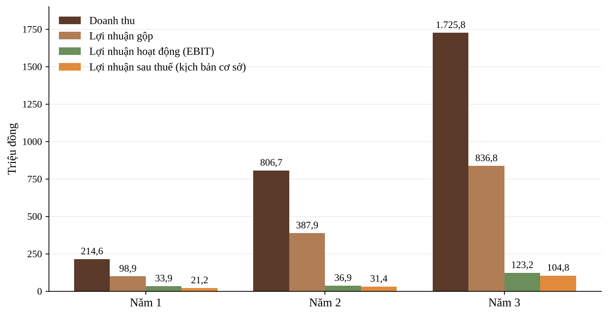

*Hình 5.1. Doanh thu và lợi nhuận dự kiến ba năm đầu (triệu đồng)*

*Nguồn: Nhóm tác giả tính toán.*

### 5.5.5. Dòng tiền, hiệu quả đầu tư và điểm hòa vốn

**Bảng 5.16. Dòng tiền thuần của dự án (triệu đồng)**

| **Chỉ tiêu (triệu đồng)** | **Khởi sự** | **Năm 1** | **Năm 2** | **Năm 3** |
| --- | --- | --- | --- | --- |
| Lợi nhuận sau thuế (kịch bản cơ sở) | - | 21,2 | 31,4 | 104,8 |
| Cộng khấu hao | - | 2,0 | 15,3 | 25,3 |
| Cộng chi phí khởi sự đã chi ở thời điểm khởi sự | - | 9,0 | 0 | 0 |
| Trừ tăng vốn lưu động (8% doanh thu) | - | 8,2 (\*) | 47,4 | 73,5 |
| Trừ đầu tư tài sản cố định | - | 0 | 40,0 | 30,0 |
| Đầu tư ban đầu đã chi (thiết bị 6 + nguyên vật liệu lô đầu 9 + chi phí khởi sự 9) | -24,0 | - | - | - |
| **Dòng tiền thuần** | **-24,0** | **24,0** | **-40,7** | **26,6** |
| Dòng tiền thuần lũy kế | -24,0 | 0,0 | -40,7 | -14,1 |

*(\*) Nhu cầu vốn lưu động cuối năm 1 là 17,2 triệu đồng, trừ 9 triệu đồng nguyên vật liệu lô đầu đã tính trong đầu tư ban đầu. Nguồn: Nhóm tác giả tính toán.*

Theo kịch bản cơ sở, NPV ba năm tại suất chiết khấu 15% khoảng -16,4 triệu đồng và IRR khoảng -26%. Dòng tiền lũy kế về khoảng 0 ở cuối năm 1 (khoản chi ban đầu 24 triệu đồng được thu hồi sau khoảng 12 tháng) nhưng âm trở lại ở năm 2 do đầu tư mặt bằng, thiết bị 40 triệu đồng và vốn lưu động tăng theo doanh thu; đến cuối năm 3 vẫn còn -14,1 triệu đồng. Ở kịch bản ưu đãi thuế, NPV khoảng +3,2 triệu đồng và IRR khoảng 22%. Các chỉ số này chưa tính giá trị tiếp tục sau năm 3 và phụ thuộc mạnh vào giả định vốn lưu động 8% doanh thu, nên không dùng riêng một chỉ số nào để kết luận dự án hiệu quả. Kết luận rút ra là: dự án có lãi hoạt động theo giả định nhưng thiếu tiền cho giai đoạn mở rộng năm 2, cần vốn seed khoảng 60 triệu đồng (không tính trong dòng tiền dự án) hoặc giãn tiến độ đầu tư; nếu không huy động được khoản này mà vẫn đầu tư như kế hoạch, số dư tiền mặt cuối năm 2 ước âm khoảng 7,7 triệu đồng.

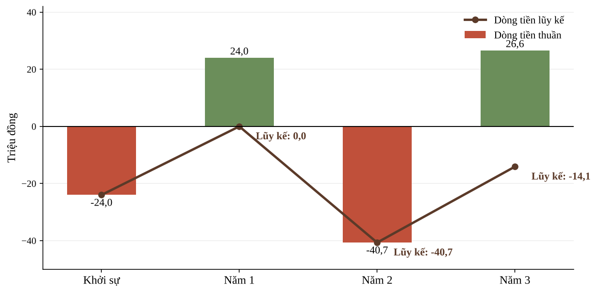

*Hình 5.2. Dòng tiền thuần và dòng tiền lũy kế (triệu đồng)*

*Nguồn: Nhóm tác giả tính toán.*

**Điểm hòa vốn.** Với giá bán 59.000 đồng, giá thành 33.000 đồng/hũ 50g và chi phí bán hàng biến đổi 5.000 đồng/hũ, số dư đảm phí là 21.000 đồng/hũ. Với chi phí cố định 4,0 triệu đồng/tháng, sản lượng hòa vốn hoạt động là 4.000.000 ÷ 21.000 ≈ 191 hũ/tháng, tương ứng doanh thu khoảng 11,27 triệu đồng/tháng. Sản lượng quý II (200 hũ/tháng) vừa vượt điểm hòa vốn theo giả định này (đồ thị ở Phụ lục 14).

### 5.5.6. Phân tích độ nhạy và phương án huy động vốn

Nhóm kiểm tra mức chịu đựng của năm 1 trước các biến động bất lợi. Với cơ sở lợi nhuận hoạt động 33,9 triệu đồng, lợi nhuận hoạt động ước còn 9,3 triệu đồng khi sản lượng giảm 30%, 58,5 triệu đồng khi sản lượng tăng 30% và 0,4 triệu đồng khi sản lượng giảm 20% đồng thời giá bán giảm 10%. Các kịch bản giữ chi phí cố định không đổi và điều chỉnh doanh thu, giá vốn, phí bán hàng biến đổi theo sản lượng.

**Bảng 5.17. Kịch bản kinh doanh năm 1**

| Chỉ tiêu | Bi quan (70% sản lượng) | Cơ sở | Lạc quan (130% sản lượng) | Xấu nhất (−20% lượng, −10% giá) |
| --- | --- | --- | --- | --- |
| Sản lượng hũ + cốc (đơn vị) | 2.380 | 3.400 | 4.420 | 2.720 |
| Doanh thu (triệu đồng) | 150,2 | 214,6 | 279,0 | 154,5 |
| Lợi nhuận hoạt động (triệu đồng) | 9,3 | 33,9 | 58,5 | 0,4 |

*Nguồn: Nhóm tác giả tính toán.*

Ở kịch bản bi quan, dự án vẫn có lợi nhuận hoạt động dương theo giả định hiện tại; ở kịch bản xấu nhất, lợi nhuận gần bằng 0 nên quỹ dự phòng 9 triệu đồng là cần thiết. Phương án huy động vốn: (1) năm 1 dùng vốn góp, hỗ trợ của gia đình, mentor và giải thưởng, hỗ trợ từ cuộc thi (nếu có); (2) đầu năm 2 huy động khoảng 60 triệu đồng từ nhà đầu tư thiên thần hoặc quỹ khởi nghiệp, dự kiến nhường khoảng 10-12% cổ phần, để đầu tư mặt bằng, thiết bị và vốn lưu động mùa cao điểm; (3) năm 3 xem xét vay ưu đãi hoặc gọi vốn vòng tiếp theo khi có dữ liệu tăng trưởng và B2B. Có vốn seed, tiền mặt cuối năm 2 dự kiến khoảng 52,3 triệu đồng và cuối năm 3 khoảng 78,9 triệu đồng. Doanh thu theo quý năm 2-3, bảng cân đối kế toán rút gọn, các chỉ số tài chính và kế hoạch sử dụng vốn seed ở Phụ lục 14.

## 5.6. Rủi ro của dự án và biện pháp phòng ngừa

Các rủi ro được gom thành năm nhóm trọng yếu. Mỗi nhóm được chấm khả năng xảy ra (KN) và mức độ ảnh hưởng (AH) theo thang 1-3 (1: thấp, 2: trung bình, 3: cao); mức rủi ro = KN × AH, từ 6 trở lên là ưu tiên cao, 3-4 là trung bình. Thang điểm do nhóm đánh giá và được rà soát lại mỗi quý.

**Bảng 5.18. Năm nhóm rủi ro trọng yếu và biện pháp phòng ngừa**

| **Nhóm rủi ro và nguyên nhân** | **KN × AH** | **Dấu hiệu cảnh báo** | **Phòng ngừa và phương án ứng phó** | **Phụ trách** |
| --- | --- | --- | --- | --- |
| **N1. Thị trường, tiêu thụ:** 87,0% chưa biết sản phẩm; ý định mua cao hơn hành vi; cạnh tranh giá; nội dung kém tương tác, KOC phát ngôn sai | 3 × 2 = 6 | Chuyển đổi < 1,5% hai tháng liền; doanh số < 70% kế hoạch hai tháng liền; CAC > 27.000 đồng | Phòng ngừa: bán thử, mẫu dùng thử, nội dung minh bạch, quy tắc nội dung cho KOC. Ứng phó: đổi nội dung, ưu đãi; chuyển ngân sách sang pop-up; giảm quy mô mẻ, hoãn đầu tư mới | Phát (Đăng giám sát) |
| **N2. Chất lượng, kỹ thuật, an toàn:** mốc, cháy lệch, khói; cốc thạch cao thấm dầu, nứt; hương liệu chưa có SDS | 2 × 3 = 6 | Khiếu nại > 2%; lô không đạt kiểm tra; mẫu lưu có mốc; điểm gian hàng < 4,5/5 | Phòng ngừa: SOP, đo độ ẩm, đốt thử mỗi lô, mẫu lưu, đợt 6-7. Ứng phó: dừng bán và cách ly lô, truy sổ lô, đổi mới hoặc hoàn tiền trong 24 giờ, cập nhật SOP, thông báo minh bạch | Mai |
| **N3. Nguyên liệu, cung ứng, vận hành:** quán ngừng hợp tác; nhà cung cấp tăng giá, giao trễ; phí sàn tăng [3]; thành viên vắng, quá tải mùa cao điểm | 2 × 2 = 4 | Thu gom trễ hai lần liên tiếp; giá vật tư tăng > 10%; nhà cung cấp trễ > 1 tuần; thành viên trễ việc > 2 tuần | Phòng ngừa: 3-5 quán và quán dự phòng; hai nhà cung cấp mỗi vật tư; tồn kho an toàn 3-4 tuần; đào tạo chéo, ma trận RACI. Ứng phó: chuyển nhà cung cấp thứ hai; điều chỉnh giá 5-10%; thuê cộng tác viên ngắn hạn | Mai, Đăng |
| **N4. Tài chính, vốn, dòng tiền:** dòng tiền năm 2 âm do đầu tư và vốn lưu động; chưa gọi được vốn seed; vốn góp chưa hoàn tất | 2 × 3 = 6 | Tiền mặt < 1 tháng chi phí cố định; chưa có cam kết vốn seed đến hết quý I năm 2 | Phòng ngừa: quỹ dự phòng 9 triệu đồng; sản xuất theo kế hoạch bán; B2B thanh toán trước 50%. Ứng phó: duy trì sản xuất tại nhà thêm 6 tháng hoặc thuê mặt bằng nhỏ hơn; giãn đầu tư; tìm giải thưởng, chương trình ươm tạo | Thảo |
| **N5. Pháp lý, tuyên bố công dụng:** nhãn hàng hóa, nhãn hiệu, quyền lợi người tiêu dùng, dữ liệu cá nhân, thương mại điện tử; quảng cáo giảm mùi, xua côn trùng khi chưa kiểm chứng; điều kiện ưu đãi thuế chưa xác minh | 1 × 3 = 3 | Sàn cảnh báo hoặc gỡ sản phẩm; khiếu nại về nhãn, quảng cáo | Phòng ngừa: nhãn theo quy định [15]; nộp đơn nhãn hiệu [17]; chỉ quảng bá hương và không gian; đăng ký lưu hành trước khi ghi công dụng xua côn trùng [22]; xác minh thuế. Ứng phó: gỡ, sửa nội dung; cập nhật nhãn; tư vấn pháp lý | Đăng |

*Nguồn: Nhóm tác giả đánh giá.*

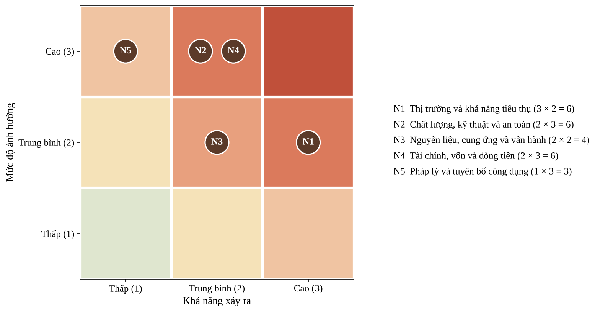

*Hình 5.3. Ma trận rủi ro (khả năng xảy ra - mức độ ảnh hưởng)*

*Nguồn: Nhóm tác giả đánh giá.*

Hai nhóm cần theo dõi sát nhất là N2 (chất lượng) và N4 (dòng tiền). Với N2, quy trình xử lý sự cố gồm bốn bước: dừng bán, cách ly lô nghi ngờ; tra sổ để xác định quán cung cấp bã, ngày sấy, ngày sản xuất và nguyên liệu; phản hồi khách trong 24 giờ, đổi mới hoặc hoàn tiền; phân tích nguyên nhân, cập nhật SOP và thông báo minh bạch. Với N4, nhóm duy trì quỹ dự phòng tối thiểu bằng một tháng chi phí cố định, sản xuất bám đơn hàng thực tế (tồn kho không quá 4 tuần) và lập sẵn danh sách khoản chi có thể trì hoãn (mở rộng xưởng, quảng cáo thử nghiệm). Kịch bản dự phòng chi tiết cho từng tình huống ở Phụ lục 15.

# CHƯƠNG 6. KẾ HOẠCH HÀNH ĐỘNG

## 6.1. Lựa chọn mô hình doanh nghiệp

Nhóm chọn lộ trình hai bước. Năm 1, khi doanh thu còn nhỏ, sản xuất thủ công tại nhà và đội ngũ chủ yếu là sinh viên, dự án đăng ký hộ kinh doanh do một thành viên làm chủ hộ; chi phí tuân thủ thấp vì lệ phí môn bài đã chấm dứt từ năm 2026 và hộ kinh doanh có doanh thu từ 500 triệu đồng/năm trở xuống không phải nộp thuế giá trị gia tăng, thu nhập cá nhân [23], [24]. Đầu năm 2, khi bắt đầu bán sỉ B2B và gọi vốn seed, dự án thành lập công ty cổ phần với bốn cổ đông sáng lập.

Lý do chọn công ty cổ phần: (1) có tư cách pháp nhân, cổ đông chỉ chịu trách nhiệm trong phạm vi vốn góp; (2) được phát hành cổ phần để huy động vốn, thuận lợi cho vòng seed khoảng 60 triệu đồng và các vòng sau [13]; (3) có thể dành cổ phần làm quỹ ESOP giữ chân nhân sự chủ chốt; (4) cổ phần phổ thông của cổ đông sáng lập bị hạn chế chuyển nhượng trong ba năm đầu, giúp giữ cam kết của đội ngũ [13]; (5) đáp ứng yêu cầu của sàn thương mại điện tử và đối tác B2B về hóa đơn, chứng từ; (6) doanh nghiệp nhỏ và vừa thành lập mới có thể được miễn thuế thu nhập doanh nghiệp ba năm đầu [23], nhưng điều kiện áp dụng (nhất là khi chuyển từ hộ kinh doanh lên doanh nghiệp) cần được xác minh với cơ quan thuế. Hạn chế là cơ cấu quản trị và nghĩa vụ báo cáo phức tạp hơn công ty TNHH; nhóm giảm thiểu bằng mô hình quản trị gọn gồm Đại hội đồng cổ đông, Hội đồng quản trị 3 thành viên và Giám đốc, thuê ngoài kế toán và thủ tục thuế.

Nến thơm không thuộc nhóm thực phẩm hay mỹ phẩm nên không phải công bố chất lượng theo quy định chuyên ngành của hai nhóm này, nhưng vẫn phải tuân thủ quy định chung về nhãn hàng hóa và an toàn tiêu dùng; riêng công dụng xua côn trùng của dòng Sớm chỉ được công bố sau khi kiểm nghiệm và đăng ký lưu hành [22]. Hồ sơ, ngành nghề kinh doanh (VSIC) và thủ tục pháp lý dự kiến ở Phụ lục 15.

## 6.2. Kế hoạch hành động theo phương pháp 5W1H

### 6.2.1. 5W1H tổng thể của dự án

**Bảng 6.1. Phân tích 5W1H tổng thể cho dự án Re:Bean**

| Câu hỏi | Nội dung |
| --- | --- |
| What - Làm gì? | Sản xuất và kinh doanh nến thơm tái chế từ bã cà phê (hũ 50 g, cốc 120 g; ba dòng Phin - Đêm - Sớm) theo quy trình khép kín: thu gom bã tại quán đối tác → sàng, sấy đạt độ ẩm ≤ 5% → nghiền, định lượng → nấu hệ sáp đậu nành - sáp ong, phối hương, đổ phân tầng → ổn định 24-48 giờ → đốt thử kiểm tra từng lô → đóng gói kèm thẻ Scent Map. Năm 1 bán B2C qua kênh số và kênh trực tiếp; từ năm 2 thêm B2B |
| Why - Tại sao? | Chuyển bã cà phê đang bị bỏ phí thành sản phẩm self-care có câu chuyện, đáp ứng nhu cầu thư giãn, trang trí, quà tặng xanh đã được khảo sát (76,7% quan tâm, 67,4% có ý định mua); đồng thời nghiên cứu thêm công năng hỗ trợ giảm mùi và xua côn trùng (kể cả kiến ba khoang) như một hướng khác biệt, chỉ công bố khi đã được kiểm chứng |
| Who - Ai thực hiện, ai là khách hàng? | Phạm Duy Đăng - Giám đốc: điều hành, đối tác, dữ liệu, hệ thống mã lô - QR; Tiêu Thị Tuyết Mai - sản xuất, R&D hương, kiểm soát chất lượng; Nguyễn Tấn Phát - marketing số, gian hàng, KOC; Trương Ngọc Thảo - tài chính, đối tác thu gom, bán hàng B2B (từ năm 2); quán đối tác - cung cấp bã (năm 1), điểm bán (từ năm 2); nhà cung cấp - sáp, hương, ly, in ấn; mentor - cố vấn. Khách hàng: người trẻ 16-35 tuổi và người mua quà tặng (B2C, năm 1); quán cà phê, cửa hàng quà tặng, homestay, doanh nghiệp (B2B, từ năm 2) |
| Where - Ở đâu? | Mở rộng dần: năm 1 sản xuất tại nhà ở TP.HCM, bán qua mạng xã hội trên toàn quốc và pop-up tại trường học, hội chợ; năm 2 thuê mặt bằng khoảng 30 m², thêm điểm bán tại quán đối tác, cửa hàng quà tặng; năm 3 xưởng khoảng 60 m², mở rộng Hà Nội và các đô thị lớn |
| When - Khi nào? | Năm 1 (2027): tiếp cận thị trường, chứng minh sản phẩm đáp ứng nhu cầu khách hàng; năm 2 (2028): mở rộng quy mô kinh doanh để tăng doanh thu; năm 3 (2029): đa dạng hóa sản phẩm. |
| How - Như thế nào? | Năm 1: sản xuất lô nhỏ theo SOP tại nhà, marketing nội dung và KOC, bán thử và dùng thử mẫu mini, kiểm soát chi phí. Năm 2: thành lập công ty cổ phần, gọi vốn seed, thuê mặt bằng, tuyển lao động, mở kênh bán sỉ và mở rộng quy mô cốc quà tặng 120g. Năm 3: mở xưởng 60 m², ra mắt wax melt, sachet, hợp tác doanh nghiệp quà tặng, chuẩn hóa mô hình thu gom để nhân rộng; huy động vốn theo từng giai đoạn. |

*Nguồn: Nhóm tác giả xây dựng.*

### 6.2.2. Kế hoạch hành động 12 tháng đầu

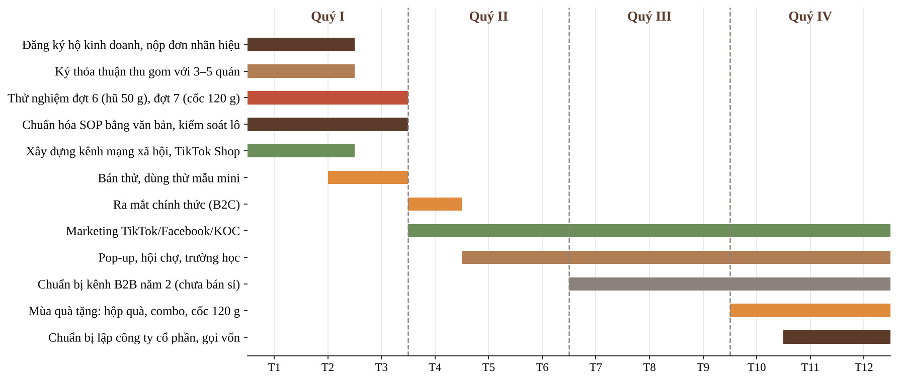

*Hình 6.1. Tiến độ thực hiện 12 tháng đầu của dự án*

*Nguồn: Nhóm tác giả lập kế hoạch.*

**Bảng 6.2. Kế hoạch hành động 12 tháng đầu theo 5W1H**

| **Quý / Việc cần làm (What)** | **Mục đích (Why)** | **Người phụ trách (Who) - Nơi thực hiện (Where)** | **Cách làm và chỉ tiêu (How)** | **Điều kiện chuyển giai đoạn** |
| --- | --- | --- | --- | --- |
| **Quý I (T1-T3):** đăng ký hộ kinh doanh; ký thỏa thuận với ≥ 3 quán; đợt thử 6 (hũ 50 g) và 7 (cốc 120 g); SOP bằng văn bản; nộp đơn nhãn hiệu; mở TikTok Shop, fanpage, Zalo; bán thử | Đủ điều kiện pháp lý và có sản phẩm thương mại đạt chuẩn nội bộ | Đăng (pháp lý, đối tác), Mai (sản xuất tại nhà), Phát (kênh số), Thảo (quán quanh trường) - TP.HCM | Làm việc với tư vấn pháp lý; thùng thu gom, sổ lô; phiếu kiểm tra lô. KPI: 300 hũ + 25 cốc; 1.000 người theo dõi; 3 quán ký | Chỉ mở bán chính thức khi đợt 6-7 đạt tiêu chí Bảng 5.10 và có SDS hương liệu |
| **Quý II (T4-T6):** ra mắt chính thức; KOC; dùng thử mẫu mini 100-150 khách; khảo sát sau mua | Đo tỷ lệ chuyển đổi thực tế, hoàn thiện sản phẩm theo phản hồi | Phát, Mai - TikTok Shop, fanpage, pop-up tại trường | Video quy trình, mẫu mini, phiếu khảo sát. KPI: 600 hũ; chuyển đổi ≥ 2%; vượt hòa vốn (≥ 191 hũ/tháng) | Tháng 6: chuyển đổi ≥ 2%, khiếu nại ≤ 2% thì giữ kế hoạch; doanh số < 70% kế hoạch thì kích hoạt Plan B |
| **Quý III (T7-T9):** mở rộng sản xuất tại nhà; pop-up, hội chợ; chuẩn bị kênh B2B cho năm 2 (danh sách đối tác tiềm năng, bộ mẫu, bảng giá sỉ) - không bán sỉ | Tăng độ phủ B2C; có sẵn hồ sơ để mở B2B ngay đầu năm 2 | Thảo, Đăng - hội chợ sinh viên, sự kiện trường; các quán, cửa hàng quà tặng tại TP.HCM | Lịch sự kiện; phỏng vấn nhu cầu đối tác tiềm năng. KPI: 900 hũ; 5 sự kiện lũy kế; bộ hồ sơ chào hàng B2B | Tồn kho đủ 4 tuần trước mùa cao điểm |
| **Quý IV (T10-T12):** mùa quà tặng (combo, hộp quà, cốc 120 g); đánh giá năm; chuẩn bị thành lập công ty cổ phần, hồ sơ gọi vốn, khảo sát mặt bằng | Đạt mục tiêu năm 1; đủ điều kiện bước sang giai đoạn mở rộng | Cả nhóm (A: Đăng) - kênh số, pop-up | Chiến dịch quà cuối năm, livestream; báo cáo năm. KPI: 1.500 hũ; doanh thu năm 214,6 triệu đồng; lợi nhuận hoạt động năm 33,9 triệu đồng | Sang năm 2 khi: đạt ≥ 70% doanh thu kế hoạch; ≥ 3 lô liên tiếp đạt kiểm tra; có cam kết vốn seed hoặc phương án dự phòng (đề xuất) |

*Nguồn: Nhóm tác giả lập kế hoạch; các điều kiện chuyển giai đoạn là đề xuất của nhóm.*

Các mốc kiểm soát theo tháng (tháng 1, 2, 4, 6, 9, 12) ở Phụ lục 15. Các hoạt động phụ thuộc vào vốn chưa huy động (thuê mặt bằng, tuyển lao động, thiết bị năm 2) được xếp sau cùng và có phương án dự phòng: nếu chưa có vốn seed, dự án duy trì sản xuất tại nhà, ưu tiên theo thứ tự (1) duy trì chất lượng và kênh B2C, (2) thử nghiệm B2B với đơn nhỏ thanh toán trước, (3) đầu tư mặt bằng khi dòng tiền cho phép.

### 6.2.3. Kế hoạch hành động năm 2 và năm 3

Chỉ tiêu sản lượng, giá và doanh thu năm 2-3 được tính thống nhất với Bảng 5.11; giá thực thu bình quân giảm dần do tỷ trọng B2B tăng từ 15% (năm 2) lên 35% (năm 3).

**Bảng 6.3. Mục tiêu và hành động chính năm 2 - 3**

| Giai đoạn | Mục tiêu | Hành động chính |
| --- | --- | --- |
| Năm 2 | 12.000 hũ 50 g và 600 cốc 120 g; doanh thu ≈ 806,7 triệu đồng; lợi nhuận gộp ≈ 387,9 triệu đồng; B2B 15% sản lượng; 10-15 quán đối tác | Thành lập công ty cổ phần; thuê mặt bằng khoảng 30 m²; tuyển 1 lao động sản xuất; gọi vốn khoảng 60 triệu đồng; mở rộng quy mô cốc quà tặng 120g và triển khai phiên bản theo mùa; mở kênh bán sỉ B2B và Shopee; thí điểm “Hũ tái sinh” |
| Năm 3 | 26.000 hũ 50 g và 1.500 cốc 120 g; doanh thu ≈ 1,73 tỷ đồng; lợi nhuận gộp ≈ 836,8 triệu đồng; B2B 35% sản lượng; mở rộng Hà Nội | Xưởng 60 m²; ra mắt wax melt, sachet từ bã sau thử nghiệm; hợp tác doanh nghiệp quà tặng; hoàn tất kiểm nghiệm, đăng ký công năng cho dòng Sớm; xây dựng quy trình thu gom có thể nhân rộng cho quán và nhóm khác |

*Nguồn: Nhóm tác giả lập kế hoạch.*

Kênh B2B được triển khai theo các bước dưới đây. Đến thời điểm hiện tại, dự án chưa có khách hàng B2B, hợp đồng hay đơn hàng; các con số là mục tiêu kế hoạch.

**Bảng 6.4. Lộ trình triển khai kênh B2B (bắt đầu bán từ năm 2)**

| **Bước** | **Thời gian** | **Nội dung** | **Đầu ra / điều kiện** |
| --- | --- | --- | --- |
| **1. Chuẩn bị (không bán)** | Quý III-IV năm 1 | Lập danh sách đối tác tiềm năng (quán, cửa hàng quà tặng, homestay, doanh nghiệp nhỏ); phỏng vấn nhu cầu; chuẩn bị bộ mẫu ba hương, bảng giá sỉ, mẫu hợp đồng | Hồ sơ chào hàng hoàn chỉnh; chỉ chuyển sang bước 2 khi đã có pháp nhân, hóa đơn và ≥ 3 lô liên tiếp đạt kiểm tra |
| **2. Tiếp cận** | Quý I năm 2 | Chào mẫu trực tiếp; phân loại đối tác thành tiềm năng, đang trao đổi, đã đặt hàng | Danh sách đối tác theo ba nhóm, cập nhật hằng tháng |
| **3. Thử nghiệm thương mại** | Quý I-II năm 2 | Đơn thử 30-50 hũ hoặc từ 30 cốc; giá sỉ 49.000 đồng/hũ, 169.000 đồng/cốc; thanh toán trước 50% | Đánh giá tốc độ bán lại, phản hồi, chi phí phục vụ đơn sỉ |
| **4. Chốt đơn, mở rộng** | Quý III-IV năm 2 | Hợp đồng theo quý hoặc năm với đối tác bán tốt; bộ quà in tên cho doanh nghiệp dịp cuối năm | Mục tiêu năm 2: 15% sản lượng (≈ 1.800 hũ và 90 cốc), doanh thu B2B ≈ 103,4 triệu đồng (12,8% doanh thu) |
| **5. Phát triển** | Năm 3 | Mở rộng sang doanh nghiệp, khách sạn, đối tác phân phối tại Hà Nội | Mục tiêu 35% sản lượng; doanh thu B2B ≈ 534,6 triệu đồng (31,0% doanh thu) |

*Nguồn: Nhóm tác giả lập kế hoạch; doanh thu B2B tính từ Bảng 5.11.*

## 6.3. Cơ chế giám sát và điều chỉnh kế hoạch

Nhóm họp giao ban hàng tuần để rà soát đơn hàng, tồn kho và phản hồi khách; đánh giá hàng tháng theo ba nhóm chỉ số: bán hàng (số hũ, doanh thu, chuyển đổi), vận hành (tỷ lệ thành phẩm đạt, thời gian xử lý đơn, tồn kho) và tài chính (dòng tiền, chi phí so với kế hoạch). Nếu doanh số thấp hơn 70% kế hoạch hai tháng liên tiếp hoặc tiền mặt xuống dưới một tháng chi phí cố định, nhóm kích hoạt phương án dự phòng: cắt giảm chi phí marketing không hiệu quả, chuyển trọng tâm sang kênh trực tiếp (năm 1) hoặc B2B (từ năm 2) và hoãn các khoản đầu tư mới.

# CHƯƠNG 7. LỢI ÍCH KINH TẾ VÀ XÃ HỘI KHI TRIỂN KHAI Ý TƯỞNG KINH DOANH

## 7.1. Lợi ích về môi trường

Giá trị môi trường cốt lõi của Re:Bean là chuyển một phụ phẩm hữu cơ từ dòng thải sang dòng sản xuất. Theo định mức của nhóm, mỗi hũ 50 g dùng khoảng 6-7 g bã khô (13-17 g bã ướt), mỗi cốc 120 g khoảng 13-16 g bã khô (32-40 g bã ướt). Bảng dưới tính theo điểm giữa định mức (15 g bã ướt, 6,5 g bã khô mỗi hũ; 36 g bã ướt, 14,5 g bã khô mỗi cốc); tất cả là mục tiêu theo kế hoạch, chưa phải kết quả đã đạt.

**Bảng 7.1. Lượng bã cà phê được tái sử dụng theo kế hoạch**

| **Chỉ tiêu (kế hoạch)** | **Năm 1** | **Năm 2** | **Năm 3** |
| --- | --- | --- | --- |
| Sản lượng hũ 50 g / cốc 120 g | 3.300 / 100 | 12.000 / 600 | 26.000 / 1.500 |
| Bã ướt cần thu gom (kg) | ≈ 53 | ≈ 202 | ≈ 444 |
| Bã khô đưa vào sản phẩm (kg) | ≈ 23 | ≈ 87 | ≈ 191 |
| Số quán đối tác | 3-5 | 10-15 | 20-25 |
| Số ly, cốc bán ra (có thể tái sử dụng) | 3.400 | 12.600 | 27.500 |

*Nguồn: Nhóm tác giả tính từ định mức nguyên liệu và sản lượng kế hoạch.*

Lượng bã đưa vào nến còn nhỏ so với tổng lượng bã của một thành phố; giá trị lớn hơn nằm ở việc chứng minh mô hình thu gom - chuyển hóa khả thi về kinh tế, nâng nhận thức của người trẻ và khả năng nhân rộng sang sản phẩm dùng nhiều bã hơn. Bao bì ưu tiên thủy tinh, thạch cao, giấy kraft; số ly bán ra không đồng nghĩa với số ly được tái sử dụng, chỉ tiêu này được đo qua chương trình “Hũ tái sinh” từ năm 2. Bã không đạt được chuyển làm phân bón thay vì thải bỏ.

## 7.2. Lợi ích về kinh tế

Với dự án, danh mục sản phẩm có biên lợi nhuận gộp khoảng 46-48,5%, doanh thu kế hoạch 214,6 triệu đồng (năm 1), 806,7 triệu đồng (năm 2) và khoảng 1,73 tỷ đồng (năm 3). Quán cà phê đối tác giảm công xử lý bã, được thu gom miễn phí, được giới thiệu là đối tác tái chế và từ năm 2 có thêm sản phẩm xanh để bán tại quầy. Nhà cung cấp sáp, hương liệu, hũ, in ấn và vận chuyển có thêm đơn hàng. Ngân sách nhà nước nhận các khoản thuế, bảo hiểm theo quy định khi dự án tăng quy mô (thuế thu nhập doanh nghiệp có thể được miễn ba năm đầu nếu đủ điều kiện [23]).

## 7.3. Lợi ích về xã hội

Năm 1, bốn thành viên sáng lập làm việc không lương; đây là cơ hội thực hành khởi nghiệp cho sinh viên nhưng chưa được tính là việc làm được trả lương. Việc làm được trả lương dự kiến bắt đầu từ năm 2 (1 lao động sản xuất toàn thời gian, phụ cấp cho 4 thành viên, cộng tác viên mùa vụ) và tăng lên ở năm 3 (2 lao động sản xuất, 2 thành viên toàn thời gian có lương, 1 nhân viên bán thời gian). Dự án cũng lan tỏa lối sống xanh qua nội dung truyền thông, hoạt động với trường học và cộng đồng “Hũ tái sinh”, đồng thời cam kết minh bạch nguồn bã và không tuyên bố quá mức về công dụng.

## 7.4. Chỉ số đo lường tác động và đóng góp cho các mục tiêu phát triển bền vững

Bảng dưới định nghĩa từng chỉ số, phân biệt hiện trạng thực tế với mục tiêu và nêu cách đo. Nhóm không tuyên bố lượng khí nhà kính giảm được khi chưa có phương pháp tính và dữ liệu đáng tin cậy.

**Bảng 7.2. Chỉ số đo lường tác động của Re:Bean**

| **Chỉ số (đơn vị)** | **Hiện trạng thực tế** | **Mục tiêu năm 1 / 2 / 3** | **Cách đo, nguồn dữ liệu, tần suất** | **SDG** |
| --- | --- | --- | --- | --- |
| **Bã cà phê thu gom (kg bã ướt)** | Chưa vận hành | ≈ 53 / 202 / 444 | Cân tại điểm thu gom, ghi sổ thu gom; tổng hợp tháng | 12, 11 |
| **Bã đưa vào sản phẩm (kg bã khô)** | Chưa vận hành | ≈ 23 / 87 / 191 | Sổ sản xuất theo lô; tổng hợp tháng | 12 |
| **Ly, cốc bán ra (đơn vị)** | 0 | 3.400 / 12.600 / 27.500 | Dữ liệu bán hàng; tháng | 12 |
| **Hũ thu hồi và được tái sử dụng (đơn vị)** | Chưa triển khai | Từ năm 2; đặt mục tiêu sau khi thí điểm | Sổ thu hồi “Hũ tái sinh”; quý | 12 |
| **Việc làm được trả lương (người)** | 0 | 0 / 1 toàn thời gian + phụ cấp 4 thành viên / 4 toàn thời gian + 1 bán thời gian | Bảng lương, hợp đồng; năm | 8 |
| **Quán đối tác có thỏa thuận (quán)** | 0 (11 quán đồng ý nguyên tắc) | 3-5 / 10-15 / 20-25 | Thỏa thuận đã ký; quý | 11, 12 |
| **Người theo dõi nội dung sống xanh (người)** | Chưa mở kênh | 7.000 cuối năm 1 | Số liệu nền tảng; tháng | 12, 13 |

*Nguồn: Nhóm tác giả đề xuất. SDG 8: việc làm; SDG 11: đô thị bền vững; SDG 12: tiêu dùng và sản xuất có trách nhiệm; SDG 13: ứng phó biến đổi khí hậu (nâng nhận thức).*

## 7.5. Khả năng mở rộng và nhân rộng

**Bảng 7.3. Hướng mở rộng và điều kiện cần**

| Hướng mở rộng | Nội dung | Điều kiện cần |
| --- | --- | --- |
| Theo sản phẩm | Cốc quà tặng 120g, wax melt, sáp thơm, sachet khử mùi, hộp quà theo mùa | Hoàn thiện công thức; kiểm tra an toàn; vốn cho thiết bị |
| Theo địa bàn | Từ TP.HCM sang Hà Nội, Đà Nẵng và các đô thị lớn | Điểm thu gom bã tại địa phương; đối tác phân phối; chi phí vận chuyển hợp lý |
| Theo nhóm khách hàng | Doanh nghiệp, khách sạn, homestay, sự kiện | Đội bán hàng B2B; năng lực sản xuất theo đơn đặt riêng |
| Theo mô hình | Chia sẻ quy trình thu gom - xử lý bã cho quán và nhóm khởi nghiệp khác | Tài liệu hóa SOP; bảo hộ thương hiệu và bí quyết |

*Nguồn: Nhóm tác giả đề xuất.*

# KẾT LUẬN

Re:Bean là dự án khởi nghiệp lấy kinh tế tuần hoàn làm trục, biến bã cà phê - một phụ phẩm hằng ngày của các quán - thành nến thơm có câu chuyện và giá dễ tiếp cận. Bản thuyết minh đã trình bày theo cấu trúc hướng dẫn: khái quát ý tưởng, tính cấp thiết, phân tích thị trường và đối thủ, mô tả sản phẩm và phương thức tiến hành, kế hoạch kinh doanh (đầu tư, nhân sự, tiếp thị, sản xuất, tài chính, rủi ro), kế hoạch hành động theo 5W1H và lợi ích kinh tế - xã hội.

Những điểm dự án đã có bằng chứng: (1) nhu cầu được phản hồi tích cực trong khảo sát 215 người (76,7% quan tâm, 67,4% có ý định mua, 75,8% sẵn lòng trả thêm cho sản phẩm tái chế), dù đây là ý định chứ chưa phải doanh số; (2) sản phẩm mẫu 45 g đã qua 5 đợt, 18 mẻ thử và được 30 người dùng thử đánh giá trung bình 4,2/5; (3) nguồn bã dồi dào khi 11/15 quán đồng ý về nguyên tắc cho thu gom. Kế hoạch được thiết kế thận trọng: năm 1 chỉ bán B2C ở quy mô sản xuất tại nhà, B2B chỉ bắt đầu từ năm 2 khi đã có pháp nhân và lô sản xuất đồng nhất.

Theo giả định hiện tại, dự án có lợi nhuận hoạt động dương cả ba năm (33,9; 36,9 và 123,3 triệu đồng) và hòa vốn hoạt động ở khoảng 191 hũ/tháng, nhưng dòng tiền lũy kế ba năm vẫn âm (NPV 15% khoảng -16,4 triệu đồng) do đầu tư mở rộng năm 2; vì vậy việc huy động khoảng 60 triệu đồng vốn seed hoặc giãn tiến độ đầu tư là điều kiện quan trọng.

Nhóm thẳng thắn nhìn nhận các hạn chế: khảo sát dùng mẫu thuận tiện; phiên bản thương mại chưa được sản xuất thử; công năng giảm mùi, xua côn trùng mới là giả thuyết; chưa có doanh thu và chưa ký thỏa thuận với quán. Các việc ưu tiên tiếp theo là hoàn thành đợt thử nghiệm 6-7, ký thỏa thuận với các quán đầu tiên, bán thử để đo tỷ lệ chuyển đổi thực tế và cập nhật kế hoạch theo dữ liệu. Với sự hướng dẫn của mentor và Ban Giám khảo, nhóm TechBiz tin rằng Re:Bean có thể trở thành một mô hình tuần hoàn nhỏ nhưng thực chất, góp phần lan tỏa tiêu dùng có trách nhiệm trong giới trẻ.

# TÀI LIỆU THAM KHẢO

[1] Emerging potential of spent coffee ground valorization for fuel pellet production in a biorefinery, *Environmental Science and Pollution Research* (2022). Nghiên cứu đề cập mức phát sinh trung bình 650 kg bã cà phê/tấn cà phê và khoảng 8 triệu tấn bã cà phê/năm trên toàn cầu.

[2] Metric - Báo cáo thị trường Nến thơm phòng, dữ liệu 01/2025 - 12/2025 trên Shopee, TikTok Shop, Lazada và Tiki. https://metric.vn/ereport/nen-thom-phong

[3] Viettimes (28/05/2026), Ủy ban Cạnh tranh Quốc gia yêu cầu Shopee không áp dụng các loại phí mới. Truy cập 10/10/2026.

[4] Ellen MacArthur Foundation (2013), *Towards the Circular Economy*, Vol. 1. Ellen MacArthur Foundation.

[5] Ries, E. (2011), *The Lean Startup*. Crown Business.

[6] Kotler, P. Keller, K. L. (2016), *Marketing Management*, 15th ed. Pearson.

[7] Osterwalder, A. Pigneur, Y. (2010), *Business Model Generation*. John Wiley & Sons.

[8] Porter, M. E. (1979), How competitive forces shape strategy, *Harvard Business Review*, 57(2), 137-145.

[9] Cục Thống kê (Bộ Tài chính), Báo cáo tình hình kinh tế - xã hội quý IV và năm 2025, họp báo ngày 05/01/2026.

[10] Quốc hội (2020), Luật Bảo vệ môi trường số 72/2020/QH14.

[11] Thủ tướng Chính phủ (2022), Quyết định số 687/QĐ-TTg phê duyệt Đề án phát triển kinh tế tuần hoàn ở Việt Nam.

[12] Thủ tướng Chính phủ (2021), Quyết định số 1658/QĐ-TTg phê duyệt Chiến lược quốc gia về tăng trưởng xanh giai đoạn 2021-2030, tầm nhìn đến năm 2050.

[13] Quốc hội (2020), Luật Doanh nghiệp số 59/2020/QH14.

[14] Quốc hội (2025), Luật Thuế thu nhập doanh nghiệp số 67/2025/QH15, hiệu lực từ 01/10/2025.

[15] Chính phủ, Nghị định số 43/2017/NĐ-CP về nhãn hàng hóa, được sửa đổi, bổ sung bởi Nghị định số 111/2021/NĐ-CP.

[16] Quốc hội (2023), Luật Bảo vệ quyền lợi người tiêu dùng số 19/2023/QH15.

[17] Quốc hội (2005), Luật Sở hữu trí tuệ số 50/2005/QH11 (được sửa đổi, bổ sung).

[18] Quốc hội (2025), Luật Bảo vệ dữ liệu cá nhân, hiệu lực từ 01/01/2026.

[19] Ansoff, H. I. (1957), Strategies for diversification, *Harvard Business Review*, 35(5), 113-124.

[20] Nhóm Vườn Gió (2025), Tiểu luận cuối kỳ học phần Khởi nghiệp - Dự án xây dựng quy trình sản xuất khép kín hồng xiêm treo gió, Trường Đại học Sài Gòn (tham khảo cấu trúc trình bày).

[21] Müller, G. C. Junnila, A. Kravchenko, V. D. Revay, E. E. Butler, J. Schlein, Y. (2008), Indoor protection against mosquito and sand fly bites: a comparison between citronella, linalool, and geraniol candles, *Journal of the American Mosquito Control Association*, 24(1), 150-153.

[22] Chính phủ (2016), Nghị định số 91/2016/NĐ-CP về quản lý hóa chất, chế phẩm diệt côn trùng, diệt khuẩn dùng trong lĩnh vực gia dụng và y tế (Văn bản hợp nhất số 10/VBHN-BYT ngày 05/04/2019 của Bộ Y tế).

[23] Quốc hội (2025), Nghị quyết số 198/2025/QH15 về một số cơ chế, chính sách đặc biệt phát triển kinh tế tư nhân; Chính phủ (2026), Nghị định số 20/2026/NĐ-CP hướng dẫn thi hành.

[24] Quốc hội (2025), Luật Thuế thu nhập cá nhân số 109/2025/QH15; Chính phủ (2026), Nghị định số 68/2026/NĐ-CP quy định về thuế đối với hộ kinh doanh, cá nhân kinh doanh.

[25] Quốc hội (2025), Luật Thương mại điện tử số 122/2025/QH15, hiệu lực từ 01/07/2026; Chính phủ (2026), Nghị định số 248/2026/NĐ-CP hướng dẫn thi hành.

[26] Thủ tướng Chính phủ (2026), Quyết định số 336/QĐ-TTg ngày 25/02/2026 phê duyệt Chương trình “Hỗ trợ học sinh, sinh viên khởi nghiệp giai đoạn 2026-2035”.

[27] Quốc hội (2017), Luật Hỗ trợ doanh nghiệp nhỏ và vừa số 04/2017/QH14.

[28] Chính phủ (2025), Nghị định số 293/2025/NĐ-CP quy định mức lương tối thiểu đối với người lao động làm việc theo hợp đồng lao động, áp dụng từ 01/01/2026.

[29] Maurya, A. (2012), *Running Lean: Iterate from Plan A to a Plan That Works*, 2nd ed. O’Reilly Media.

# PHỤ LỤC

## Phụ lục 1. Khảo sát khách hàng

Bảng hỏi gồm 18 câu, chia bốn phần. Dưới đây là các câu hỏi chính được sử dụng trong thuyết minh.

- Phần A - Thông tin chung: độ tuổi; nghề nghiệp; nơi sinh sống; giới tính.

- Phần B - Hành vi: Bạn đã mua/sử dụng nến thơm trong 12 tháng qua chưa? Tần suất mua; mục đích sử dụng (chọn nhiều); mức giá thường mua; mức độ quan tâm đến sản phẩm xanh, tái chế (thang 1-5).

- Phần C - Phản hồi khái niệm Re:Bean: Bạn đã biết đến nến thơm từ bã cà phê chưa? Mức độ quan tâm (thang 1-5); ý định mua trong 3 tháng; dòng hương ưa thích; điều lo ngại (chọn nhiều).

- Phần D - Giá và kênh: mức giá tối đa chấp nhận cho một hũ nến ***[Cần xác nhận quy cách mô tả trong bảng hỏi: 45 g hay 50 g]***; mức sẵn lòng trả thêm cho sản phẩm tái chế; kênh mua ưa thích (chọn nhiều); góp ý khác.

**Bảng PL.1. Thông tin chung về khảo sát khách hàng**

| **Nội dung** | **Mô tả** |
| --- | --- |
| Phương pháp | Bảng hỏi trực tuyến và phát phiếu trực tiếp; lấy mẫu thuận tiện |
| Thời gian | Tháng 10 năm 2026 |
| Kích thước mẫu | 215 phiếu hợp lệ (n = 215), trong đó 163 người đã dùng nến thơm trong 12 tháng gần nhất |
| Cơ cấu mẫu | Nữ 68,8%; nam 28,4%; khác 2,8%. TP.HCM 78,1%, Hà Nội 7,9%, tỉnh/thành khác 14,0% |
| Công cụ xử lý | Google Sheets, thống kê mô tả (tần suất, tỷ lệ phần trăm, điểm trung bình) |
| Hạn chế | Mẫu thuận tiện, thiên về sinh viên; kết quả mang tính tham khảo cho giai đoạn đầu, cần tiếp tục kiểm chứng bằng dữ liệu bán hàng thực tế |

*Nguồn: Khảo sát của nhóm, tháng 10/2026.*

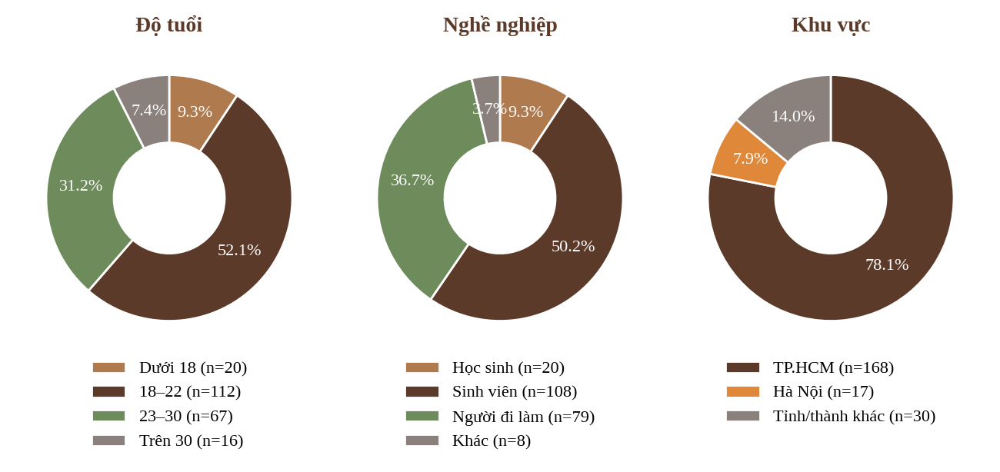

*Hình PL.1. Cơ cấu mẫu khảo sát theo độ tuổi, nghề nghiệp và khu vực (n = 215)*

*Nguồn: Khảo sát của nhóm, tháng 10/2026.*

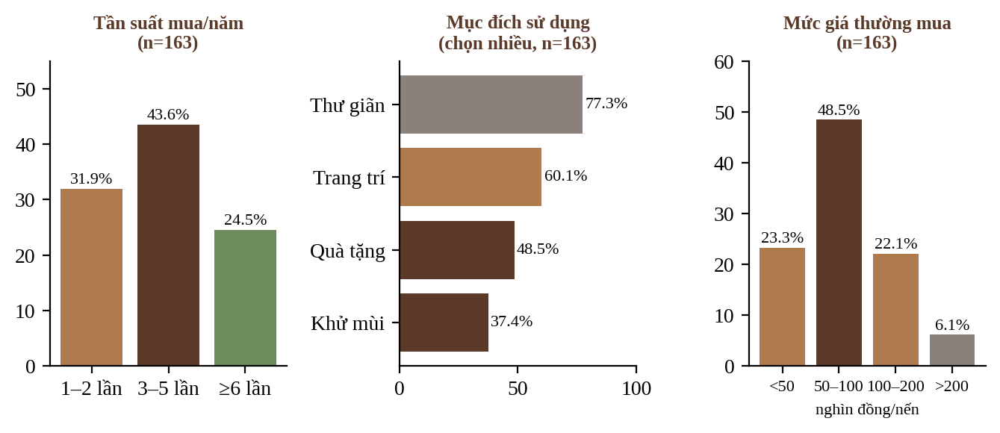

*Hình PL.2. Hành vi sử dụng nến thơm của nhóm đã từng mua (n = 163)*

*Nguồn: Khảo sát của nhóm, tháng 10/2026.*

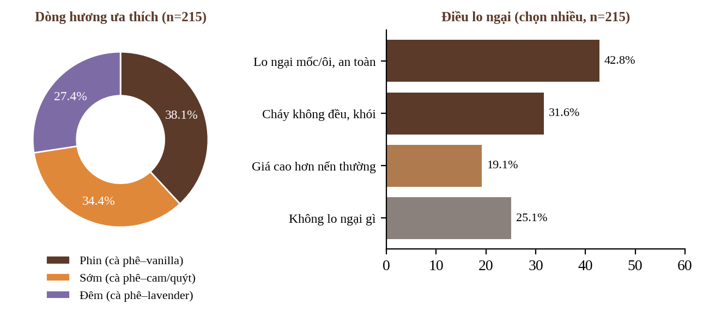

*Hình PL.3. Dòng hương ưa thích và các mối lo ngại khi dùng nến làm từ bã cà phê (n = 215)*

*Nguồn: Khảo sát của nhóm, tháng 10/2026.*

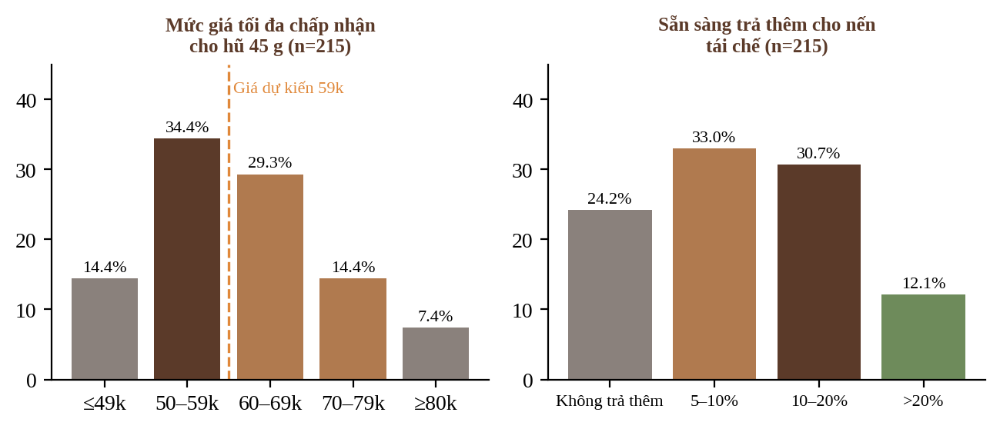

*Hình PL.4. Mức giá chấp nhận và mức sẵn lòng trả thêm cho sản phẩm tái chế (n = 215)*

*Nguồn: Khảo sát của nhóm, tháng 10/2026.*

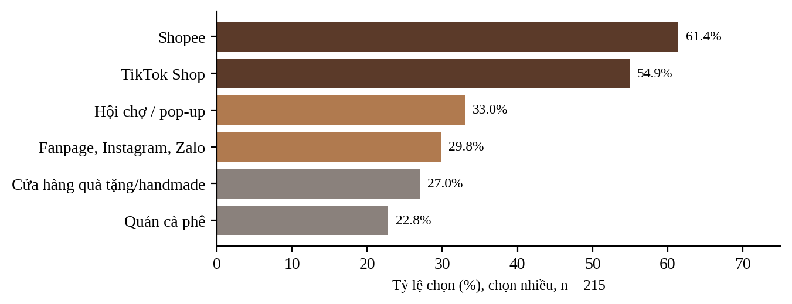

*Hình PL.5. Kênh mua nến thơm ưa thích (chọn nhiều, n = 215)*

*Nguồn: Khảo sát của nhóm, tháng 10/2026.*

## Phụ lục 2. Giá thành dự kiến của phiên bản thương mại

**Bảng PL.2. Giá thành dự kiến của hũ 50 g và cốc 120 g (năm đầu bán, đồng)**

| STT | Nguyên liệu, vật tư | Hũ 50g | Cốc 120g |
| --- | --- | --- | --- |
| 1 | Sáp đậu nành (80% hệ sáp) | 4.400 | 10.600 |
| 2 | Sáp ong nguyên chất (20% hệ sáp) | 2.500 | 6.000 |
| 3 | Hương liệu, tinh dầu (7-10% khối lượng sáp) | 3.000 | 6.500 |
| 4 | Bã cà phê đã sấy | 300 | 700 |
| 5 | Tim cotton đan xoắn, đế kim loại (cốc 120g dùng hai tim) | 1.000 | 2.000 |
| 6 | Vỏ chứa: ly thủy tinh 50g / cốc thạch cao có nắp, phủ chống thấm | 10.000 | 18.000 |
| 7 | Decal nhãn chống thấm dầu | 1.000 | 1.500 |
| 8 | Hộp ngoài: hộp giấy in vùng miền / hộp quà cứng kèm thiệp | 5.000 | 11.500 |
| 9 | Thẻ Scent Map, thẻ QR | 1.000 | 3.000 |
| 10 | Trang trí bề mặt (bột bã, hoa khô, vỏ cam sấy) | 500 | 1.000 |
| 11 | Vật tư phụ và vật tư tiêu hao trực tiếp | 4.300 | 7.200 |
|  | Tổng giá thành | 33.000 | 68.000 |

*Nguồn: Ước tính sơ bộ của nhóm; sẽ cập nhật theo báo giá chính thức của nhà cung cấp trước khi sản xuất đại trà.*

*Ghi chú: với hũ 50 g, khoản hương liệu, tinh dầu 3.000 đồng gồm 1.500 đồng hương liệu tạo mùi (7% khối lượng sáp) và 1.500 đồng tinh dầu định hướng cho công năng xua côn trùng (5% khối lượng sáp) theo bảng định mức ban đầu của nhóm.*

## Phụ lục 3. Quy trình sản xuất, định mức và kiểm soát chất lượng

**Bảng PL.3. Phiếu kiểm tra chất lượng một lô sản xuất**

| STT | Hạng mục kiểm tra | Tiêu chuẩn | Kết quả (Đạt/Không đạt) |
| --- | --- | --- | --- |
| 1 | Độ ẩm bã sau sấy | ≤ 5%, không mùi lạ, không mốc |  |
| 2 | Nhiệt độ nấu sáp và cho hương | 75-80°C; hương ở 62°C |  |
| 3 | Tim nến | Thẳng, đúng tâm |  |
| 4 | Bề mặt và độ tách lớp | Phẳng, không rỗ, không tách lớp |  |
| 5 | Đốt thử mẫu | Cháy đều, không khói đen quan sát được |  |
| 6 | Nhãn, mã lô, cảnh báo | Đầy đủ, đúng quy định |  |

*Nguồn: Nhóm tác giả xây dựng.*

**Bảng PL.4. Định mức thời gian cho một mẻ 20 hũ (năm 1)**

*Nguồn: Nhóm tác giả ước tính từ các mẻ thử nghiệm.*

**Bảng PL.5. Quy trình vận hành tiêu chuẩn (SOP) sản xuất nến thơm Re:Bean (hũ 50 g và cốc 120 g)**

| Công đoạn | Thời gian | Ghi chú |
| --- | --- | --- |
| Chuẩn bị, cân đo nguyên liệu | 30 phút | Cân sáp, hương, bã theo công thức từng dòng hương |
| Nấu sáp, phối trộn bã | 40 phút | Giữ nhiệt độ 75-80°C |
| Đổ lớp 1 và làm nguội | 60 phút | Lớp bã - sáp đáy; cố định tim |
| Đổ lớp 2, 3, 4 và làm nguội | 90 phút | Xen kẽ lớp sáp thơm và lớp bã - sáp; lớp trên cùng sáp nguyên chất |
| Dọn dẹp, vệ sinh dụng cụ | 20 phút | Theo bảng kiểm vệ sinh |
| Tổng thời gian hoạt động | ≈ 3,5 giờ (210-240 phút) | Đóng rắn thêm 24-48 giờ trước khi đóng gói |

*Nguồn: Nhóm tác giả xây dựng.*

## Phụ lục 4. Nội dung chính của thỏa thuận hợp tác thu gom bã với quán đối tác (dự thảo, chưa ký)

- Quán cam kết cung cấp bã cà phê sạch, không lẫn tạp chất, bảo quản trong thùng kín do Re:Bean cung cấp.

- Re:Bean thu gom miễn phí 2-3 lần/tuần, ghi sổ khối lượng; không thu phí quán.

- Quyền lợi của quán: được giới thiệu là đối tác tái chế trên kênh truyền thông của Re:Bean (khi quán đồng ý); nhận sản phẩm ưu đãi theo quý; từ năm 2 có thể bán sản phẩm tại quầy với hoa hồng thỏa thuận.

- Ưu tiên hợp tác: quán dành ưu tiên cung cấp bã cho Re:Bean trong thời gian hiệu lực; hai bên bảo mật thông tin kinh doanh.

- Hiệu lực 12 tháng, mỗi bên có quyền chấm dứt với thông báo trước 15 ngày.

## Phụ lục 5. Công cụ trí tuệ nhân tạo đã sử dụng

**Bảng PL.6. Công cụ trí tuệ nhân tạo sử dụng trong hồ sơ**

| STT | Công cụ | Mục đích sử dụng | Phần nội dung liên quan |
| --- | --- | --- | --- |
| 1 | ChatGPT ***[Cần bổ sung phiên bản]*** | Tạo hình ảnh minh họa | Hình 4.1 (ảnh mô phỏng ba dòng nến) |
| 2 | Claude (Anthropic) ***[Cần bổ sung phiên bản đã dùng ở các bản trước]*** | Hỗ trợ diễn đạt, tổng hợp cấu trúc, dựng bảng biểu, sơ đồ và mô hình tính toán; rà soát nội dung còn thiếu theo tài liệu tập huấn và dựng các bảng, biểu đồ bổ sung của bản bán kết | Toàn bộ thuyết minh; số liệu do nhóm cung cấp và rà soát |
| 3 | Claude Opus 5.5 (Anthropic) | Rà soát, biên tập bản bán kết theo tiêu chí chấm; tính lại các bảng tài chính từ giả định của nhóm; vẽ lại một số biểu đồ, sơ đồ | Toàn bộ thuyết minh; số liệu gốc do nhóm cung cấp và kiểm chứng |

*Nguồn: Nhóm tác giả kê khai; nhóm chịu trách nhiệm kiểm chứng nội dung.*

## Phụ lục 6. Đối sánh chi tiết các thương hiệu nến thơm hiện hành

**Bảng PL.7. Đối sánh Re:Bean với các thương hiệu nến thơm hiện hành**

| Thương hiệu | Phân khúc và giá | Điểm mạnh (cần kế thừa) | Điểm yếu (cần cải tiến) |
| --- | --- | --- | --- |
| UpCircle Beauty (Anh) | Cao cấp; hũ 180 ml (≈ 322 g), 19,79-22,65 bảng Anh (≈ 650.000-750.000 đồng) | Hiệu ứng bọt cappuccino độc đáo; chứng nhận Vegan, Leaping Bunny, Plastic Negative, COSMOS Approved; cháy 20-35 giờ | Bã lắng đáy, phải chừa ≥ 1 cm sáp không đốt, nguy cơ bã cháy làm nứt hũ; mùi cà phê lấn vani (khoảng 3,0/5 trên BeautyBay, Kudzu); bao bì đơn điệu |
| Incapto Coffee (Tây Ban Nha) | Tầm trung; 120 ml: 9,95 euro (≈ 275.000 đồng); 250 ml: 14,95 euro (≈ 410.000 đồng) | Giá dễ tiếp cận hơn UpCircle; chuỗi cung ứng bã khép kín trong hệ sinh thái tuần hoàn; cháy 22-45 giờ; chất lượng 4,3/5 | Chỉ có hương Espresso, thiếu hương chức năng (xua côn trùng, thanh lọc không khí); giá trị trên giá tiền 3,7/5 |
| Herbzen (New Zealand), 2nd Shine | Thủ công sinh thái, quy mô nhỏ | Nền sáp đậu nành + sáp ong tăng độ cứng, điểm chảy, giữ bã lơ lửng tốt; bã rang sấy khô và tinh dầu cà phê nguyên chất | Sản xuất nhỏ lẻ, tính địa phương; chưa phân nhánh dòng hương theo công năng |
| Heny Garden (TP.HCM) | Tầm trung - cao cấp; size M 200 g: 289.000-379.000 đồng; set quà 199.000-879.000 đồng | Phối hương đa tầng bài bản (Peppermint Moca: cà phê - vani - bạc hà); tinh dầu cà phê chiết CO₂, khuyến nghị 5-10% trong sáp; công thức đuổi muỗi sả chanh + sả Java | Dùng tinh dầu chiết từ hạt, chưa tận dụng bã cà phê tái chế vào thân nến |
| First Sight Present (TP.HCM) | Tầm trung - quà tặng; hũ 220-250g: 239.000-359.000 đồng | Sáp dừa cho bề mặt mịn, tỏa hương tốt; thiết kế sáng tạo: nến hình ly cà phê, Message Candle, nến hai tầng | Thiên về trang trí, quà tặng; không giải bài toán bã cà phê; chưa có cơ chế hấp phụ mùi hay xua muỗi |
| Re:Bean (mẫu thử 45 g) và các dự án khởi nghiệp Việt Nam (B.E.A, City Glow, Mộc) | Phổ thông - sinh viên; phiên bản thương mại Re:Bean: hũ 50 g giá 59.000 đồng, giá thành dự kiến 33.000 đồng | Chi phí bã rất thấp (≈ 300 đồng/hũ); đổ phân tầng xen kẽ lớp bã sấy khô và sáp; ba hương rõ ràng Sớm - Đêm - Phin | Mẫu 45 g còn nhỏ cho phòng lớn; mới dừng ở phối trộn cơ học, chưa có hoạt chất chức năng được kiểm chứng; chưa đạt chuẩn khứu giác cao cấp |

*Nguồn: Nhóm tổng hợp từ website, gian hàng chính thức và trang đánh giá của các thương hiệu, tháng 10/2026; giá quy đổi mang tính tham khảo.*

## Phụ lục 7. Cấu tạo lõi nến của phiên bản thương mại

**Bảng PL.8. Cấu tạo lõi nến của phiên bản thương mại (thiết kế, chưa sản xuất thử)**

| Hạng mục | Thông số và mục đích |
| --- | --- |
| Hệ sáp | 80% sáp đậu nành thiên nhiên + 20% sáp ong nguyên chất: tăng độ cứng, nâng điểm chảy, giữ hạt bã lơ lửng và kéo dài thời gian sử dụng |
| Tỷ lệ hương | 7-10% khối lượng sáp: mức 7% đã đạt lan hương tốt, không gắt ở đợt thử 3; mức 8,5-10% được thử cho dòng Sớm, không vượt ngưỡng gây tách sáp |
| Tim và đế tim | Bấc sợi cotton 100% không chì, đan xoắn kép giảm khói đen; đế kim loại cố định ở tâm đáy bằng keo chịu nhiệt; chân đế cao 3-5 mm để tự tắt khi sáp cạn, tránh sốc nhiệt làm vỡ đáy ly |
| Phân tầng bã cà phê | Tầng đáy là sáp nền tinh khiết giữ vững đế tim; thân ly đổ xen kẽ sáp thơm và tầng hạt bã mịn đã sấy, tạo vân “địa chất” tự nhiên; lớp trên cùng là sáp thơm nguyên chất dày ≥ 8 mm |
| Trang trí bề mặt | Phin: mặt sáp trắng ngà, viền rắc nhẹ bột bã mịn; Đêm: tím pastel, điểm cánh oải hương khô; Sớm: cam vàng ấm, lát cam sấy, vỏ cam mỏng đặt xa vùng tim |
| Khoảng đệm an toàn | Mặt sáp cách miệng ly 1,2-1,5 cm để chứa sáp tan chảy, chống tràn khi di chuyển |

*Nguồn: Nhóm tác giả thiết kế.*

## Phụ lục 8. Đánh giá các phương án huy động vốn

**Bảng PL.9. Đánh giá các phương án huy động vốn theo giai đoạn**

| Nguồn vốn | Ưu điểm | Nhược điểm | Áp dụng cho Re:Bean |
| --- | --- | --- | --- |
| Vốn tự có, gia đình và bạn bè | Thỏa thuận đơn giản, linh hoạt, giữ quyền kiểm soát | Quy mô nhỏ, áp lực về quan hệ | Năm 1: 28 triệu đồng |
| Mentor, giải thưởng, chương trình hỗ trợ của nhà nước và nhà trường | Không phải hoàn trả, có cố vấn, tăng uy tín | Cạnh tranh, tốn thời gian, có điều kiện sử dụng | Năm 1-2: 5 triệu đồng từ mentor; giải thưởng cuộc thi, ươm tạo (nếu có) |
| Nhà đầu tư thiên thần | Quyết định nhanh, kèm cố vấn và mạng lưới quan hệ | Chia sẻ lợi nhuận, kỳ vọng tăng trưởng cao | Đầu năm 2: ≈ 60 triệu đồng, 10-12% cổ phần công ty cổ phần |
| Ngân hàng, vay ưu đãi | Không mất cổ phần, điều khoản rõ ràng | Cần thế chấp, bảo lãnh; áp lực lãi vay | Cân nhắc từ năm 3 khi đã có báo cáo tài chính |
| Gọi vốn cộng đồng | Kiểm chứng thị trường, tiếp cận nhiều người ủng hộ | Phải giao quà, sản phẩm đúng hạn; cạnh tranh | Chưa áp dụng (không bán đặt trước) |
| Quỹ đầu tư mạo hiểm | Vốn lớn, mạng lưới rộng | Mức kiểm soát cao, yêu cầu tăng trưởng rất nhanh | Chưa phù hợp với quy mô hiện tại |

*Nguồn: Nhóm tác giả đánh giá.*

## Phụ lục 9. Nguồn nghiên cứu, phát hiện chính và hàm ý marketing

**Bảng PL.10. Nguồn nghiên cứu, phát hiện chính và hàm ý marketing**

| Nguồn nghiên cứu | Phát hiện chính | Hàm ý marketing |
| --- | --- | --- |
| Khảo sát 215 khách hàng (định lượng) | 87% chưa biết nến bã cà phê; kênh ưa thích là Shopee (61,4%), TikTok Shop (54,9%); lo ngại an toàn 42,8% | Ưu tiên ngân sách cho nhận biết; nội dung minh bạch quy trình; năm 1 chốt đơn qua TikTok Shop và mạng xã hội |
| Dùng thử với 30 người (thang 1-5) | Thẩm mỹ lớp bã 4,6; bao bì 4,4; cảm nhận khử mùi 3,8; 83,3% sẵn sàng giới thiệu | Lấy hình ảnh lớp bã làm hình ảnh chủ đạo; chưa dùng khử mùi làm thông điệp chính; khai thác giới thiệu bạn bè |
| Khảo sát nhanh 15 quán cà phê | 11/15 quán đồng ý về nguyên tắc cho thu gom; muốn được ghi nhận và có sản phẩm bán tại quầy | Thông điệp “Lô của quán…”; đồng thương hiệu với quán; quán là điểm chạm trực tiếp từ năm 2 |
| Đối sánh thương hiệu, ma trận CPM | Re:Bean yếu nhất ở nhận biết thương hiệu (1/4) và độ phủ kênh (2/4) | Tập trung ngân sách vào KOC, quảng cáo theo mùa; mở rộng kênh có kiểm soát |
| Dữ liệu thứ cấp Metric (2025) | Giá bình quân ≈ 79.000 đồng/sản phẩm; nhu cầu tăng mạnh cuối năm | Giữ giá 59.000 đồng; chuẩn bị tồn kho và chiến dịch quà tặng quý IV |
| Lắng nghe mạng xã hội (hằng tháng) | Từ khóa “nến thơm”, “quà tặng xanh”; bình luận trên gian hàng đối thủ | Điều chỉnh nội dung, phát hiện sớm xu hướng hương mới và phản hồi tiêu cực |

*Nguồn: Nhóm tác giả tổng hợp.*

## Phụ lục 10. Phân tích bổ sung về thị trường và môi trường kinh doanh

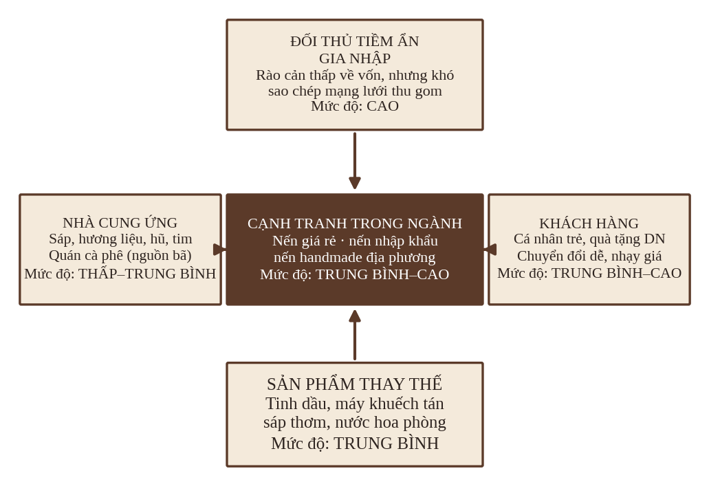

*Hình PL.6. Mô hình năm lực lượng cạnh tranh của ngành nến thơm đối với Re:Bean*

*Nguồn: Nhóm tác giả phân tích theo Porter [8].*

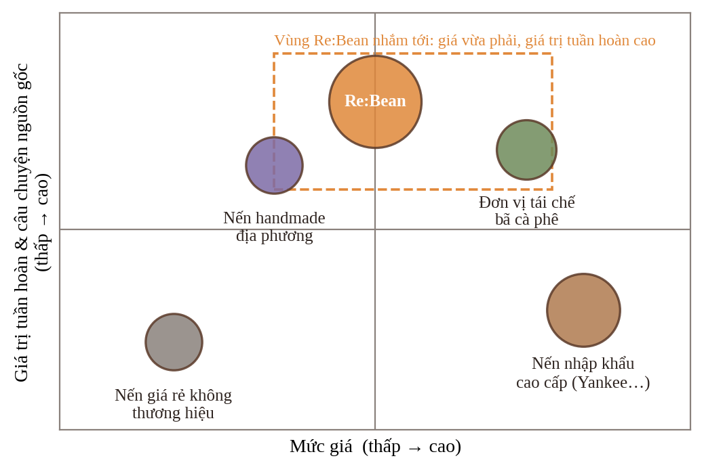

*Hình PL.7. Bản đồ định vị của Re:Bean so với các nhóm đối thủ*

*Nguồn: Nhóm tác giả đánh giá.*

**Bảng PL.11. Ma trận hình ảnh cạnh tranh (CPM) của Re:Bean**

| **Yếu tố thành công** | **Trọng số** | **Re:Bean** | **Heny Garden** | **AGAYA** | **Nến giá rẻ** | **UpCircle** |
| --- | --- | --- | --- | --- | --- | --- |
| Chất lượng và độ lan hương | 0,20 | 3 | 4 | 3 | 1 | 3 |
| Giá phù hợp khách hàng mục tiêu | 0,15 | 4 | 2 | 3 | 4 | 1 |
| Câu chuyện bền vững, tái chế | 0,15 | 4 | 2 | 2 | 1 | 4 |
| Thiết kế, bao bì, quà tặng | 0,15 | 3 | 4 | 3 | 2 | 2 |
| Công năng theo không gian sử dụng | 0,10 | 4 | 3 | 2 | 1 | 1 |
| Mức độ nhận biết thương hiệu | 0,15 | 1 | 3 | 3 | 2 | 3 |
| Kênh phân phối, tiện lợi khi mua | 0,10 | 2 | 3 | 4 | 4 | 1 |
| **Tổng điểm có trọng số** | **1,00** | **3,00** | **3,05** | **2,85** | **2,05** | **2,30** |

*Nguồn: Nhóm tác giả đánh giá, mang tính tham khảo.*

**Bảng PL.12. Khách hàng mục tiêu theo từng giai đoạn tăng trưởng**

| **Giai đoạn** | **Khách hàng trọng tâm** | **Đặc điểm và nhu cầu** | **Lý do lựa chọn** |
| --- | --- | --- | --- |
| Năm 1 - B2C | Nhóm 1 (người trẻ yêu lối sống xanh) và nhóm 2 (người mua quà tặng) tại TP.HCM | Mua online, đơn nhỏ 1-3 hũ, nhạy với nội dung video và đánh giá; chi 50.000-200.000 đồng/lần | Chi phí tiếp cận thấp qua mạng xã hội; phù hợp năng lực sản xuất tại nhà; kiểm chứng nhu cầu và hoàn thiện sản phẩm |
| Năm 2 - B2C + B2B nhỏ | Thêm quán cà phê đối tác, cửa hàng quà tặng, handmade, homestay | Đặt 30-100 sản phẩm/đơn, cần tem riêng, giao đúng hạn, giá sỉ ổn định | Đã có đánh giá thực tế và lô sản xuất đồng nhất; đơn sỉ giúp ổn định sản lượng và dòng tiền (thanh toán trước 50%) |
| Năm 3 - B2B mở rộng | Doanh nghiệp đặt quà tặng, sự kiện, khách sạn; đối tác phân phối tại Hà Nội | Cần hóa đơn GTGT, bộ quà in tên, cốc 120 g sang trọng, gắn thông điệp ESG | Công ty cổ phần đủ điều kiện xuất hóa đơn; xưởng 60 m² đáp ứng khoảng 3.500 sản phẩm/tháng |

*Nguồn: Nhóm tác giả đề xuất.*

**Bảng PL.13. Đánh giá nguồn lực theo khung VRIO**

| **Nguồn lực** | **Giá trị** | **Hiếm** | **Khó bắt chước** | **Tổ chức** | **Kết luận** |
| --- | --- | --- | --- | --- | --- |
| Mạng lưới quán đối tác thu gom bã | Có | Một phần | Có | Có | Lợi thế cạnh tranh tạm thời đến bền vững nếu ký được thỏa thuận ưu tiên |
| Công thức, quy trình xử lý bã và cấu trúc lớp | Có | Một phần | Một phần | Có | Lợi thế tạm thời; cần ghi chép SOP và bảo mật bí quyết |
| Thương hiệu và câu chuyện “tái sinh” | Có | Có | Có | Có | Lợi thế bền vững nếu nhất quán và minh bạch |
| Năng lực kênh số và dữ liệu của đội | Có | Không | Một phần | Có | Ngang bằng cạnh tranh, tạo hiệu quả vận hành |
| Vốn đầu tư thấp, sản xuất lô nhỏ | Có | Không | Không | Có | Lợi thế linh hoạt, dễ bị sao chép |

*Nguồn: Nhóm tác giả đánh giá.*

**Bảng PL.14. Ma trận TOWS: các chiến lược kết hợp**

| **Nhóm** | **Chiến lược** | **Hành động cụ thể** |
| --- | --- | --- |
| SO | Dùng điểm mạnh để nắm bắt cơ hội | Đẩy mạnh nội dung “bã cà phê tái sinh” trên TikTok/Facebook (S2, O2); từ năm 2, ký hợp đồng quà tặng với quán và homestay (S1, O4) |
| WO | Khắc phục điểm yếu bằng cơ hội | Tham gia cuộc thi, chương trình hỗ trợ khởi nghiệp xanh để có vốn và mentor (W1, W4, O3); dùng nền tảng thương mại điện tử để thử thị trường nhanh (W1, O1) |
| ST | Dùng điểm mạnh để giảm đe dọa | Cạnh tranh bằng minh bạch (mã lô, ảnh quy trình) thay vì giá (S2, T1, T3); đăng ký nhãn hiệu, ký thỏa thuận ưu tiên với quán (S1, T4) |
| WT | Giảm thiểu điểm yếu và né đe dọa | Chuẩn hóa SOP, kiểm soát lô nghiêm ngặt (W2, T3); giữ quỹ dự phòng và đa dạng nhà cung cấp (W4, T2) |

*Nguồn: Nhóm tác giả đề xuất.*

**Bảng PL.15. Chính sách hỗ trợ, quy định liên quan và tác động đến Re:Bean**

| **Văn bản, chính sách** | **Nội dung chính** | **Tác động đến dự án** |
| --- | --- | --- |
| Luật Bảo vệ môi trường 2020; Quyết định 687/QĐ-TTg [10], [11] | Khuyến khích giảm, tái sử dụng, tái chế chất thải; phát triển mô hình kinh tế tuần hoàn | (+) Dự án đúng định hướng; lợi thế khi tham gia chương trình hỗ trợ, quỹ và cuộc thi về kinh tế xanh |
| Nghị quyết 198/2025/QH15; Nghị định 20/2026/NĐ-CP [23] | Miễn thuế TNDN 3 năm cho doanh nghiệp nhỏ và vừa thành lập mới, tính từ khi được cấp GCN ĐKDN lần đầu; chấm dứt thu lệ phí môn bài từ 01/01/2026 | (+) Công ty cổ phần thành lập đầu năm 2 có thể được miễn thuế TNDN giai đoạn 2028-2030 nếu đáp ứng điều kiện (cần xác minh với cơ quan thuế) |
| Luật Thuế TNCN 2025; Nghị định 68/2026/NĐ-CP [24] | Hộ, cá nhân kinh doanh có doanh thu năm từ 500 triệu đồng trở xuống không phải nộp thuế GTGT, TNCN | (+) Doanh thu năm 1 dự kiến 214,6 triệu đồng, dưới ngưỡng; nhóm vẫn ghi sổ doanh thu đầy đủ để chứng minh với nhà đầu tư |
| Luật Hỗ trợ DNNVV 2017; Quyết định 336/QĐ-TTg (2026) [26], [27] | Hỗ trợ tư vấn, đào tạo, ươm tạo, kết nối đầu tư cho doanh nghiệp khởi nghiệp sáng tạo; chương trình hỗ trợ học sinh, sinh viên khởi nghiệp giai đoạn 2026-2035 | (+) Tiếp cận ươm tạo, mentor, vốn mồi qua nhà trường và cuộc thi; giảm chi phí tư vấn pháp lý, tài chính |
| Luật Thương mại điện tử 2025 (hiệu lực 01/07/2026); Nghị định 248/2026/NĐ-CP [25] | Người bán trên sàn, mạng xã hội có chức năng giao dịch, livestream phải xác thực danh tính, công khai thông tin người bán và hàng hóa; KOC, KOL không được phóng đại công dụng | (Tuân thủ) Xác thực tài khoản bán hàng; bộ thông tin sản phẩm chuẩn; quy tắc nội dung cho KOC |
| Nghị định 91/2016/NĐ-CP [22] | Sản phẩm có tác dụng xua, diệt côn trùng dùng trong gia dụng được quản lý như chế phẩm và phải có số đăng ký lưu hành | (Tuân thủ) Dòng Sớm chỉ được quảng bá là hương cam chanh - sả; chỉ công bố công dụng xua côn trùng sau khi kiểm nghiệm và đăng ký lưu hành |
| Nghị định 43/2017/NĐ-CP (sửa đổi); Luật BVQLNTD 2023; Luật BVDLCN 2025 [15], [16], [18] | Ghi nhãn đầy đủ, thông tin trung thực, bảo vệ dữ liệu cá nhân khách hàng | (Tuân thủ) Nhãn và hộp có cảnh báo an toàn; chính sách đổi trả công khai; xin đồng ý khi thu thập dữ liệu tích điểm |

*Nguồn: Nhóm tác giả tổng hợp từ các văn bản trích dẫn.*

## Phụ lục 11. Lộ trình phát triển, nỗi đau khách hàng, vòng đời sản phẩm và ma trận BCG

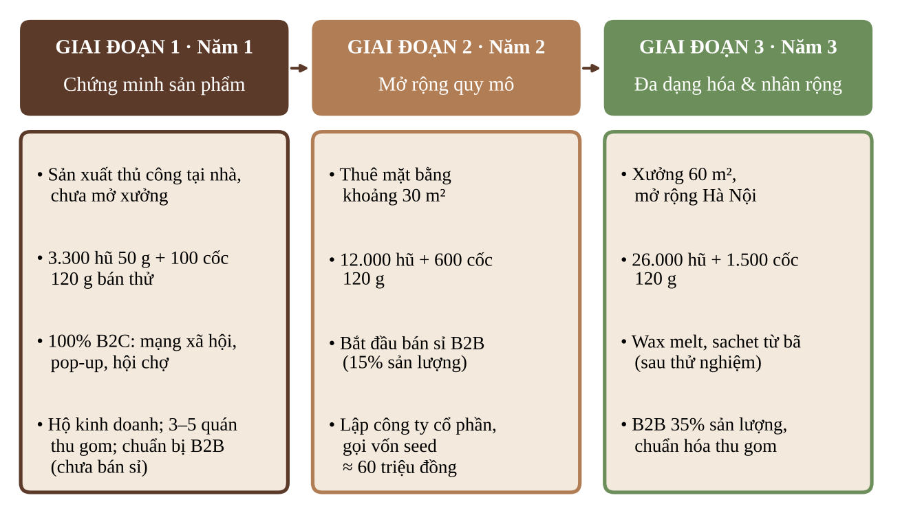

*Hình PL.8. Lộ trình phát triển ba giai đoạn của Re:Bean*

*Nguồn: Nhóm tác giả đề xuất.*

Mỗi dòng sản phẩm của Re:Bean được đặt vào một vị trí cụ thể trên chu kỳ sống của sản phẩm và ma trận BCG nhằm định hình chiến lược phân bổ nguồn lực và quyết định hành động phù hợp cho từng giai đoạn phát triển. Việc kết hợp hai công cụ quản trị này giúp dự án chủ động kiểm soát danh mục sản phẩm, tối ưu hóa chi phí tiếp thị và duy trì dòng tiền tăng trưởng bền vững qua các năm.

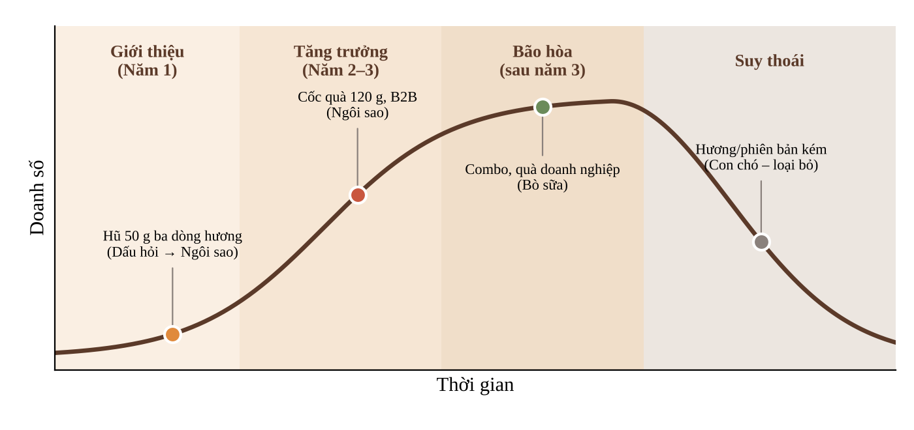

*Hình PL.9. Vòng đời sản phẩm và vị trí các dòng sản phẩm Re:Bean theo ma trận BCG*

*Nguồn: Nhóm tác giả đề xuất.*

**Bảng PL.16. Nỗi đau của khách hàng mục tiêu và giải pháp của Re:Bean**

| **Nhóm khách hàng** | **Nỗi đau** | **Bằng chứng** | **Giải pháp của Re:Bean** |
| --- | --- | --- | --- |
| Người trẻ (B2C) | Sợ nến rẻ có mùi hắc, khói, không rõ nguồn gốc; muốn sống xanh nhưng ngại sản phẩm xanh đắt | Lo ngại mốc, an toàn 42,8%; cháy không đều, có khói 31,6%; giá cao 19,1% | Sáp đậu nành - sáp ong, tim cotton không chì, đốt thử từng lô, mã lô; giá 59.000 đồng thấp hơn bình quân thị trường |
| Người mua quà tặng | Khó tìm quà nhỏ xinh, có ý nghĩa, đóng gói đẹp | 48,5% mua nến để tặng; chi 100.000-200.000 đồng/hộp quà | Hộp vùng miền, cốc 120 g giá 199.000 đồng, thiệp, thẻ Scent Map |
| Cư dân căn hộ | Phòng kín dễ ám mùi; mùa mưa côn trùng bay vào nhà | 37,4% người dùng nến với mục đích khử mùi | Dòng Đêm, Sớm với hương phù hợp phòng kín; công năng giảm mùi, xua côn trùng đang kiểm nghiệm, chưa quảng bá |
| **Quán cà phê (nguồn cung; B2B từ năm 2)** | Bã ẩm, nhanh có mùi, tốn công xử lý; muốn được ghi nhận | 11/15 quán bỏ bã chung rác sinh hoạt | Thu gom miễn phí 2-3 lần/tuần bằng thùng kín; được giới thiệu là đối tác tái chế; từ năm 2 có thể bán sản phẩm tại quầy |
| Doanh nghiệp (B2B, năm 2-3) | Cần quà tặng xanh gắn ESG, in logo, có hóa đơn | Nhu cầu quà tặng xanh của quán, homestay, doanh nghiệp | Bộ quà in tên, đơn từ 30-50 sản phẩm, xuất hóa đơn khi thành lập công ty cổ phần |

*Nguồn: Khảo sát của nhóm; nhóm tác giả đề xuất.*

**Bảng PL.17. Định hướng hành động theo từng giai đoạn của vòng đời sản phẩm**

| **Giai đoạn** | **Đặc điểm** | **Mục tiêu** | **Định hướng hành động** |
| --- | --- | --- | --- |
| Giới thiệu (năm 1) | Doanh số thấp, chi phí truyền thông cao; chỉ 13% khách biết đến nến bã cà phê | Tạo nhận biết, thúc đẩy dùng thử | Ba dòng cốt lõi; giá 59.000 đồng theo giá trị, không giảm sâu; bán trực tiếp qua mạng xã hội; nội dung “Từ bã đến nến”, mẫu mini, KOC |
| Tăng trưởng (năm 2-3) | Doanh số tăng nhanh, đối thủ bắt đầu sao chép | Tăng thị phần, giữ chân khách hàng | Ra mắt cốc 120 g, phiên bản theo mùa; thêm B2B, Shopee, Hà Nội; chiết khấu theo bậc cho B2B; quảng cáo theo mùa, CRM, “Hũ tái sinh” |
| Bão hòa (sau năm 3) | Tăng trưởng chậm, cạnh tranh giá | Bảo vệ lợi nhuận, giữ khác biệt | Làm mới hương theo mùa, dịch vụ đặt riêng, hợp đồng B2B theo năm, tối ưu chi phí; phát triển dịch vụ “Bean Back” cho quán |
| Suy thoái | Doanh số giảm do thị hiếu thay đổi | Thu hoạch, chuyển nguồn lực | Loại bỏ mã có doanh số dưới 5% danh mục trong hai quý liên tiếp; chuyển nguồn bã sang wax melt, sachet; giảm tồn kho |

*Nguồn: Nhóm tác giả đề xuất.*

## Phụ lục 12. Cơ cấu nhân sự, mô tả công việc, khoảng trống năng lực và ma trận RACI

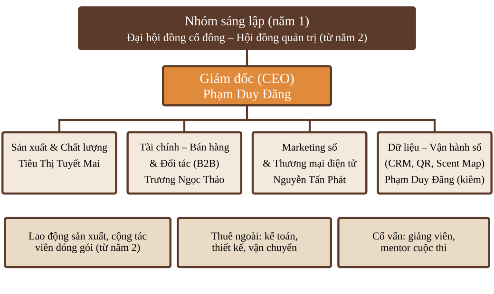

*Hình PL.10. Cơ cấu nhân sự và phân công vai trò trong dự án*

*Nguồn: Nhóm tác giả xây dựng.*

**Bảng PL.18. Mô tả công việc và yêu cầu năng lực theo vị trí**

| Vị trí | Mô tả công việc chính | Yêu cầu năng lực |
| --- | --- | --- |
| Giám đốc | Xây dựng kế hoạch năm, điều phối nguồn lực, quan hệ đối tác và nhà đầu tư, giám sát chỉ tiêu | Tư duy quản trị, kỹ năng giao tiếp, hiểu dữ liệu bán hàng |
| Phụ trách sản xuất - chất lượng | Chuẩn hóa SOP, quản lý lô, kiểm tra chất lượng, an toàn nhiệt, mua vật tư | Cẩn thận, hiểu quy trình, kỷ luật an toàn |
| Phụ trách tài chính - bán hàng | Lập ngân sách, theo dõi thu chi, đàm phán đối tác thu gom và B2B ( từ năm 2 ) | Kiến thức kế toán cơ bản, kỹ năng thương lượng |
| Phụ trách marketing số | Sản xuất nội dung, quảng cáo, quản lý gian hàng, chăm sóc khách | Kỹ năng nội dung, phân tích số liệu, sáng tạo |
| Lao động sản xuất (từ năm 2) | Sấy, sàng bã; nấu và đổ nến; đóng gói theo SOP | Đào tạo 2 tuần; tuân thủ an toàn; chịu khó, tỉ mỉ |

*Nguồn: Nhóm tác giả xây dựng.*

**Bảng PL.19. Khoảng trống năng lực và chiến lược bổ sung nhân sự (Build - Buy - Borrow)**

| Nhóm hoạt động | Phụ trách | Yêu cầu | Hiện tại | Thiếu | Cách bổ sung |
| --- | --- | --- | --- | --- | --- |
| Phát triển sản phẩm: R&D hương, hệ sáp, kiểm soát chất lượng | Mai | 5 | 3 | 2 | Build: Học kỹ thuật nến cùng người hướng dẫn, thử nghiệm có ghi chép theo đợt |
| Marketing: Nội dung số, quảng cáo, KOC | Phát | 4 | 3 | 1 | Build + Borrow: Thiết kế bao bì thuê freelancer, KOC theo chiến dịch |
| Bán hàng: Bán qua mạng xã hội, chăm sóc khách, B2B | Thảo | 5 | 3 | 2 | Build ở năm 1; Buy ở năm 3: nhân viên bán hàng bán thời gian |
| Vận hành: mua hàng, tồn kho, sản xuất, giao hàng | Đăng | 4 | 2 | 2 | Buy từ năm 2: Lao động sản xuất toàn thời gian; cộng tác viên đóng gói mùa vụ |
| Tài chính: ngân sách, dòng tiền, thuế | Thảo | 4 | 2 | 2 | Borrow: kế toán dịch vụ từ năm 2; mentor tài chính của cuộc thi |

*Ghi chú: khoảng thiếu = mức yêu cầu - năng lực hiện tại (tự đánh giá thang 1-5, rà soát mỗi quý). Nguồn: Nhóm tác giả đánh giá.*

**Bảng PL.20. Ma trận RACI của nhóm Re:Bean**

| Hoạt động | Đăng (CEO) | Mai (Sản xuất) | Phát (Marketing) | Thảo (Tài chính - Bán hàng) |
| --- | --- | --- | --- | --- |
| Phát triển sản phẩm, R&D hương | A | R | C | I |
| Sản xuất, kiểm soát lô | A | R | I | C |
| Chiến dịch marketing, nội dung | A | C | R | I |
| Bán hàng mạng xã hội, chăm sóc khách | A | I | R | C |
| Phát triển quán đối tác, kênh B2B | A | C | I | R |
| Hệ thống dữ liệu, mã lô, trang Scent Map - QR | A, R | I | C | I |
| Phê duyệt ngân sách | A | I | C | R |
| Báo cáo kinh doanh định kỳ | A | C | C | R |

*Ghi chú: R - thực hiện; A - chịu trách nhiệm cuối cùng; C - được tham vấn; I - được thông báo. Nguồn: Nhóm tác giả phân công.*

## Phụ lục 13. Kế hoạch marketing chi tiết

**Bảng PL.21. Lộ trình cải tiến và giá trị sản phẩm trong ba năm**

| Năm | Cải tiến sản phẩm | Giá trị gia tăng cho khách hàng |
| --- | --- | --- |
| Năm 1 | Hũ 50g hệ sáp đậu nành - sáp ong; ba dòng hương vùng miền; thẻ Scent Map, QR cơ bản | Cháy sạch, an toàn hơn; chọn hương theo không gian; trải nghiệm mở hộp |
| Năm 2 | Cốc quà tặng 120g có nắp; có phiên bản theo mùa; QR nâng cao, playlist; chương trình “Hũ tái sinh” | Quà tặng cao cấp; lý do mua lại theo mùa; được tham gia vòng tuần hoàn |
| Năm 3 | Wax melt, sachet khử mùi từ bã; bộ quà doanh nghiệp in tên; công bố công năng nếu đã kiểm chứng và đăng ký | Dùng không cần lửa; quà gắn ESG cho doanh nghiệp; công năng rõ ràng |

*Nguồn: Nhóm tác giả đề xuất.*

**Bảng PL.22. Thang giá và chính sách ưu đãi**

| Sản phẩm / chính sách | Giá (đồng) | Nội dung và mục tiêu |
| --- | --- | --- |
| Hũ lẻ 50g (ba dòng hương) | 59.000 | Giá niêm yết cho khách cá nhân; thấp hơn giá bình quân thị trường (≈ 79.000 đồng) |
| Cốc quà tặng 120g | 199.000 | Phiên bản quà tặng, không gian lớn; từ năm 2, B2B 169.000 đồng/cốc khi đặt từ 30 cốc |
| Mẫu mini dùng thử | Tặng/giá ưu đãi | Dành cho 100-150 khách đầu tiên và sự kiện; thu thập phản hồi |
| Tích điểm, voucher | 5% giá trị đơn | Khuyến khích mua lại; voucher 5.000 đồng khi trả hũ rỗng (từ năm 2) |

*Nguồn: Nhóm tác giả đề xuất.*

**Bảng PL.23. Năm công cụ truyền thông marketing tích hợp của Re:Bean (năm 1)**

| Công cụ | Hoạt động cụ thể | Giai đoạn hành trình | Ngân sách năm 1 |
| --- | --- | --- | --- |
| Quảng cáo | TikTok, Meta Ads theo mùa; quảng cáo nhắm lại người đã xem video | Nhận biết, cân nhắc | 10,2 triệu đồng |
| Quan hệ công chúng (PR) | Câu chuyện quán đối tác, báo chí sinh viên, cuộc thi khởi nghiệp, chiến dịch Ngày Trái Đất | Nhận biết | Lồng ghép vào nội dung, sự kiện |
| Khuyến mãi | Mẫu mini, combo, voucher mua lần hai, voucher “Hũ tái sinh” (từ năm 2) | Cân nhắc, mua hàng, quay lại | Tính trong ngân sách sự kiện và chính sách giá |
| Bán hàng cá nhân | Tư vấn tại pop-up, hội chợ, trường học; chào hàng B2B từ năm 2 | Cân nhắc, mua hàng | 6,2 triệu đồng |
| Marketing trực tiếp và kỹ thuật số | Nội dung TikTok, Facebook, Instagram; KOC; livestream; Zalo OA và tin nhắn chăm sóc sau mua | Toàn bộ hành trình | 14,4 triệu đồng (nội dung) + 10,2 triệu đồng (KOC) |

*Nguồn: Nhóm tác giả đề xuất.*

**Bảng PL.24. Lịch chiến dịch marketing theo mùa**

| Quý | Dịp trọng tâm | Sản phẩm, thông điệp | Hoạt động chính |
| --- | --- | --- | --- |
| I | Tết, Valentine, 8/3 | Hộp quà 2 hũ, combo Tam hương; “Khởi đầu mới, hương thơm mới” | Mở bán sớm trước dịp lễ, quà tặng cho người thân, truyền thông cùng quán đối tác |
| II | Ra mắt chính thức, 1/6 | Mẫu mini dùng thử; dòng Sớm cho mùa hè | Video quy trình, KOC sinh viên, pop-up tại trường |
| III | Khai giảng, Trung thu | Quà tặng thầy cô, bạn bè; dòng Phin | Hội chợ sinh viên; từ năm 2: đối tác sỉ, quà tặng doanh nghiệp nhỏ |
| IV | 20/10, 20/11, 11.11, 12.12, Giáng sinh | Hộp quà, combo; dòng Đêm cho mùa lạnh | Chiến dịch quà cuối năm, livestream, tăng tồn kho từ tháng 9-10 |

*Nguồn: Nhóm tác giả đề xuất.*

Ngoài các dịp lễ, nhóm xây dựng bốn chiến dịch gắn với bản sắc tuần hoàn của thương hiệu: (1) Ngày Trái Đất 22/4 - livestream quy trình tái sinh bã và chương trình “Đổi hũ cũ, nhận voucher” (từ năm 2); (2) Ngày Môi trường Thế giới 5/6 - ra mắt lô “Lô của quán…” mới cùng quán đối tác; (3) Ngày Cà phê Quốc tế 1/10 - gian pop-up do nhóm tự đứng bán tại quán đối tác, tặng nến mini cho khách mang cốc cá nhân; (4) 11.11 và 12.12 - chương trình combo trên TikTok Shop, Shopee, không giảm giá hũ lẻ. Mỗi chiến dịch có sản phẩm chủ lực, thông điệp, kênh và KPI riêng, tồn kho được chuẩn bị trước ít nhất 4 tuần.

**Bảng PL.25. Ngưỡng cảnh báo và phương án điều chỉnh marketing**

| Chỉ số | Ngưỡng cảnh báo | Phương án điều chỉnh (Plan B) |
| --- | --- | --- |
| Tỷ lệ chuyển đổi đơn hàng | < 1,5% trong 2 tháng liên tiếp | Đổi nội dung và ưu đãi đầu phễu; thử nghiệm A/B ảnh sản phẩm, giá combo; tăng dùng thử |
| Chi phí thu hút khách (CAC) | > 27.000 đồng/khách | Cắt nhóm quảng cáo kém hiệu quả, chuyển ngân sách sang KOC và pop-up |
| Tỷ lệ mua lại | < 10% ở quý III | Kích hoạt voucher lần hai, phiên bản theo mùa, nhắc mua qua Zalo OA |
| Điểm đánh giá gian hàng | < 4,5/5 | Rà soát lô liên quan, liên hệ từng khách, cập nhật SOP đóng gói |
| Tương tác nội dung | Lượt xem trung bình giảm 30% so với tháng trước | Đổi định dạng (livestream, hậu trường), hợp tác KOC mới |
| Doanh số tháng | < 70% kế hoạch trong 2 tháng liên tiếp | Kích hoạt phương án dự phòng chung |

*Nguồn: Nhóm tác giả đề xuất.*

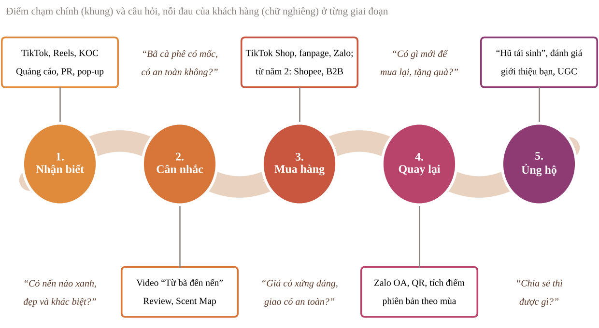

*Hình PL.11. Hành trình khách hàng và các điểm chạm marketing*

*Nguồn: Nhóm tác giả xây dựng.*

**Bảng PL.26. Dự phóng hiệu quả đầu tư marketing (ROMI) ba năm**

| **Chỉ tiêu (triệu đồng)** | **Năm 1** | **Năm 2** | **Năm 3** |
| --- | --- | --- | --- |
| Doanh thu (hũ 50 g và cốc 120 g) | 214,6 | 806,7 | 1.725,8 |
| Số dư đảm phí (sau giá vốn và phí bán hàng biến đổi) | 81,9 | 324,9 | 699,2 |
| Chi phí marketing | 41,0 | 72,0 | 108,0 |
| Lợi nhuận đóng góp sau marketing | 40,9 | 252,9 | 591,2 |
| Doanh thu tạo ra trên 1 đồng marketing (đồng) | 5,2 | 11,2 | 16,0 |
| ROMI = (số dư đảm phí − marketing) / marketing | 99,8% | 351,2% | 547,5% |
| ROMI thận trọng = (50% số dư đảm phí − marketing) / marketing | -0,1% | 125,6% | 223,7% |

*Nguồn: Nhóm tác giả tính toán; chưa trừ các chi phí cố định khác.*

## Phụ lục 14. Bảng tài chính bổ sung

**Bảng PL.27. Doanh thu dự kiến theo quý năm 2 và năm 3 (triệu đồng)**

| Chỉ tiêu | Quý I | Quý II | Quý III | Quý IV |
| --- | --- | --- | --- | --- |
| Năm 2: sản lượng (hũ) | 2.400 | 2.700 | 3.000 | 3.900 |
| Năm 2: doanh thu (hũ + cốc) | 167,2 | 184,4 | 201,7 | 253,4 |
| Năm 3: sản lượng (hũ) | 5.200 | 6.000 | 6.400 | 8.400 |
| Năm 3: doanh thu (hũ + cốc) | 359,3 | 403,7 | 425,9 | 536,9 |

*Nguồn: Nhóm tác giả tính toán; tổng các quý khớp doanh thu năm ở Bảng 5.11.*

**Bảng PL.28. Cân đối kế toán rút gọn cuối năm, kịch bản cơ sở (triệu đồng)**

| **Chỉ tiêu (triệu đồng)** | **Cuối năm 1** | **Cuối năm 2** | **Cuối năm 3** |
| --- | --- | --- | --- |
| Tiền mặt | 33,0 | 52,3 | 78,9 |
| Vốn lưu động ròng (tồn kho, phải thu trừ phải trả) | 17,2 | 64,5 | 138,1 |
| Tài sản cố định ròng | 4,0 | 28,7 | 33,3 |
| **Tổng tài sản** | **54,2** | **145,5** | **250,3** |
| Vốn góp của thành viên | 20,0 | 20,0 | 20,0 |
| Hỗ trợ không hoàn lại (gia đình 8, mentor 5) | 13,0 | 13,0 | 13,0 |
| Vốn huy động vòng seed (năm 2) | 0 | 60,0 | 60,0 |
| Lợi nhuận giữ lại lũy kế | 21,2 | 52,5 | 157,3 |
| **Tổng nguồn vốn** | **54,2** | **145,5** | **250,3** |

*Ghi chú: không có nợ vay; tiền mặt cuối năm 1 gồm 9 triệu đồng dự phòng giữ lại. Nguồn: Nhóm tác giả tính toán.*

**Bảng PL.29. Các chỉ số tài chính chính (kịch bản cơ sở)**

| **Chỉ số** | **Năm 1** | **Năm 2** | **Năm 3** |
| --- | --- | --- | --- |
| Tăng trưởng doanh thu | - | 275,9% | 113,9% |
| Biên lợi nhuận gộp | 46,1% | 48,1% | 48,5% |
| Biên lợi nhuận hoạt động (EBIT) | 15,8% | 4,6% | 7,1% |
| Biên lợi nhuận ròng | 9,9% | 3,9% | 6,1% |
| ROE (lợi nhuận sau thuế / vốn chủ sở hữu cuối kỳ) | 39,1% | 21,6% | 41,9% |
| Tỷ lệ nợ trên tổng tài sản | 0% | 0% | 0% |

*Nguồn: Nhóm tác giả tính toán.*

**Bảng PL.30. Kế hoạch sử dụng vốn huy động vòng seed (60 triệu đồng)**

| Hạng mục | Số tiền (triệu đồng) | Tỷ trọng | Mục đích |
| --- | --- | --- | --- |
| Thiết bị, thiết lập xưởng 30 m² | 25 | 41,7% | Nồi nấu, máy sấy công suất lớn, kệ, khu làm nguội |
| Vốn lưu động mùa cao điểm | 20 | 33,3% | Nguyên vật liệu, tồn kho trước Tết và cuối năm |
| Marketing tăng tốc, B2B | 10 | 16,7% | KOC, bộ mẫu B2B, sự kiện |
| Pháp lý, nhãn hiệu, dự phòng | 5 | 8,3% | Thành lập công ty, đăng ký nhãn hiệu |
| Tổng | 60 | 100% |  |

*Ghi chú: khoản đầu tư tài sản 40 triệu đồng năm 2 gồm 25 triệu đồng từ vốn seed và phần còn lại từ dòng tiền hoạt động. Nguồn: Nhóm tác giả lập kế hoạch.*

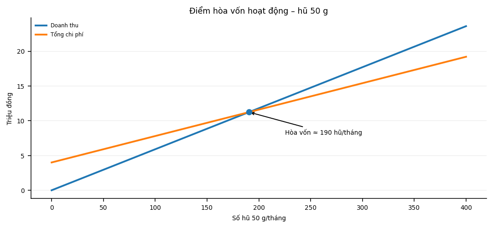

*Hình PL.12. Đồ thị điểm hòa vốn hoạt động năm 1 (hũ 50 g/tháng)*

*Nguồn: Nhóm tác giả tính toán.*

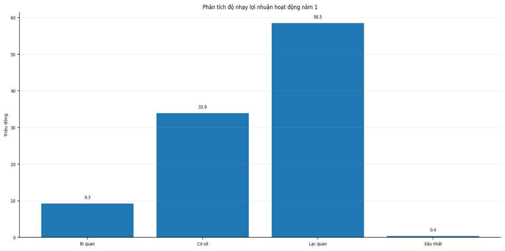

*Hình PL.13. Phân tích độ nhạy lợi nhuận hoạt động năm 1 (triệu đồng)*

*Nguồn: Nhóm tác giả tính toán.*

## Phụ lục 15. Thủ tục pháp lý, các mốc kiểm soát và kịch bản dự phòng

**Bảng PL.31. Hồ sơ, ngành nghề và thủ tục pháp lý dự kiến**

| Nội dung | Mô tả |
| --- | --- |
| Hồ sơ thành lập | Năm 1: hồ sơ đăng ký hộ kinh doanh. Đầu năm 2: giấy đề nghị đăng ký doanh nghiệp, điều lệ công ty cổ phần, danh sách cổ đông sáng lập, giấy tờ pháp lý của cổ đông; đăng ký trực tuyến tại cơ quan đăng ký kinh doanh |
| Ngành nghề (VSIC 2018) đề xuất | 3290 - Sản xuất khác chưa được phân vào đâu (gồm nến); 4649 - Bán buôn đồ dùng khác cho gia đình; 4773 - Bán lẻ hàng hóa mới trong cửa hàng chuyên doanh; 4791 - Bán lẻ qua bưu điện hoặc Internet |
| Nhãn hiệu | Nộp đơn đăng ký nhãn hiệu “Re:Bean” cho nhóm hàng nến tại Cục Sở hữu trí tuệ [17] |
| Ghi nhãn hàng hóa | Tên hàng hóa, tên và địa chỉ tổ chức chịu trách nhiệm, xuất xứ, khối lượng, thành phần chính, hướng dẫn sử dụng và cảnh báo an toàn, mã lô [15] |
| An toàn sản phẩm | Yêu cầu nhà cung cấp cung cấp SDS và xác nhận hương liệu phù hợp tiêu chuẩn IFRA; SOP kiểm soát lô; chính sách đổi trả; công dụng xua côn trùng chỉ công bố sau khi đăng ký lưu hành chế phẩm [22] |
| Dữ liệu khách hàng | Thu thập và sử dụng dữ liệu cá nhân khi tích điểm, CRM theo quy định về cam kết bảo vệ dữ liệu cá nhân [18] |
| Bán hàng trực tuyến | Xác thực danh tính người bán, công khai thông tin người bán và sản phẩm trên các nền tảng; quy tắc nội dung cho KOC theo Luật Thương mại điện tử 2025 [25] |
| Thuế | Năm 1 (hộ kinh doanh): doanh thu dưới 500 triệu đồng không phải nộp thuế GTGT, TNCN [24]. Từ năm 2: có thể được miễn thuế TNDN ba năm đầu theo Nghị quyết 198/2025/QH15 [23] nếu đáp ứng điều kiện (cần xác minh); sau thời gian miễn, thuế suất 15% với doanh nghiệp có doanh thu đến 3 tỷ đồng [14]. Mô hình tài chính dùng kịch bản cơ sở có tính thuế 15% |

*Nguồn: Nhóm tác giả tổng hợp.*

**Bảng PL.32. Các mốc quan trọng trong 12 tháng đầu**

| Thời điểm | Mốc | Tiêu chí hoàn thành |
| --- | --- | --- |
| Tháng 1 | Hoàn tất thỏa thuận với quán đối tác | Ký tối thiểu 3 quán; có thùng thu gom và lịch thu gom |
| Tháng 2 | Hoàn thiện SOP và mở gian hàng | SOP bản 50 g bằng văn bản; hoàn thành đợt 6 (hũ 50 g); gian hàng TikTok Shop, fanpage hoạt động; mở bán thử |
| Tháng 4 | Ra mắt chính thức | Giao đơn đầu tiên; 200 hũ/tháng (vượt điểm hòa vốn) |
| Tháng 6 | Đánh giá giữa kỳ | Chuyển đổi ≥ 2%; khiếu nại chất lượng ≤ 2%; đánh giá điều kiện thành lập công ty cổ phần đầu năm 2 |
| Tháng 9 | Chuẩn bị mùa cao điểm | Tồn kho đủ 4 tuần; bộ hộp quà hoàn thiện; bộ mẫu và bảng giá sỉ B2B sẵn sàng cho năm 2 (chưa bán) |
| Tháng 12 | Tổng kết năm 1 | 3.300 hũ 50 g và 100 cốc 120 g (100% B2C); lợi nhuận hoạt động ≈ 33,9 triệu đồng; hồ sơ gọi vốn năm 2 |

*Nguồn: Nhóm tác giả lập kế hoạch.*

**Bảng PL.33. Kịch bản dự phòng (Plan B) theo tình huống**

| Tình huống | Dấu hiệu kích hoạt | Phương án dự phòng |
| --- | --- | --- |
| Doanh số thấp hơn kế hoạch | Dưới 70% kế hoạch trong 2 tháng liên tiếp | Cắt quảng cáo kém hiệu quả, chuyển trọng tâm sang pop-up và quán đối tác; giảm quy mô mẻ; hoãn đầu tư mới |
| Không gọi được vốn seed đầu năm 2 | Chưa có cam kết đến hết quý I năm 2 | Duy trì sản xuất tại nhà thêm 6 tháng hoặc thuê mặt bằng nhỏ hơn; tận dụng giải thưởng, chương trình ươm tạo; tăng trưởng bằng lợi nhuận giữ lại |
| Lô lỗi hoặc khủng hoảng truyền thông | Phản ánh về mốc, cháy lệch; bài đăng tiêu cực lan truyền | Áp dụng quy trình xử lý sự cố bốn bước; tạm dừng quảng cáo; công bố kết quả kiểm tra lô |
| Thành viên chủ chốt tạm vắng (thi, thực tập) | Vắng mặt quá 2 tuần | Người dự phòng theo ma trận RACI đảm nhận; điều chỉnh mục tiêu tuần; thuê cộng tác viên ngắn hạn |
| Nhà cung cấp chính ngừng cung cấp | Không giao hàng quá 1 tuần | Chuyển sang nhà cung cấp thứ hai đã thẩm định; dùng tồn kho an toàn 4 tuần |
| Tài khoản bán hàng bị hạn chế, tiếp cận giảm do thuật toán | Lượt tiếp cận giảm trên 50% | Chuyển đơn sang fanpage, Zalo, Shopee; khai thác danh sách khách CRM; tăng hoạt động trực tiếp |

*Nguồn: Nhóm tác giả đề xuất.*
