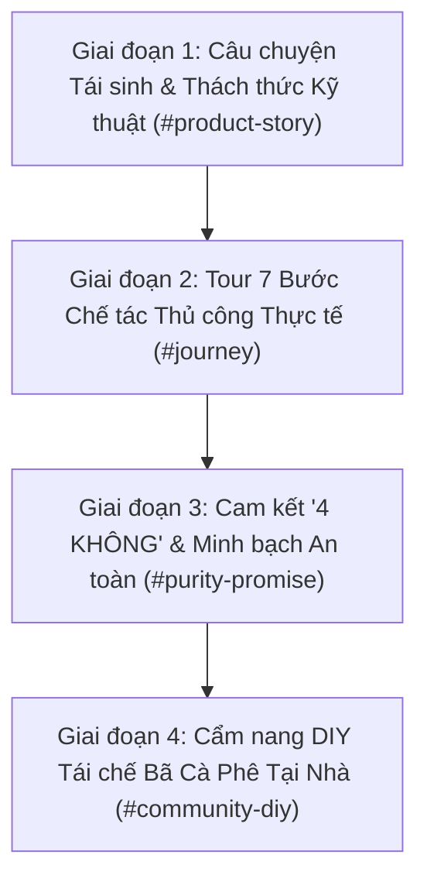

# 📋 KẾ HOẠCH NÂNG CẤP WEBSITE RE:BEAN (BE STARTUP 2026)
> **Mục tiêu cốt lõi:** Phục vụ khách hàng muốn tìm hiểu sâu về **Câu chuyện vòng đời hạt cà phê** & **Quy trình chế tác thủ công minh bạch**, tập trung 100% vào **bản chất sản phẩm, logic kỹ thuật giải quyết vấn đề và chất lượng chế tác** *(không đưa yếu tố cá nhân sáng lập hay tên quán đối tác vào nội dung)*.

---

## 📌 I. TỔNG QUAN ĐÁNH GIÁ HIỆN TRẠNG (TRANSPARENT AUDIT)

| Tiêu chí | Điểm hiện tại | Nhận xét chi tiết & Khoảng cách cần hoàn thiện |
| :--- | :---: | :--- |
| **1. Câu chuyện vòng đời & Triết lý sản phẩm** | **6.5 / 10** | Đã nêu được thông điệp giảm rác thải cà phê và cảm hứng hương thơm 3 miền. Tuy nhiên, khách hàng chưa thấy rõ **"Tại sao nến Re:Bean lại có cấu trúc khác biệt?"**: Chưa giải thích thách thức khoa học của bã cà phê (dễ ẩm mốc, khói đen khi đốt trực tiếp) và cơ chế cấu trúc 2-trong-1 giải quyết triệt để vấn đề này. |
| **2. Minh bạch quy trình chế tác (Crafting Process)** | **6.5 / 10** | Khu vực giải phẫu hũ nến (`#jar-anatomy`) đã hoàn thiện tốt 5 tầng lát cắt kỹ thuật. Tuy nhiên, quy trình 7 bước (`#journey`) hiện tại mới ở dạng thẻ tóm tắt với icon emoji, thiếu hình ảnh thực tế công đoạn chế tác, thông số kiểm soát nhiệt độ và bí quyết xử lý thủ công. |
| **3. Cam kết an toàn & Sức khỏe (Health & Safety)** | **6.0 / 10** | Khách hàng nến thơm đặc biệt quan tâm tới khói nến trong phòng kín và an toàn hô hấp. Website cần bảng cam kết "4 KHÔNG" minh bạch và bảng đối chiếu rõ ràng giữa nến Re:Bean vs nến công nghiệp thông thường. |
| **4. Giá trị ứng dụng & Cộng đồng (DIY Upcycling)** | **5.5 / 10** | Chưa có cẩm nang hướng dẫn khách hàng tự tái chế bã cà phê tại nhà (khử mùi tủ lạnh, dưỡng cây trồng, tẩy da chết), giúp kéo dài lối sống xanh sau khi sử dụng hết nến. |

---

## 🚀 II. LỘ TRÌNH TRIỂN KHAI 4 GIAI ĐOẠN (FOCUSED ON PRODUCT & CRAFT)

---

### 🔹 GIAI ĐOẠN 1: CÂU CHUYỆN TÁI SINH & THÁCH THỨC KỸ THUẬT (`#product-story`)
> **Mục tiêu:** Giúp khách hàng hiểu tường tận **"Tại sao Re:Bean được chế tạo theo cách này?"** mà không dùng câu chuyện cá nhân. Tập trung vào bản chất hạt cà phê và giải pháp kỹ thuật độc bản.

- [ ] **1.1. Vòng đời thứ hai của bã cà phê:**
  - Sau mỗi tách cà phê, 99.8% sinh khối của hạt cà phê bị vứt bỏ dù vẫn giữ trọn vẹn cấu trúc xốp vi thể có khả năng khử mùi tự nhiên cùng hàm lượng chất chống oxy hóa dồi dào.
  - Re:Bean ra đời nhằm tái sinh phần giá trị bị bỏ quên này thành một tạo phẩm thủ công ấm áp cho không gian sống.
- [ ] **1.2. Thách thức thực nghiệm & Logic thiết kế 2-trong-1:**
  - **Thách thức 1 (Nấm mốc do ẩm):** Bã cà phê thải giữ ẩm rất cao; nếu xử lý không chuẩn sẽ bị nấm mốc chỉ sau 48–72 giờ. $\rightarrow$ *Giải pháp: Quy trình sấy nhiệt đối lưu nghiêm ngặt đưa độ ẩm về < 3%.*
  - **Thách thức 2 (Khói khét & tắc bấc):** Nếu trộn lẫn bã thô vào sáp để đốt, bã bị cháy xém trực tiếp ở nhiệt độ cao sẽ sinh khói đen nghẹt bấc và mùi khét khó chịu. $\rightarrow$ *Giải pháp: Tách biệt hoàn toàn công năng!*
    - **Khi đậy nắp:** Túi lọc bã khô đính nắp hút ẩm và khử mùi phòng liên tục qua lỗ thoáng khí.
    - **Khi mở nắp đốt:** Tầng sáp đậu nành tinh khiết trên cùng cháy sạch 100%, không khói đen, lan tỏa hương thơm tinh dầu tự nhiên dịu êm.

---

### 🔹 GIAI ĐOẠN 2: TOUR 7 BƯỚC CHẾ TÁC THỦ CÔNG THỰC TẾ (`#journey`)
> **Mục tiêu:** Nâng cấp khu vực `#journey` thành **Visual Craft Workshop Tour** với hình ảnh thực tế, thông số kỹ thuật chuẩn hóa cho từng công đoạn và các bí quyết xử lý thủ công (Artisan Tips).

- [ ] **2.1. Thanh điều hướng công đoạn trực quan (Interactive Step Navigator):**
  - Cho phép người xem click chọn từng bước hoặc lướt xem tuần tự từ nguyên liệu thô đến thành phẩm.
- [ ] **2.2. Chi tiết 7 công đoạn chế tác minh bạch:**
  1. **Bước 1: Thu gom & Tuyển chọn bã cà phê sạch trong ngày**
     - *Tiêu chuẩn:* Thu gom bã tươi trong vòng 4 giờ sau khi chiết xuất, sàng lọc kỹ loại bỏ hoàn toàn cặn thô và tạp chất.
     - *Bí quyết:* Tuyển chọn bã pha máy Espresso có độ mịn đồng nhất từ 100% hạt Robusta & Arabica nguyên chất.
  2. **Bước 2: Khử ẩm & Sấy nhiệt đối lưu 100°C – 120°C**
     - *Tiêu chuẩn:* Sấy đảo nhiệt đối lưu liên tục 90 phút, đưa độ ẩm bã về dưới 3%.
     - *Bí quyết:* Kiểm soát nhiệt chuẩn xác để giữ lại lớp tinh dầu béo tự nhiên của bã cà phê mà không làm cháy khét xơ cellulose.
  3. **Bước 3: Ép nhiệt túi lọc bã khô đính nắp thiếc**
     - *Tiêu chuẩn:* Định lượng chính xác 15g bã khô, hàn kín viền bằng nhiệt siêu âm vào túi vải không dệt chuyên dụng.
     - *Bí quyết:* Liên kết cố định chắc chắn dưới nắp thiếc, kết hợp cùng hệ lỗ thoáng đối lưu không khí khử mùi khi đậy nắp.
  4. **Bước 4: Nấu chảy 100% sáp đậu nành & Phối hương ở 65°C**
     - *Tiêu chuẩn:* Sáp đậu nành thiên nhiên không pha paraffin, phối trộn tinh dầu tự nhiên ở nhiệt độ vàng 65°C.
     - *Bí quyết:* Giữ nhiệt độ ổn định để bảo toàn các phân tử nốt hương đầu (top notes) không bị bốc hơi sớm.
  5. **Bước 5: Kỹ thuật rót sáp 3 tầng phân lớp thủ công**
     - *Tiêu chuẩn:* Rót lần lượt: Tầng đáy an toàn 1.5cm $\rightarrow$ Tầng bã sáp khử mùi $\rightarrow$ Tầng sáp bề mặt tinh khiết.
     - *Bí quyết:* Canh thời gian nghỉ đông 45 phút giữa mỗi tầng để các lớp liên kết bền chặt mà không bị hòa lẫn vào nhau.
  6. **Bước 6: Kiểm định tâm bấc & Test đốt mẫu thực nghiệm 4 giờ**
     - *Tiêu chuẩn:* Cố định bấc 100% sợi bông cotton không lõi chì ngay tâm hình học; đốt thử nghiệm kiểm tra đường kính ngọn lửa 2.5cm và không sinh khói đen.
     - *Bí quyết:* Cắt tỉa bấc thủ công về độ dài tiêu chuẩn 0.6cm trước khi xuất xưởng.
  7. **Bước 7: Đóng gói hộp giấy Ivory 350gsm tái chế & Đóng số mẻ (Batch No)**
     - *Tiêu chuẩn:* Hộp giấy Ivory định lượng cao 350gsm thân thiện môi trường, in mực gốc đậu nành.
     - *Bí quyết:* Đóng dấu thủ công số mẻ chế tác (Batch Number) trên từng sản phẩm để đảm bảo khả năng truy xuất nguồn gốc.

---

### 🔹 GIAI ĐOẠN 3: CAM KẾT "4 KHÔNG" & MINH BẠCH AN TOÀN SỨC KHỎE (`#purity-promise`)
> **Mục tiêu:** Minh bạch toàn bộ thành phần, xóa bỏ hoàn toàn e ngại về khói nến độc hại trong phòng kín.

- [ ] **3.1. Hệ thống huy hiệu "Cam Kết 4 KHÔNG":**
  - ❌ **KHÔNG Paraffin:** 100% Sáp đậu nành nguyên chất từ thực vật, phân hủy sinh học tự nhiên.
  - ❌ **KHÔNG Bấc chì:** 100% Sợi bông dệt thuần khiết, an toàn tuyệt đối cho hệ hô hấp.
  - ❌ **KHÔNG Khói đen:** Cơ chế tầng sáp trên tinh khiết giúp ngọn lửa cháy êm, sạch, không làm ố trần nhà.
  - ❌ **KHÔNG Hương liệu công nghiệp độc hại:** Chỉ sử dụng tinh dầu tự nhiên lành tính, không gây đau đầu khi đốt lâu.
- [ ] **3.2. Bảng đối chiếu minh bạch (Side-by-Side Comparison):**
  - So sánh trực quan giữa Nến thơm Re:Bean và Nến thơm Paraffin công nghiệp trên thị trường.

---

### 🔹 GIAI ĐOẠN 4: CẨM NANG DIY TÁI CHẾ BÃ CÀ PHÊ TẠI NHÀ (`#community-diy`)
> **Mục tiêu:** Cung cấp giá trị thực tế cho khách hàng, hướng dẫn cách tự tận dụng bã cà phê tại nhà sau khi uống cafe hoặc sau khi dùng hết nến.

- [ ] **4.1. 3 Mẹo tái chế bã cà phê tại gia đơn giản & hiệu quả:**
  - **Mẹo 1 — Túi hút ẩm & khử mùi:** Tự làm túi bã khô treo tủ lạnh, tủ giày hoặc xe hơi.
  - **Mẹo 2 — Dinh dưỡng cho cây trồng:** Ủ bã cà phê giàu nitơ và kali làm đất trồng tơi xốp cho cây trong nhà.
  - **Mẹo 3 — Tẩy tế bào chết toàn thân:** Kết hợp bã mịn với dầu dừa nguyên chất cho làn da mềm mịn tự nhiên.
- [ ] **4.2. Hướng dẫn tái sử dụng vỏ hũ thủy tinh Re:Bean:**
  - Vệ sinh sạch đáy sáp bằng nước ấm để biến hũ nến thành lọ cắm bút, chậu cây sen đá hoặc hũ đựng gia vị decor.

---

## 🛠️ III. FILE ARTIFACTS & TÀI NGUYÊN HỆ THỐNG LIÊN QUAN

- Kế hoạch dự án: [`PLAN.md`](file:///c:/Competition/BeStartup2026/CauChuyenReBean/PLAN.md)
- Cấu hình tự động mở Preview: [`.vscode/settings.json`](file:///c:/Competition/BeStartup2026/CauChuyenReBean/.vscode/settings.json)
- Mã nguồn trang: [index.html](file:///c:/Competition/BeStartup2026/CauChuyenReBean/index.html)
- Bảng phong cách CSS: [style.css](file:///c:/Competition/BeStartup2026/CauChuyenReBean/style.css)
- Logic tương tác JavaScript: [app.js](file:///c:/Competition/BeStartup2026/CauChuyenReBean/app.js)

---

## 📅 IV. TIẾN ĐỘ THỰC HIỆN

- [x] **Audit đánh giá tính minh bạch câu chuyện & quy trình**
- [x] **Cấu hình tự động mở Markdown Preview cho IDE**
- [x] **Cập nhật Kế hoạch chuẩn hóa (`PLAN.md`) loại bỏ hoàn toàn yếu tố người sáng lập & đối tác**
- [ ] **Triển khai Giai đoạn 1: Section Câu chuyện Tái sinh & Thách thức Kỹ thuật (`#product-story`)**
- [ ] **Triển khai Giai đoạn 2: Nâng cấp Visual Tour 7 bước chế tác thủ công (`#journey`)**
- [ ] **Triển khai Giai đoạn 3: Section Cam kết 4 KHÔNG & Minh bạch An toàn (`#purity-promise`)**
- [ ] **Triển khai Giai đoạn 4: Section Cẩm nang DIY tái chế bã tại nhà (`#community-diy`)**
- [ ] **Kiểm thử E2E trên trình duyệt di động & máy tính để bàn**
